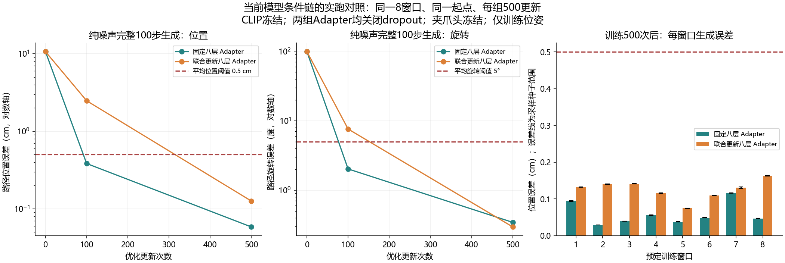

# 当前八层 Adapter 与扩散位姿头：小样本联合拟合对照

## 结论

2026-10-11 本地实际运行两组同起点实验，两组均通过预先固定的训练生成门槛。当前原始记录解析、冻结 CLIP、八层 Adapter 与多尺度扩散位姿头的组合，能够在这八个训练窗口上完成位姿记忆。联合更新 Adapter 没有使这项能力消失。

这把证据从之前的“给动作头固定缓存上下文”推进到了当前条件处理代码。它不证明全部数据处理正确、语言理解正确、所有训练配方有效，或模型具备抓取和泛化能力；此前五任务全量拟合失败的根因仍未确定。

## 实际结果

| 每组500更新 | 路径平均位置 | 路径平均旋转 | 窗口终点位置 | 窗口终点旋转 | 全部三采样种子逐窗口位姿门槛 |
|---|---:|---:|---:|---:|---:|
| 固定当前八层 Adapter，仅训练解码器 | 0.058414 cm（0.584 mm） | 0.342952° | 0.069183 cm | 0.235506° | 8/8 |
| 当前八层 Adapter 与解码器联合训练 | 0.125966 cm（1.260 mm） | 0.294809° | 0.226606 cm | 0.279963° | 8/8 |

指标针对纯高斯动作噪声开始的完整100步生产采样，非真实动作加噪恢复。各指标为全部目标和三个采样种子的均值；逐窗口通过要求每个种子各自的窗口平均位置≤0.5cm、旋转≤5°，不是每个动作点的最大误差门槛。另检查每种子的总体终点位置≤1cm、旋转≤10°；两组均满足。

初始两组预测完全相同：路径位置10.646944cm、旋转98.924438°，第一步训练损失均0.4411114454。100更新时固定组0.383744cm/2.018494°、联合组2.475498cm/7.595757°，两组均未满足完整逐窗口门槛。联合组早期位置学习较慢，最终两组均通过；不能把100次的差距当作永久故障。最后联合组位置误差高于固定组、旋转误差略低，不支持“更新 Adapter 就一定让所有指标变差”的说法。



## 输入及当前代码的执行核验

- 原始数据路径 E:/dataset/bridge_v2_0.0.1/0.0.1；沿用上一轮预先选定的八条不同训练演示，每条首窗口，未按本次误差选样本。
- 直接索引这些记录，执行当前 UnifiedRobotDataset.__getitem__、TFRecord 解析和 prepare_image；未重新执行完整自动扫描或随机 DataLoader。当前解析的8×16×8动作目标及8×1当前夹爪输入与旧缓存逐元素一致，位姿掩码全部有效。这是这些记录上的一致性证明，不是全部数据集验收。
- 使用现有离线 CLIP ViT-L/14 权重。真实图像经当前视觉编码器得到 [8,257,1024] tokens；同一任务文本经当前文本编码器得到 [8,5,768] tokens。当前 Adapter 输出 [8,1024]。
- 首次执行真实 RobotAdapterModel.get_context_vector，与同一 CLIP tokens 经当前 Adapter 的路径最大逐元素差为0。CLIP 冻结，因此只提取一次 tokens，训练时复用它们；不是每次更新都重新执行 CLIP。
- 当前八层交叉注意力，attention_dim=512，读出cls_patch_mean；Adapter从随机初始化开始。当前多尺度 U-Net 宽度[256,512,1024]、77,670,023参数，其初始权重哈希与上一轮成功的解码器完全一致。
- 联合组 Adapter 与解码器均有非零梯度和权重变化；固定组只有解码器更新。CLIP 两个编码器的参数哈希全程未变，夹爪参数两组均未变。未优化夹爪损失。

两组计划、设置和结果：[plan.json](../reports/bridge_adapter_pair_local_20261011/plan.json)、[report.json](../reports/bridge_adapter_pair_local_20261011/report.json)、[逐窗口指标](../reports/bridge_adapter_pair_local_20261011/per_window_metrics.json)。预测NPZ保存了三次采样和真实目标，可独立重新计算指标。

## 控制变量与限制

同一八窗口、图像、文本、目标、初始 Adapter/解码器/夹爪参数、batch=8、Adam lr=3e-4、wd=0、固定学习率、梯度裁剪1、500更新。每次更新使用seed=420000+update生成相同时间步和动作噪声；评估种子1101/1102/1103。两组训练种子都是42，三种采样不是三次独立训练。

唯一预定干预是 Adapter 是否接收优化器更新。为了不混入 dropout 与训练/评估模式差异，两组 Adapter 都处于eval模式；联合组保留梯度并更新参数。配置保留dropout=0.1，但eval模式关闭它。因此本次没有复现原来的dropout开启、AdamW、batch2、cosine和全量五任务训练。优化时联合组总梯度裁剪包括Adapter，这属于联合优化的耦合，不能由本次差距单独断言Adapter实现错误。

注意力反向传播提示其内存高效CUDA实现存在非确定性；脚本控制随机种子并检查相同起点，不承诺跨运行逐元素复现最终权重。结果是一次训练初始化的受控诊断，仍需区分执行通过与完整研究重复。

同一任务文本没有跨任务语言判别对照；本次不能证明物体定位、语言理解、夹爪切换、图像泛化或闭环任务成功。窗口终点也只是16步预测窗口末端，并非任务最终抓取位置。

## 资源与后续

实际GPU：NVIDIA GeForce RTX 4060 Laptop GPU；PyTorch2.11.0+cu128。总耗时约156秒，联合优化阶段峰值保留显存2.916GiB（不含之前CLIP提取阶段的峰值）。没有下载新资产；报告、预测和图约0.73MiB，未保存新的大权重。

后续已经完成同一八窗口、联合优化配方和判据下的dropout开关对照，两组均通过小样本位姿记忆门槛，详见 [dropout对照](BRIDGE_DROPOUT_PAIR_LOCAL_20261011.md)。原全量优化设置、数据规模与夹爪联合损失仍未由这些实验验收；不能根据当前结果直接给全量训练增加轮数或混入其他数据集。

复用命令（新输出目录，约数分钟，读取已有资产）：

```powershell
D:\miniconda\envs\zeroshot-gpu\python.exe code/fit_bridge_adapter_pair.py --output reports/bridge_adapter_pair_local_new
```
