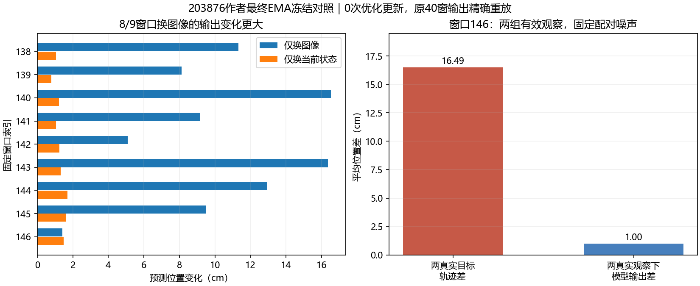

# 作者冻结输入对照203876：独立复算结果

两个小文件齐全，共109,372字节。CPU独立复算通过：协议与检查点身份、固定9对索引及原/近邻目标、全部配对变化和有效观察误差核验一致。原40个窗口的三次预测逐元素精确重放，最大差0。权重／归一化统计未改变、未选行变化0来自集群报告，未下载权重或保存完整混合条件下的未选行输出来再次独立核验。[独立分析JSON](../reports/bridge_author_observation_analysis_203876/analysis.json)、[复算脚本](../scripts/analyze_bridge_author_observation_probe_203876.py)。

用户提供Slurm状态：COMPLETED/0:0，1分32秒，gpu-a6000-1。原40开发窗口在1101/1102/1103三个采样种子均完成重放；9个西兰花窗口的四种观察完成推理。没有优化更新或新checkpoint。已结束作业不再出现在squeue，不代表失败。

| 替换 | 相对原预测的位置变化cm | 相对原预测的旋转变化° |
| --- | ---: | ---: |
| 仅图像 | 10.0426 | 16.0936 |
| 仅当前末端状态 | 1.2730 | 1.9388 |
| 图像和状态同时换成同一训练近邻 | 10.6544 | 16.7816 |

以上是9窗、三个采样的平均**输出变化**，不是预测误差或准确率。独立复算确认8/9窗口换图像的位置变化比换状态更大，并非全部9窗如此；三个采样均值同向。9窗来自两条演示，且训练近邻仅7条不同窗口，不能当9个独立任务或三次独立训练。

当前有限结论：在这批固定配对条件下，图像和当前状态均能改变作者模型输出；平均图像替换敏感性比状态更大。不能把它解释为状态完全未接入，不能按变化幅度给两路输入排普遍的重要性，更不能据此判定视觉编码器错误。图像与状态的替换跨度不同，交叉条件可能物理不一致；同时替换的影响也不等于两个单独影响的线性相加。

## 两种有效观察的读出

原9个留出观察对应自身专家目标的误差为12.726cm/10.923°；二者同时换成同一训练近邻后，对相应训练目标的误差为0.868cm/1.969°。后者仍未通过原5mm拟合门槛，不能称严格拟合达标。两者使用不同的有效观察和对应真值，这说明已见观察读出误差较小，**不是留出准确率获得改善**；没有修改模型或修复泛化。

只换图像或只换状态的交叉观察可能不一致，本分析不对其计算“改进准确率”。

## 窗口146：一对真实条件未被充分区分

该窗口不是平均敏感性的代表：换图像的位置变化1.416cm、换状态1.481cm、同时换二者1.003cm。两个有效观察分别为留出`00011::24 t=8`和训练`00061::25 t=0`。

| 同一对观察／目标的比较 | 位置cm | 旋转° |
| --- | ---: | ---: |
| 两条专家真实相对轨迹差 | 16.489 | 16.092 |
| 固定配对噪声下两个有效观察的模型输出差 | 1.003 | 1.225 |
| 原留出预测对原目标的误差 | 15.393 | 15.928 |
| 训练观察预测对训练目标的误差 | 1.113 | 1.715 |

这使此前“原预测贴近另一条训练路线”的线索更具体：相对当前专家轨迹监督，作者模型未充分复现这对真实条件所对应的动作差异。原控制精确重放，不能把此项差异解释成刚好换了随机噪声。它不能单独定位ResNet、状态编码、FiLM或U-Net某一层；不同专家路线也不代表机器人只有一种正确路线，本项仍不是闭环任务失败判定。



## 回到项目模型：不能把作者现象直接当成Adapter错误

使用已核验的既有NPZ及其哈希，不加载模型，检查同一对窗口146/114保存的1024维条件向量：

| 项目检查点 | 保存向量是什么 | 余弦相似度 | L2差 |
| --- | --- | ---: | ---: |
| 201663 | Adapter输出；重复当前图像的历史差抵消，无数值位姿输入 | 0.6763 | 25.783 |
| 202278真实状态组 | Adapter加当前状态投影后的融合条件 | 0.7275 | 23.877 |

两者都不是相同向量，排除了**这对样本在对应保存条件处完全塌成同一向量**的解释。202278列不是单独Adapter输出，不能据此评价Adapter自身所有维度。不同向量不等于正确编码了机器人几何，也不能进一步断定动作头有错。

另用既有保存条件进行一次固定“同任务、训练池、余弦Top1”的只读动作检索，不训练、不扫描距离或k值、不用开发目标选近邻。201663/202278真实组在40开发窗的位置误差分别9.082/8.982cm，旋转17.573/16.541°，仍差于静止8.212cm/15.098°。这没有给出绕开扩散头就能成功的简单方案；检索失败不证明向量没有有用信息，也不证明扩散头正确。本项为事后诊断，不是替代策略或独立基准。

## 本轮收口与下一步边界

作者冻结观察对照现已完成，原生重放和逐窗结果核验通过；不追加作者种子或更多混合输入组合。已确认一个可复现的条件区分不足现象，尚未确认唯一故障模块。项目现有条件不完全塌缩，故不根据作者结果直接重写Adapter或更换U-Net。

下一项回到项目202278真实状态检查点的**融合条件→扩散动作头边界**：以既有两组有效条件、相同采样噪声进行原生输出对照，并观察99/74/49/24/0步骤的轨迹还原。先重放原预测，再判断错误在初始条件读出已出现，还是生成链后续放大；不改变数据、权重、步数或优化更新。该项已完成本地CPU机制检查、Bash语法检查及13,298字节小包冻结，尚未提交；本地未加载真实检查点或执行GPU重放。不会把两个不同随机序列的既有预测差当作配对因果证据，也不会据此跳到“唯一U-Net错误”的结论。见[固定协议与上传提交命令](BRIDGE_PROJECT_CONDITION_PROBE_202278.md)。

## 下载两个小文件

集群Bash：

```bash
cd /projects/Zeroshot/runs
tar -czf /projects/Zeroshot/bridge_author_obs_results_203876.tar.gz \
  bridge-author-obs-203876/report.json \
  bridge-author-obs-203876/predictions.npz
```

本地PowerShell：

```powershell
scp zixiao005@10.97.216.128:/projects/Zeroshot/bridge_author_obs_results_203876.tar.gz "D:/ntu_related/dissertation/Zero_shot/reports/"
tar -xzf "D:/ntu_related/dissertation/Zero_shot/reports/bridge_author_obs_results_203876.tar.gz" -C "D:/ntu_related/dissertation/Zero_shot/reports/"
```

上述下载已完成，两个文件齐全并独立复算。[固定协议与解释边界](BRIDGE_AUTHOR_OBSERVATION_PROBE_203699.md)。
