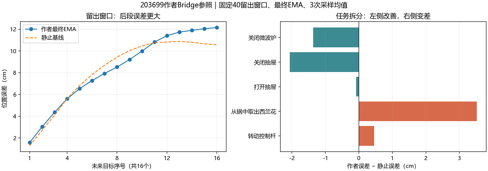

# 作者Bridge参照203699：独立核验结果

八份必要文件现已齐全，本地CPU独立核验通过：[分析JSON与文件哈希](../reports/bridge_author_reference_analysis_203699/analysis.json)、[复算脚本](../scripts/analyze_bridge_author_reference_203699.py)。实际配置与冻结协议、源码哈希、8192条更新及Workspace日志逐条对齐，500步warmup/cosine学习率符合配置，512轮均值正确。四份NPZ的168个目标和行索引与原项目缓存一致，所有整体及逐演示指标复算一致。未下载checkpoint或大图像缓存，未在本地运行模型，权重内部及集群输入缓存没有再做独立内容核验。

用户提供Slurm状态：COMPLETED/0:0，19分12秒，gpu-a6000-1。日志记录8192/8192更新完成，以及最终raw/EMA完整训练与开发评价。队列中查不到已结束作业不表示训练失败，以sacct完成记录为准。先前test-only是新作业排期估算，不能代表203699实际开始时间。

| 最终参数 | 训练路径位置/旋转 | 训练达标窗口 | 开发路径位置/旋转 |
| --- | --- | --- | --- |
| raw（辅助） | 7.02mm / 1.58° | 5/128，门槛未通过 | 8.347cm / 15.132° |
| EMA（预定主要结果） | 8.74mm / 2.08° | 0/128，门槛未通过 | 8.378cm / 15.220° |
| 原开发静止基线 | — | — | 8.212cm / 15.098° |

达标窗口须三个采样结果的平均路径位置均≤5mm、旋转均≤5°；总体训练门槛还要求≥90%窗口达标、各采样整体路径和终点达标。不能只按平均训练旋转较小宣布拟合通过，也不改门槛或事后把raw改成主要结果。

独立复算支持：作者适配实现，在固定同数据与8192更新预算下没有成为有效参照。它整体未超过静止基线，差距较小；部分任务/演示改善见下文，不能说所有指标都退步。与项目八层Adapter不同的完整实现仍失败，不足以指向项目的唯一自写模块；这也不是排除Adapter问题的单变量证据。训练、采样、观察/标签定义、规模及评估问题仍未完全分离。

## 本次新定位到什么

1. **作者模型学习了训练动作，但精度和采样一致性不足。** EMA训练位置8.74mm，训练静止89.60mm；64条训练演示的位置和旋转均改善。五个任务训练位置约6.61–10.91mm。所有128窗口至少一次采样的位置未达5mm，只有11窗有旋转失败，故门槛主要卡在位置；0/128是“每窗三次采样均达标”的计数，不是零学习能力。原项目201663同128窗训练复算1.83mm/0.58°、128/128达标，因此不能把当前作者参照当作拟合已经成功的替代。

2. **留出失败并非全部演示同向变差。** EMA在6/10演示位置改善、5/10旋转改善，但两项总体都未超过静止；三次采样开发位置分别8.348、8.388、8.397cm，结论同向。西兰花任务9窗来自两条留出演示，其位置分别10.466cm（静止8.604）和17.246cm（静止10.395）；这些表现拉高整体位置误差。定位到任务/演示不等于确认该数据有错，不能事后删除失败任务来宣布成功。

| 留出任务 | 窗口数 | EMA位置cm | 静止位置cm | EMA旋转° | 静止旋转° |
| --- | ---: | ---: | ---: | ---: | ---: |
| 关闭微波炉 | 10 | 7.768 | 9.132 | 12.43 | 11.02 |
| 关闭抽屉 | 6 | 7.692 | 9.757 | 36.86 | 41.40 |
| 打开抽屉 | 11 | 7.402 | 7.483 | 11.75 | 11.41 |
| 从锅中取出西兰花 | 9 | 12.726 | 9.201 | 10.92 | 8.59 |
| 转动控制杆 | 4 | 3.829 | 3.376 | 8.97 | 10.62 |

3. **长预测段更差，但第一步也没有优于静止。** EMA留出第1/8/16目标位置误差为1.575/8.521/12.147cm；静止为1.280/9.430/10.565cm。中段有改善，末段退步。目标均相对原观测锚点独立比较，这不是仿真动作逐步执行后的累积误差，也不能直接推出缩短窗口就能修复泛化。训练第1/16目标为2.86/11.91mm。

4. **本批留出失败主要不是三次随机采样的波动。** 按保存的三次输出，将位置平方误差精确分成“三次平均预测相对目标的残差”和“输出间波动”：EMA训练的波动项约49.2%，开发仅1.34%；raw分别46.8%与1.05%。平均三个EMA预测后，开发位置仍8.315cm。此项只是有限三次输出的代数分解，不估计全部模型不确定性，不采用平均预测作为新策略，也不修改拟合门槛。它不支持靠换采样种子解决当前约8cm开发误差。



训练首轮平均噪声损失1.0894、末轮0.00851，末32轮均值0.00599；该损失不能替代动作误差。EMA四元数范数约0.981–1.020（训练）、0.964–1.034（开发），未发现退化零四元数。不能据此宣称全部旋转/动作处理正确。

该实验不等同作者原论文完整训练预算，不能据此判断Diffusion Policy算法无效、Bridge数据错误或问题无解。共享观察/监督的西兰花只读审计现已完成，见[原始记录、范围/阶段/近邻证据](BRIDGE_BROCCOLI_OBSERVATION_AUDIT_203699.md)：发现同任务覆盖差异，但无本批全局XYZ范围截断或索引/语言错误；作者某范围内失败预测接近另一条训练路线，原项目同窗没有同样贴近。下一项仅设计固定作者权重的图像/状态干预，未打包或提交。须保留完整40窗评价，不能把只读观察当作已确认根因。当前不追加训练、扩数据、切换EMA或挑选采样种子；也不要求靠不断加轮数让作者模型越过5mm门槛。

## 固定结果下载

集群终端仅打包八份小结果，权重与浮点图像缓存留集群：

```bash
cd /projects/Zeroshot/runs
tar -czf /projects/Zeroshot/bridge_author_reference_results_203699.tar.gz \
  bridge-author-reference-203699/report.json \
  bridge-author-reference-203699/runtime_config.yaml \
  bridge-author-reference-203699/updates.jsonl \
  bridge-author-reference-203699/raw_train.npz \
  bridge-author-reference-203699/raw_development.npz \
  bridge-author-reference-203699/ema_train.npz \
  bridge-author-reference-203699/ema_development.npz \
  bridge-author-reference-203699/workspace/logs.json.txt
```

本地PowerShell：

```powershell
scp zixiao005@10.97.216.128:/projects/Zeroshot/bridge_author_reference_results_203699.tar.gz "D:/ntu_related/dissertation/Zero_shot/reports/"
tar -xzf "D:/ntu_related/dissertation/Zero_shot/reports/bridge_author_reference_results_203699.tar.gz" -C "D:/ntu_related/dissertation/Zero_shot/reports/"
```

以上下载步骤已完成，八份文件齐全并独立复算通过。[冻结训练协议](BRIDGE_AUTHOR_REFERENCE_TRAINING_20261014.md)。
