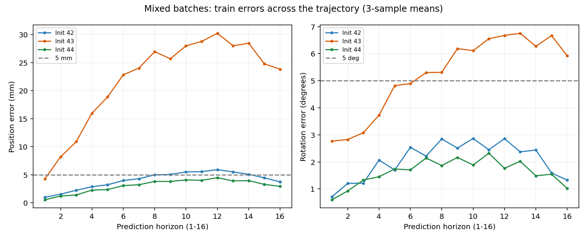
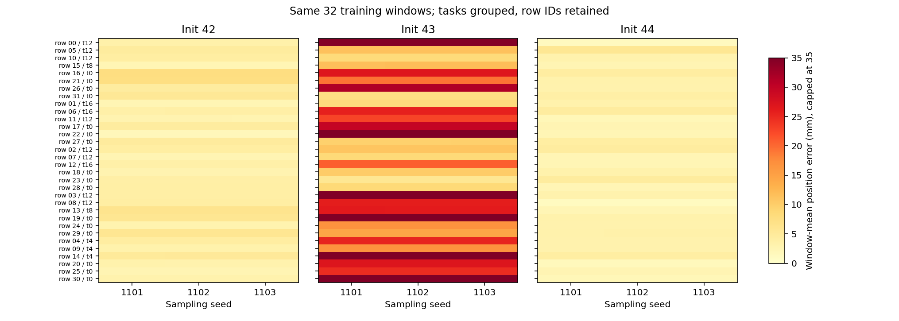
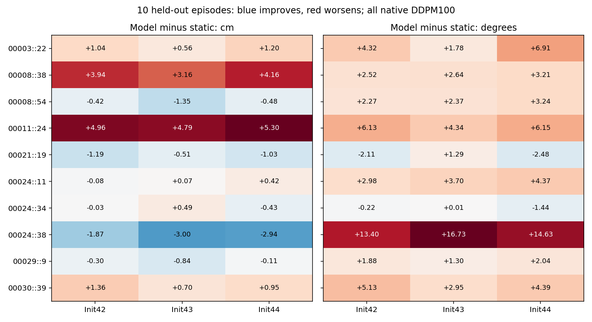

# 198871原始预测复核与逐窗口分析

本次只读取已下载的报告和12份预测NPZ，在CPU上用独立NumPy程序重新计算误差，没有训练、下载模型或运行仿真。原始结果位于`reports/bridge-batch-fit-v2-198871/`；分析结果位于`reports/bridge_batch_analysis_198871_20261012/`。

## 核验范围

实验清单SHA256、执行脚本快照、八个生产/诊断源文件与冻结上传包全部匹配。六组预算均为2048次更新、每训练窗口512份抽样；同初始化两组的初始参数哈希相同，三个初始化哈希互不相同。报告记录CLIP与非训练参数保持不变，Adapter、扩散头和历史投影具有梯度及参数变化。

72个窗口的报告原始图像、RGB、状态、动作和指令身份与本地参考一致；12份预测中的标签在各自划分内完全相同，与Windows参考标签的最大分量差为4.470348358154297e-7，低于预设绝对容差1e-6。训练16条演示与留出10条演示无身份交集。这些核验支持本实验数据和执行身份正确，不能代替所有数据语义或视觉预处理方法的完整审计。

独立计算使用float64：局部XYZ误差乘10得到cm，四元数先归一化，再按`2*acos(abs(dot))`计算角度。聚合及逐演示指标与集群float32报告的最大差为位置2.51383443838904e-6cm、旋转0.0016582195306223957°，都在核验容差内。它们是两种计算精度的差异，不是模型相对真实动作的误差。

## 共同拟合：模型能做到，但训练不稳定

以下都是完整100步DDPM生成、三个采样种子取平均；初始化种子42/43/44与采样种子1101/1102/1103是不同概念。

| 初始化 | 混合组训练 mm/° | 窗口通过 | 完整拟合门槛 | 同窗口重复组训练 mm/° |
|---|---:|---:|---|---:|
| 42 | 4.07 / 2.06 | 25/32 | 未通过 | 48.67 / 13.38 |
| 43 | 21.86 / 5.24 | 0/32 | 未通过 | 85.46 / 15.75 |
| 44 | 3.03 / 1.62 | 31/32 | 通过 | 83.69 / 15.41 |

窗口通过要求每个采样种子下的路径平均误差都不超过5mm和5°；完整门槛还要求至少90%窗口通过、各种子总体路径和终点均达标。不是每个时刻必须低于5mm，也不是32个窗口全部通过。seed44唯一未过窗口是row5、关闭微波炉、起点t12，路径5.68mm/3.34°。之前反复失败的微波炉早期row26和晚期row10，在seed44分别为3.11mm和3.00mm，均通过。

### seed43不是被一个坏任务拖累

| 任务 | seed42位置mm | seed43位置mm | seed44位置mm | seed43窗口通过 |
|---|---:|---:|---:|---:|
| close microwave | 4.93 | 18.85 | 3.38 | 0/8 |
| close the drawer | 3.32 | 21.84 | 3.08 | 0/6 |
| open the drawer | 3.46 | 10.79 | 3.16 | 0/6 |
| take broccoli out of pan | 4.79 | 28.52 | 2.69 | 0/6 |
| turn lever vertical to front | 3.55 | 30.29 | 2.73 | 0/6 |

seed43的32个窗口位置误差均高于seed44；每窗路径均值范围5.69–52.27mm，全部超过5mm。它不是某一条数据污染导致的整体平均失败，也不是只能学习某一种任务。相同数据在seed44下可以共同拟合，是反对“这些窗口整体不可学习”的直接证据。

### 误差主要在中后段变大，而且稳定重现

seed43第1个预测时刻位置均值4.25mm，第12个30.22mm，第16个23.82mm；seed44对应0.57、4.48、2.95mm。并非只在最后一步突然出错。这里是从同一当前位姿定义的16个相对目标，不能直接当作16次闭环控制误差累加。

seed43三个生成结果之间的平均位置距离只有0.0546mm，而相对标签的路径误差为21.86mm；三个采样种子的总体路径误差也几乎相同。XYZ误差平方的“采样间离散”占比约0.00019%，其余主要来自三次生成均值与标签之间的偏差。这个分解只描述保存的样本，没有将均值输出替换为新策略。

因此，本次混合组失败主要表现为稳定预测偏差，而非偶尔采到另一条路线。seed43整体局部XYZ有符号均值偏差约[-0.217,-0.557,-1.305]cm，但窗口间仍有显著差异，不能用减一个常数当作修复。这些结果也不能证明扩散应当没有随机性、或某个U-Net层坏了。同窗口重复组的采样差异明显更大，不能把混合组结论推广到所有组。





图中row编号对应清单的训练行，按任务分组显示；超过35mm的热图颜色封顶，准确数值保留在CSV。

## 泛化：逐演示也未通过，不只是平均值掩盖

| 初始化（混合组） | 留出路径cm/° | 位置优于各自静止基线的演示 | 旋转优于基线 | 两项同时改善 |
|---|---:|---:|---:|---:|
| 42 | 9.18 / 18.48 | 6/10 | 2/10 | 2/10 |
| 43 | 8.72 / 18.19 | 4/10 | 0/10 | 0/10 |
| 44 | 9.21 / 19.05 | 5/10 | 2/10 | 2/10 |

总体留出静止基线8.21cm/15.10°。seed44训练拟合更好，并没有对应更好的留出表现；这说明稳定训练拟合与独立演示泛化是两道不同门槛。

seed44逐演示如下，数值为路径平均误差；短ID为TFRecord分片号::记录号。

| 演示ID | 任务 | 模型位置cm | 静止位置cm | 模型旋转° | 静止旋转° |
|---|---|---:|---:|---:|---:|
| 00003::22 | close the drawer | 10.12 | 8.92 | 64.18 | 57.26 |
| 00008::38 | close microwave | 12.90 | 8.74 | 14.37 | 11.17 |
| 00008::54 | take broccoli out of pan | 8.13 | 8.60 | 11.30 | 8.05 |
| 00011::24 | take broccoli out of pan | 15.69 | 10.40 | 15.80 | 9.65 |
| 00021::19 | turn lever vertical to front | 2.62 | 3.65 | 8.12 | 10.59 |
| 00024::11 | close microwave | 10.14 | 9.72 | 15.17 | 10.80 |
| 00024::34 | turn lever vertical to front | 2.67 | 3.10 | 9.21 | 10.65 |
| 00024::38 | close the drawer | 8.49 | 11.43 | 24.32 | 9.68 |
| 00029::9 | open the drawer | 7.00 | 7.11 | 13.59 | 11.54 |
| 00030::39 | open the drawer | 8.89 | 7.93 | 15.64 | 11.25 |

三个初始化中，00008::38和00011::24的位置退化都较大；00024::38位置改善而旋转显著退化。只有部分演示改善，不能把问题归到唯一异常演示，也不能删掉失败演示来宣称泛化通过。终点也没有挽救结论：seed44只有4/10演示的终点位置、2/10的终点旋转优于对应静止基线。



## 当前排除与未定位部分

后续进展：训练过程追踪200039已重现这里的最终预测，并发现三个初始化在1024次均通过、seed43在后期退化。因此下文“没有学习曲线”的限制描述仅适用于原始198871记录，详见[后续追踪结果](BRIDGE_TRAINING_TRACE_RESULT_200039_20261012.md)。

已核验本实验源代码、原始输入身份、目标、动作误差计算、演示划分和抽样预算；没有发现足以解释厘米级失败的传输或统计错误。证明当前CLIP→Adapter→扩散生成整条路径在某个初始化下能共同记住多个任务，且混合批次在三个初始化下都比重复批次拟合好。

没有确定唯一故障模块。批次组织同时改变每批多样性和时间顺序；初始化及CUDA非确定性也限制因果归因。只有最终预测，没有学习曲线、训练中间生成或最终检查点，无法判定seed43是一直收敛慢还是训练后期退化，也无法定位偏差首次出现在Adapter输出还是解码器内部。十条留出演示反复用于开发，不是未触碰的最终测试。

下一步优先追踪混合组的训练过程：固定这32个窗口、模块和训练配方，在预定中间更新点记录完整DDPM训练误差及分模块梯度，保留必要集群检查点。先判定误差出现/消失的阶段，再决定做冻结Adapter的模块隔离或有限预算延长；不能凭本次最终值直接说加轮数能修复。当前不加入新数据集，不把夹爪或PyBullet抓取纳入该位姿结论。

## 文件与复算

- `analysis.json`：完整核验、哈希、12组指标、采样离散、逐时刻误差。
- `windows.csv`：432条逐窗口行，含三次采样误差与窗口通过状态。
- `episodes.csv`：156条逐演示行，含各自静止基线。
- `tasks.csv`：60条逐任务行。
- 三张PNG：训练逐时刻、训练逐窗口与留出逐演示。

复算命令（不依赖Torch，不用GPU）：

```powershell
D:/miniconda/envs/ee6483/python.exe scripts/analyze_bridge_batch_fit_198871.py
```

本次只新增小型分析文件，不保存或复制模型权重；原始结果未修改。历史终端汇总`reports/bridge_batch_fit_198871_observed_summary.json`保留原有“用户四舍五入日志”来源，正式结论以本次原始预测复核为准。
