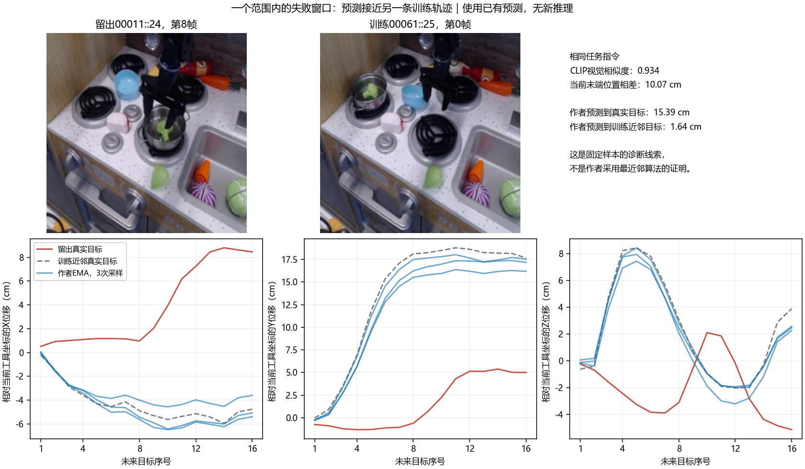

# 西兰花任务：共享观察与监督审计

本次只读审计已完成。范围固定为12条训练演示的24个原窗口、2条留出演示的9个窗口；没有增加训练样本、更新参数、加载新模型或生成新的CLIP特征。该任务因此前预测误差较大而被选中，属于事后诊断，不是独立测试。全40开发窗口原评价保留，不删除失败演示。

## 核验与实际输入

原始14条演示、12个分片的文件哈希通过，原始当前/未来状态与已核验缓存逐元素相同。所有帧的规范化指令均为`take broccoli out of pan`，未发现窗口中途换成其他任务；原图像/状态/语言时间索引对齐已在168窗审计核验。此次读取仅指定记录，保留测试目标未读取。

实际画面显示同一类厨房场景，但锅、碗、其他物品和机器人姿态不同。训练中已包含多种摆放，不能把留出失败直接说成遇到了完全陌生的厨房，也不能只因背景相似就认为动作应相同。[全部24训练输入](../reports/bridge_broccoli_observation_audit_203699/train_input_images.png)、[全部9留出输入](../reports/bridge_broccoli_observation_audit_203699/development_input_images.png)、[全部留出视觉近邻对照](../reports/bridge_broccoli_observation_audit_203699/all_development_visual_neighbors.png)。

## 范围差异存在，但不足以解释全部失败

| 检查 | 结果 | 解释边界 |
| --- | --- | --- |
| 留出当前XYZ超出同任务训练输入的逐轴范围 | 4/9窗口 | 反映同任务采样覆盖差异；逐轴范围不等于全部联合几何关系 |
| 留出未来相对XYZ超出同任务训练标签逐轴范围 | 32/144动作目标 | 这是同任务范围，不是实际全任务归一化器的范围 |
| 当前XYZ超出全部128训练输入逐轴范围 | 0/9窗口 | 不能据此宣称所有条件都处于相同分布 |
| 未来相对XYZ超出全部128训练标签逐轴范围 | 0/144目标 | 不支持本批XYZ目标被全局limits边界直接截掉的解释；不排除其他表示/优化影响 |

未来目标仍为工具相对位姿。动作标签范围比较是诊断，未使用未来标签挑选输入近邻或新训练数据。

## 相似画面不等于相同当前位置或未来轨迹

近邻在同任务训练窗口中根据已有冻结CLIP视觉描述选择，训练对训练排除同演示；另按先前固定的当前XYZ/姿态距离选择状态近邻。近邻选择不使用目标或预测误差。

| 平均诊断量 | 训练对训练，排除同演示 | 留出对训练 |
| --- | ---: | ---: |
| 视觉近邻余弦相似度 | 0.951 | 0.947 |
| 视觉近邻当前末端位置差cm | 9.52 | 10.55 |
| 视觉近邻未来相对位置轨迹差cm | 14.10 | 13.37 |
| 状态近邻当前末端位置差cm | 4.01 | 4.71 |
| 状态近邻未来相对位置轨迹差cm | 9.42 | 9.72 |

留出并未在这些近邻量上全面远离训练。相似画面、相近状态却对应不同未来路线的现象在训练中也存在；它支持检查几何、阶段与观察信息，不能自动确定泛化失败就是分布错配。CLIP描述用于审计，不是作者ResNet编码器的实际输出。

例一：留出`00011::24 t=0`与训练`00008::37 t=0`视觉相似度0.973，当前位置相差18.36cm，未来相对轨迹相差21.00cm。语义近邻不能替代机器人几何匹配；该例也在先前条件输入审计中出现过，本次是定位到作者失败演示的复查，并非一个全新根因发现。

## 一个范围内的具体失败窗口

留出`00011::24 t=8`（全局窗口146）的当前XYZ及全部16个未来XYZ均在同任务训练逐轴范围内，但作者EMA位置误差仍15.39cm。其固定视觉近邻为训练`00061::25 t=0`（窗口114）：

- 视觉相似度0.934，当前位置差10.07cm，当前姿态差4.87°；未来相对轨迹本身差16.49cm。
- 作者三次预测与该训练近邻轨迹的位置差仅1.64cm、旋转差2.18°，与本窗口真值则15.39cm/15.93°。
- 图中预测三条曲线接近另一条训练目标。它是值得检查的行为线索，不能证明作者模型内部执行了最近邻检索，也不能直接认定视觉编码器有错。
- 原项目201663在同一窗口位置误差10.72cm，与同一训练近邻轨迹差10.79cm，没有呈现同样的贴近现象。两种模型的具体错误不能直接归为同一种机制。项目该控制未输入数值当前位姿，也不能直接和作者做单模块因果比较。

## 阶段与16步跨度

12条训练演示中10条有38个记录步，另两条25/26步；两条留出演示分别38和25步，长度本身并非新范围。原训练每演示只选2个当前输入，留出则在有效区间按4步间隔评价6和3个当前输入，留出包含训练输入采样较稀疏的中间阶段。

16个未来目标占25步演示的约67%记录跨度、38步演示的约43%。这只是记录序号比例，不代表相同的语义阶段或物理时间。原始记录没有可用时间戳，不能确认16步一定是3.2秒，也不能证明硬件传感器同步。完整原始状态与抽样画面已保存，未来画面只用于人工审计，不作为模型输入。

上述阶段覆盖现象不是已证实根因：先前同数量中段换窗对照202069没有整体收益，本次不会据此重复同一种换窗方案，也不直接缩短窗口或删除后半段评价。

## 结论与下一项

本次未发现任务文本切换、当前/未来索引错位或本批XYZ目标超出实际全局归一化范围。找到了同任务覆盖差异，以及作者模型某个预测更接近另一条训练路线的明确例子。既不能说“数据完全没问题”，也不能说“就是训练集随机选错了”。仅扩大样本、改变网络或再训练无法验证这些观察的因果关系。

下一项设计是固定203699的最终EMA，针对全部9个西兰花留出窗口，分别替换同任务训练近邻的图像、当前状态，以及同时替换二者。保持语言、100步采样、权重和配对随机噪声不变，先重放原40窗输出。混合图像/状态可能物理不一致，因此只比较预测敏感性，不将混合条件误差当作改进或机器人成功。两者同时替换后是有效训练输入，可与对应训练目标比较。此项只检查哪个条件通道影响作者模型输出，不能单独证明唯一故障层或修复项目。

[固定9对输入和噪声重放设计](../reports/bridge_broccoli_observation_audit_203699/frozen_observation_intervention_plan.json)保留为设计记录。对应小作业包现已准备并冻结，8,533字节，本地输入替换／CPU随机数／启动检查通过，但未加载作者模型或执行GPU重放，**尚未提交作业**；无新训练。见[运行协议和命令](BRIDGE_AUTHOR_OBSERVATION_PROBE_203699.md)。模型干预前不得把只读近邻观察写成已经运行的因果实验。

证据：[数值审计](../reports/bridge_broccoli_observation_audit_203699/analysis.json)、[14条原始演示核验](../reports/bridge_broccoli_observation_audit_203699/raw_episode_audit.json)、[复现脚本](../scripts/audit_bridge_broccoli_observations_203699.py)。本次生成约17MiB结果，无数据集或权重下载。
