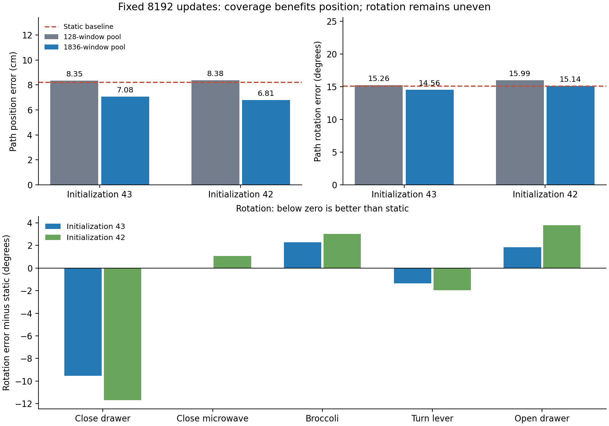

# 207558独立验收与两初始化结果

已收到并核验归档17文件、7预测快照，没有缺文件。输入/完整415演示payload与原审计指纹、原128/40身份、状态统计、初始化42参数起点、源代码、原完整缓存key、8192训练更新与学习率、预检恢复和正式前4步均通过。保存预测以float64复算，最大报告差1.20e-6cm/0.000636°，未影响结论。没有重新运行编码、训练、采样或仿真，没有下载PT或完整特征缓存。

## 主要结果：固定原40窗/10条开发演示

| 方法 | 路径位置/cm | 路径旋转/° | 第16目标位置/cm | 第16目标旋转/° |
|---|---:|---:|---:|---:|
| 静止 | 8.212326 | 15.098500 | 10.565334 | 19.986393 |
| 同初始化42小池202463/real | 8.381655 | 15.993918 | 10.710619 | 22.287618 |
| 大池207558 | **6.808208** | 15.138891 | **8.221684** | **19.032170** |

位置较静止低17.10%、较同seed小池低18.77%。10条演示中9条位置优于静止、8条优于小池；五任务路径位置均优于同seed小池和静止，收益不只来自一个任务。

旋转路径均值比静止高0.040390°；原固定门槛15.118500°被超过0.020390°。其他原条件通过（含至少6/10演示位置优于小池），但**完整候选未通过，不能调门槛或再选一个种子**。旋转仅2/10演示优于静止、7/10优于小池，不能用整体均值接近静止来暗示多数演示已解决。

## 与第一次覆盖对照一致和不一致之处

| 初始化 | 小池→大池位置/cm | 大池位置优于静止演示 | 小池→大池旋转/° | 大池旋转优于静止演示 | 完整原候选 |
|---|---|---:|---|---:|---|
| 43，202278→207348 | 8.349→7.079 | 7/10 | 15.256→14.560 | 3/10 | 通过 |
| 42，202463→207558 | 8.382→6.808 | 9/10 | 15.994→15.139 | 2/10 | 未通过 |

两个初始化支持当前固定8192更新预算下扩大覆盖降低开发位置误差的方向。旋转相对同初始化小池也均下降，但相对静止的收益没有稳定复现；不能说完整策略泛化修复或达到统计显著。三次扩散采样不是三个独立训练初始化。

两次旋转都呈任务差异：关抽屉和拨杆优于静止；微波炉、西兰花和开抽屉的路径旋转更差。静止在部分任务是较强的旋转基线。seed42分任务如下，保留所有任务而不排除失败组：

| 任务 | 静止位置/cm | 大池位置/cm | 静止旋转/° | 大池旋转/° |
|---|---:|---:|---:|---:|
| 关抽屉 | 9.757 | 6.288 | 41.404 | 29.718 |
| 关微波炉 | 9.132 | 7.561 | 11.021 | 12.091 |
| 取西兰花 | 9.201 | 8.282 | 8.586 | 11.597 |
| 拨杆 | 3.376 | 2.927 | 10.625 | 8.662 |
| 开抽屉 | 7.483 | 6.613 | 11.412 | 15.210 |

训练全1836窗仍为厘米级；训练拟合不是本次延长预算理由。大小训练池曝光与覆盖共同改变，不能将位置收益唯一解释成“更多演示”“更多阶段窗口”或“更少记忆”。

## 收口与后续边界

本项一次独立初始化复核按计划结束，不追加种子、训练次数或重跑小样本记忆。保留大池位置收益作为下一项工作参考；后续若改善旋转，需预先确定一个旋转相关干预、固定当前数据池/预算/位置监控与逐任务评价，不能因为门槛差0.02°而临时调门槛或挑一次更好结果。当前尚未准备/提交任何新实验，也没有宣称唯一根因已找到。

评估为反复使用的同任务独立演示开发集，没有读取未触碰测试目标，没有验证未见任务或机器人抓取。夹爪保持冻结，位置误差降低不等于抓取成功。

证据：[完整独立验收](../reports/bridge_coverage_replication_analysis_207558/analysis.json)、[两初始化汇总](../reports/bridge_coverage_replication_analysis_207558/two_initializations.json)、[逐演示CSV](../reports/bridge_coverage_replication_analysis_207558/episodes.csv)、[逐任务CSV](../reports/bridge_coverage_replication_analysis_207558/tasks.csv)、[逐目标CSV](../reports/bridge_coverage_replication_analysis_207558/horizons.csv)。

