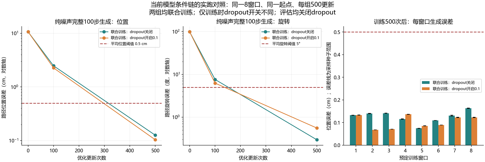

# 当前模型的 Adapter dropout 对照（2026-10-11）

## 结论

两组实际联合训练都通过预定的小样本位姿生成门槛。原代码训练模式下的 Adapter dropout=0.1 没有阻止当前八层 Adapter 和扩散位姿头在这八个训练窗口上学成功。本次不支持将 dropout 单独判为此前全量训练失败的根因，也不支持以后把 dropout 永久关闭作为修复方案。

这项结果证明当前位姿链在允许 Adapter 更新且开启原有 dropout 的条件下仍能记忆小样本；不能证明多任务语言理解、泛化、夹爪切换或仿真抓取通过。此前全量实验失败的根因仍未确定。

## 真实运行结果

两组均训练500次更新，使用同一8窗口，每次batch=8。

| 训练时 Adapter dropout | 完整生成平均位置 | 完整生成平均旋转 | 窗口终点位置 | 窗口终点旋转 | 全部三采样种子逐窗口门槛 |
|---|---:|---:|---:|---:|---:|
| 关闭 | 0.125966cm（1.260mm） | 0.294809° | 0.226606cm | 0.279963° | 8/8 |
| 开启0.1 | 0.103583cm（1.036mm） | 0.555432° | 0.175165cm | 0.444489° | 8/8 |

开启组的位置误差略低、旋转误差略高，两个指标均满足原门槛。这是单次训练初始化的结果，不能由它判断 dropout 提升或降低泛化。



## 控制变量及核验

复用 [上一轮八层Adapter联合拟合对照](BRIDGE_ADAPTER_PAIR_LOCAL_20261011.md) 的同一八条训练记录、首窗口、原始图像、文本、位姿和当前夹爪输入；仍通过当前 __getitem__ 和 TFRecord 解析读取。当前目标与旧缓存逐元素一致，没有新的按误差选样本操作。图像/目标/CLIP tokens/初始上下文哈希与上一轮一致。

CLIP使用现有离线权重并冻结，只计算一次视觉/语言tokens。两组均训练当前八层Adapter与同一多尺度U-Net；夹爪参数冻结，不计算夹爪优化损失。网络配置、初始Adapter/解码器/编码器哈希、Adam lr=3e-4、wd=0、恒定学习率、梯度裁剪1和500更新均相同。

仅改变优化时 Adapter 的 train/eval 模式：关闭组eval、开启组train，使原有0.1注意力及残差/FFN dropout生效。源码检查确认Adapter没有BatchNorm；两组都保留Adapter梯度并更新参数。评估两组统一eval，关闭dropout。

每次更新先用seed=430000+update确定dropout随机流，计算上下文后再用420000+update生成扩散时间步和动作噪声，因此开启dropout不会通过消耗随机数改变动作噪声。初始两组生成指标完全一致。关闭组0、100、500更新的全部记录指标与上一轮联合组逐项一致，实验入口扩展没有改变共同基线。

两组Adapter/解码器都有非零梯度和参数变化；两组CLIP无梯度，参数哈希未变；夹爪参数未变。训练初始化seed=42，采样种子1101/1102/1103；三个采样种子不是三个独立训练种子。CUDA注意力反向存在非确定性提示，不承诺跨平台逐元素复现最终权重。

评估均从纯高斯动作噪声开始，使用当前模型完整100步采样。判据沿用上一轮：每种采样种子总体位置≤0.5cm、旋转≤5°，至少90%窗口在所有种子下的窗口平均位姿达到同一门槛；每种子的总体终点位置≤1cm、旋转≤10°。不是逐动作点最大误差判据，不使用真实轨迹加噪恢复或训练loss来判成功。

## 证据与范围

- [完整报告](../reports/bridge_dropout_pair_local_20261011/report.json)
- [开跑前计划](../reports/bridge_dropout_pair_local_20261011/plan.json)
- [共同起点、基线复现和参数范围核验](../reports/bridge_dropout_pair_local_20261011/verification.json)
- [从保存预测独立计算的逐窗口指标](../reports/bridge_dropout_pair_local_20261011/per_window_metrics.json)
- [逐步位置误差图](../reports/bridge_dropout_pair_local_20261011/dropout_pair_eight_windows.png)

真实GPU为RTX4060 Laptop，PyTorch2.11.0+cu128，耗时约219.8秒。优化阶段峰值保留显存约2.936GiB，不含先前CLIP提取阶段的高峰。没有下载新模型或数据，新增报告、源码快照、预测和图不到1MiB，没有保留新的大权重。

本次是单任务八训练窗口位姿记忆，未使用验证或测试目标优化/评估。数据读取绕过完整自动扫描器与随机DataLoader，不能据此验收所有数据管线。原全量实验的batch2、AdamW、cosine、夹爪联合损失和五任务规模尚未在本次对齐。

后续已完成训练暴露量对照：同一训练路径20次为8.632cm/8.169°，500次为0.103583cm/0.555°，由0/8窗口达标变成8/8。详见[实际次数对照](BRIDGE_EXPOSURE_LOCAL_20261011.md)。这一差距证明小样本配方的预算敏感性，不能直接断定全量任务只需加轮数。

复用命令（使用新的输出目录）：

```powershell
D:\miniconda\envs\zeroshot-gpu\python.exe code/fit_bridge_adapter_pair.py --comparison dropout --output reports/bridge_dropout_pair_local_new
```

本轮和上一轮的实际运行入口均保留runner_snapshot.py源码快照，其哈希与对应report的执行源码哈希一致；后续入口变化不覆盖历史报告。
