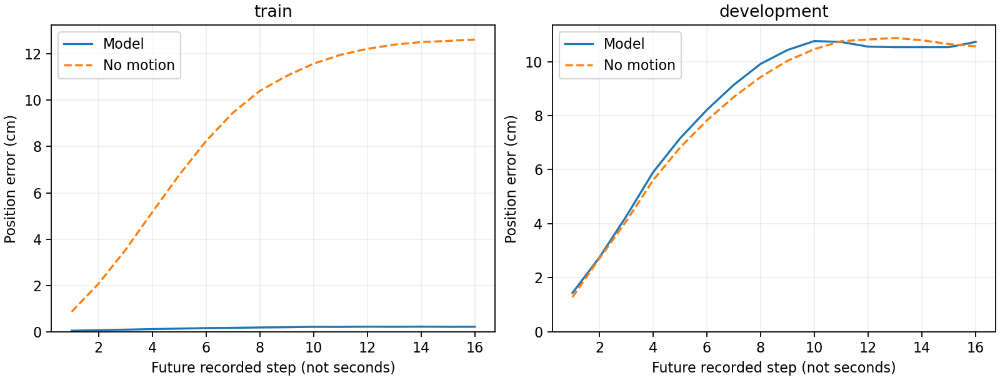

# Bridge端到端逻辑核对

2026年10月15日。本次没有找到能够解释全部留出误差的索引或坐标计算错误，也没有修复泛化。已完成一项有边界的核对：将当前128训练窗、40开发窗的原始记录、实际冻结loader、监督标签与保存预测连起来检查，并明确它们与老师要求和控制任务之间的差别。不启动新训练，不替换标签或评分标准。

## 检查对象和方法

核对202278真实当前状态组的最终保存预测；204258重复当前控制此前已精确重放它。本轮使用冻结的`bridge_growth128_v1`源码，重读74条选定演示、42个分片中的168个窗口。检查分片哈希、原始图像/状态/命令/指令身份、完整16目标边界和训练开发演示不相交，没有解析预留测试演示。

不依赖生产编码解码互相抵消：另外用float64矩阵`Rz(yaw) Ry(pitch) Rx(roll)`计算世界位置及旋转矩阵，核对保存目标是否真的对应指定原始state。残差由已保存的3次原生DDPM采样复算，不加载CLIP或checkpoint，不生成新预测。两张示例图使用事先固定的第一训练窗及第一开发窗，不挑选成功或最坏案例。

## 老师要求与当前实验的对应

重新读取了第一封原始邮件及第五封回信。第一封要求统一语言、RGB序列、位置/四元数/夹爪的8维位姿动作，冻结CLIP，训练Adapter和扩散解码器，并最终以仿真rollout任务成功率评价。它没有规定必须原样预测Bridge的7维增量命令，因此不能仅因本项目使用未来实测位姿就判定实现错误。

当前实现与完整项目目标仍有明确距离：本次128窗系列是**位姿部分拟合诊断**，夹爪头被冻结，损失只优化7维位姿，保存的第8维不能当作已训练夹爪的证据。Bridge夹爪标签为开/关命令，尚非跨机器人物理宽度。诊断使用离线专家位姿误差，尚未建立Bridge预测在目标仿真控制器中的有效执行与闭环成功。因此“128窗拟合通过”必须写成位姿诊断通过，不能说完整抓取策略通过。

## 时间和坐标对应

对输入时刻`t`，实际关系为：

| 项目 | 实际取值 |
|---|---|
| 图像及语言 | 同一记录的`image_0[t]`、`language_instruction[t]` |
| 当前末端状态 | `state[t]`，真实状态端口只取当前XYZ和旋转特征 |
| 第1个目标 | `state[t+1]`相对`state[t]`，配`action[t]`的夹爪命令 |
| 第k个目标 | `state[t+k]`相对同一`state[t]`，配`action[t+k-1]`夹爪命令 |
| 第16个目标 | `state[t+16]`，配`action[t+15]`夹爪命令 |

全部168窗均有16个真实未来观测，不涉及末尾补齐。末步无效action不参加夹爪反向扫描。按RLDS约定，action与当前观测对应，末步action无效；这个索引关系符合约定，但不证明原始硬件传感器在物理时间上完全同步。[RLDS字段定义](https://github.com/google-research/rlds/blob/main/README.md)

位置标签为`R(t)^T [p(t+k)-p(t)] / 0.10`，旋转标签对应`R(t)^T R(t+k)`；每个目标都以输入时刻为参考，不是把16个数值当作逐步增量累加。厘米评分乘回10。独立重建到原记录的最大位置坐标差为`3.23e-8 m`，旋转矩阵最大元素差为`2.85e-7`；loader重算与集群保存标签最大分量差`4.77e-7`，在既定跨平台容差内。夹爪16个索引均与有效命令独立反向扫描结果一致。

第一训练窗为微波炉演示`t=12`：第1个目标取state13，夹爪取action12；第16个目标取state28，夹爪取action27。第一开发窗为关抽屉演示`t=0`：目标取state1到16，夹爪取action0到15。对应数值见[逐项记录](../reports/bridge_end_to_end_audit_20261015/selected_timeline.json)。

这些检查排查的是**导出记录到训练目标的转换**，没有原始相机/控制器时间戳或标定记录，不能据此宣布物理时间、相机外参、TCP标定全部正确。当前本地记录未发现timestamp字段。已检查的PyBullet单演示rollout保持同一个重规划参考位姿解码chunk前4个目标，没有逐目标累加；它属于另一份仿真数据和权重，不能用于验证Bridge到PyBullet的控制映射。

## 为什么未来实测位姿不能直接叫原生命令

Bridge原始7维action是XYZ增量、RPY增量和绝对夹爪命令；项目没有把前6维误读为绝对位姿。Bridge作者loader本身也提供用相邻实测状态差重标动作的方式，因此“使用实测状态监督”不是本项目独有的错误。[Bridge作者动作处理](https://github.com/rail-berkeley/bridge_data_v2/blob/main/jaxrl_m/data/bridge_dataset.py)

但作者的相邻状态差、项目的16个固定参考系未来位姿、原始下发命令仍是不同对象。未来测量包含机器人对命令的实际响应；把它当作期望位姿执行需要具体控制器、参考系及时间约定。不能把离线专家轨迹误差直接换成抓取成功率，也不能把改造后的作者Bridge参照称为原论文同任务成功复现。

作者公开转换器还包含按采集日期修正相机延迟的步骤。它说明导出前可能已有延迟处理，不支持我们对当前旧版导出记录擅自再移一帧；当前本地文件不是该最新转换器的可复核原始转换产物。[公开转换器](https://github.com/kvablack/dlimp/blob/main/rlds_converters/bridge_dataset/bridge_dataset_dataset_builder.py)

## 保存预测的残差说明了什么

| 范围及未来目标 | 模型位置误差 | 静止位置误差 |
|---|---:|---:|
| 训练全部16目标平均 | 0.169cm | 8.960cm |
| 开发第1目标 | 1.439cm | 1.280cm |
| 开发第8目标 | 9.916cm | 9.430cm |
| 开发第16目标 | 10.728cm | 10.565cm |
| 开发全部16目标平均 | 8.349cm | 8.212cm |

开发集从第1个目标起就没有优于静止；不能把全部失败解释为只有远期目标难预测。这里横轴是未来记录步，不是扩散去噪步，也没有换算成秒。对新条件的预测响应不可靠，是现象描述，不是已经确定CLIP、Adapter或动作头其中之一有错。

输出也不是全部不动或爆炸：开发预测相对当前的平均位移6.432cm，专家目标为8.212cm；最终XYZ没有触碰±3裁剪边界。对目标位移大于1cm的目标，约30.2%的采样预测位移与专家位移夹角超过90度，训练为0%。这只比较到同一专家目标的方向，不等于30.2%任务物理失败，也不能证明存在统一轴反转。

将误差旋回各窗口的世界坐标后，开发平均残差约`[-0.421, 0.611, 1.635] cm`；统一偏置向量仅占位置均方误差约3.08%。这个比例是均方误差分解，不是修正后的平均距离改善率；本次没有减偏置后重新判成功。它不支持“只是同一个平移常数写错”解释全部误差，但不排除随场景变化的坐标问题。

固定检查同一批预测槽3到14，将专家目标统一移`-2,-1,0,+1,+2`帧。训练误差在0偏移为0.179cm，±1偏移超过1.60cm；开发0偏移9.011cm，最佳的-2仍为8.290cm，-1为8.628cm。没有通过移一两帧恢复到训练精度；这不是物理同步证明，不据此更换标签或选择最有利评分。

## 数据来源及一个元数据矛盾

源路径包含Bridge V1和V2收集目录，共11个训练来源组，开发来自4组。全部开发的“任务×来源组”在训练中都有记录，例如开发关微波炉的`v1/berkeley/toykitchen5`也有5条训练演示；西兰花训练12条、开发2条均归到`v1/berkeley/toykitchen1`。因此“开发全来自完全没见过的厨房目录”不是当前清单事实。[按任务及来源目录计数](../reports/bridge_end_to_end_audit_20261015/task_source_groups.csv)

但同一个目录不证明相机外参、物体布局和阶段相同；目录只是可复核来源分组，不能用它宣称同场景控制已经建立。Bridge V2文件名也不能理解为仅含V2来源。没有因这些目录改变或重划分现有窗口。

168窗的`has_image_0`元数据都为false，但实际image0均有非空、非恒定RGB内容，两份原始时序示例也已打开确认。这是元数据与实际内容不一致，不能用该flag判定图像缺失；当前loader直接读实际image0，并未因flag而换成黑图，故没有证据说明它导致当前动作误差。也不能由非空像素单独证明相机身份正确。

## 决策与未解决部分

本次有界核对结束。未发现当前168窗被错配、填充、错乘单位，或把原生增量当绝对位姿使用的证据。没有找到可立即修复并保证泛化恢复的大bug，也不以这些数值检查宣称任务定义已得到闭环验证。

当前需要保留的根本区分是：能记住128个已见观察的未来位姿，不代表已经学到新观察下可靠的几何控制规律；有效的任务与控制映射也不能由小样本记忆代替。当前五任务配方继续增加种子/轮数/模块的路径仍然关闭。任何后续最小泛化实验都必须先明确任务、场景/相机依据、可用观察及可执行目标，保持老师要求的CLIP+Adapter+扩散方法；不根据这次事后残差选择有利窗口或移位标签。

复查：[核对脚本](../scripts/audit_bridge_end_to_end_20261015.py)、[数值结果与源码指纹](../reports/bridge_end_to_end_audit_20261015/analysis.json)、[原始字段链](../reports/bridge_end_to_end_audit_20261015/raw_lineage.json)、[逐目标误差](../reports/bridge_end_to_end_audit_20261015/per_horizon.csv)、[固定时间移位检查](../reports/bridge_end_to_end_audit_20261015/fixed_time_shift.csv)。本次只新增CPU审计与小型报告，不安装依赖、不下载模型或数据、不保存新权重、不向集群提交作业。
