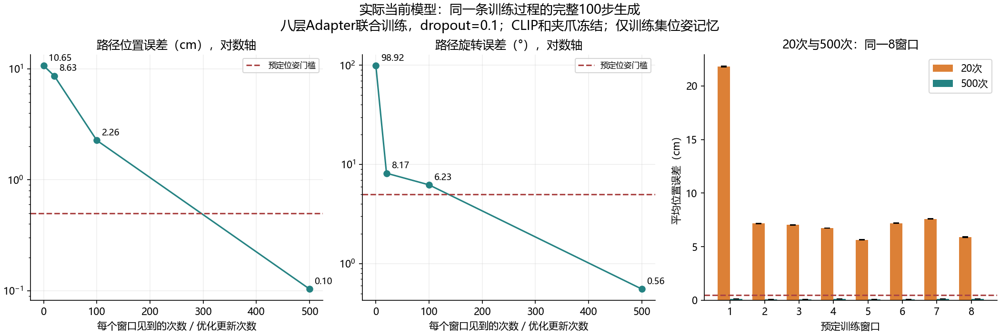

# 同一训练过程的20/100/500次暴露量对照

2026-10-11，本地GPU实际运行完成。当前八层Adapter与多尺度扩散位姿头在同一8个训练窗口上，20次尚未拟合、500次通过预定位姿生成门槛。证明这套小样本配方对训练次数敏感；此前全量训练失败的唯一根因仍未确定。

## 实际结果

每次batch包含全部8窗口，各窗口每次更新出现一次。下表次数是每窗口暴露量，也等于本实验优化器更新次数；不能直接与其他batch/数据规模实验的总更新次数等同。

| 每窗口见到次数 | 完整生成路径位置 | 路径旋转 | 窗口终点位置 | 窗口终点旋转 | 全部三采样种子逐窗口达标 |
|---|---:|---:|---:|---:|---:|
| 20 | 8.632cm | 8.169° | 11.182cm | 10.751° | 0/8 |
| 100 | 2.262cm | 6.234° | 5.627cm | 8.319° | 0/8 |
| 500 | 0.103583cm（1.036mm） | 0.555° | 0.175165cm（1.752mm） | 0.444° | 8/8 |

同一批窗口静止位置基线为7.735cm、旋转7.785°。20次时平均位置比静止更差，并不表示该模型无法学会；沿同一条训练路径继续优化后，500次明显超过基线。这里不是根据训练loss判成功，也不是先输入真实目标再加噪恢复。



## 控制与核验

在[上一轮dropout对照](BRIDGE_DROPOUT_PAIR_LOCAL_20261011.md)成功配方上，仅增加第20次评估，执行一条500更新训练路径。相同8条独立训练演示的首窗口、同一任务，使用当前TFRecord解析和图像处理；目标、图像、当前输入、CLIP tokens及初始上下文与上一轮逐项相同。

冻结现有离线CLIP，联合更新当前8层Adapter和多尺度U-Net；训练dropout=0.1，评估关闭。Adam lr=3e-4、wd=0、恒定学习率、batch8、梯度裁剪1，位姿x0目标MSE。夹爪参数冻结，不优化夹爪损失。生产模型、Adapter、数据解析、扩散解码器源码未因这项实验修改，仅扩展已有诊断入口。

初始参数哈希、CLIP tokens、原始数据和配置与上一轮相同。训练初始化seed42；dropout seed=430000+update，动作噪声seed=420000+update；完整100步纯高斯噪声采样，种子1101/1102/1103。评估使用fork_rng隔离随机状态；新增20次评估后，0/100/500次的生成指标、上下文变化量与上一轮dropout_on逐项完全一致。三个采样种子不是三个训练种子。

从各阶段实际保存的预测NPZ独立重算位置/旋转误差和逐窗口达标数量，均与运行报告一致。CLIP和夹爪参数未变，Adapter与解码器都有梯度和参数变化。保留执行入口源码快照，其SHA256与执行报告一致。

判据沿用开跑前已有门槛：每种采样种子总体平均位置≤0.5cm、旋转≤5°；至少90%窗口在所有种子下窗口平均位姿达到同一门槛；每种子的总体终点平均位置≤1cm、旋转≤10°。这是平均误差判据，并非每个动作点最大误差的保证；窗口终点也不是任务最终抓取位置。

## 能证明什么

当前小样本条件链能够联合学习并从纯噪声完整生成准确位姿，原有dropout并不阻止这一能力。20次和500次差距来自同一条学习过程，支持后续关注训练暴露量与优化设置。

不能由此断定原全量任务加25倍轮数就能成功。原全量实验还包含更大且多任务的数据、batch2、AdamW lr=1e-4、cosine退火和夹爪联合损失等差异。本次未验证泛化、夹爪切换、物体定位、语言判别或PyBullet操作。仅明确索引8记录，没有验收全量自动扫描器和随机DataLoader。

后续已完成同一500次配方的学习率单变量对照：改为1e-4后位置误差2.180mm、旋转1.232°，8/8窗口仍通过门槛，详见[学习率实跑结果](BRIDGE_LR_LOCAL_20261011.md)。不支持把1e-4单独判为全量失败的根因。其余优化器、退火、batch与夹爪监督差异仍未对齐，不直接重跑全量训练。

## 文件与资源

- [完整运行报告](../reports/bridge_exposure_local_20261011/report.json)
- [开跑前计划](../reports/bridge_exposure_local_20261011/plan.json)
- [独立预测指标](../reports/bridge_exposure_local_20261011/independent_metrics.json)
- [共同训练路径及源码核验](../reports/bridge_exposure_local_20261011/verification.json)

RTX4060 Laptop GPU，PyTorch2.11.0+cu128，实际耗时114.97秒。优化阶段峰值保留显存2.953GiB，不包含先前CLIP提取阶段。没有下载数据/权重、没有保留大型checkpoint；此次预测、报告、源码快照、图合计约0.30MiB。

复用命令（必须使用新的输出目录）：

```powershell
D:\miniconda\envs\zeroshot-gpu\python.exe code/fit_bridge_adapter_pair.py --comparison exposure --output reports/bridge_exposure_local_new
```
