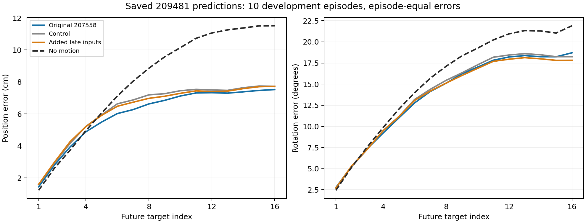
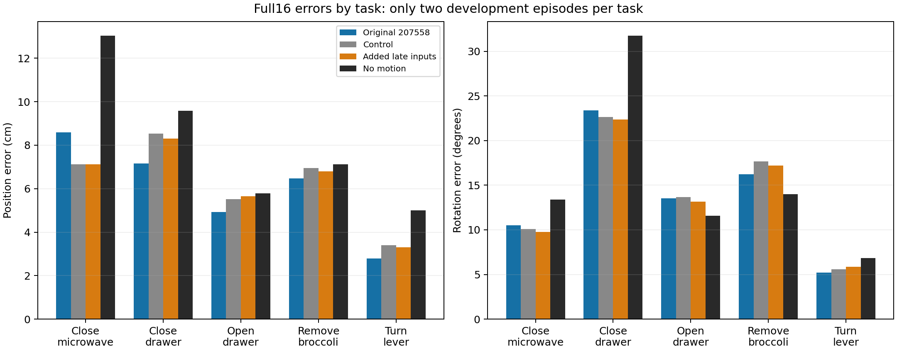

# 209481保存结果分析：整体优势与近端动作短板同时存在

## 范围与核对

只读取用户下载的report.json、validation_rows.json和已有NPZ，未加载模型/权重、原始数据或最终25演示，无GPU、无新训练/推理。新开发10演示、50完整窗口、3个扩散采样种子，全部保留。

用独立acos公式及演示等权重算报告的整体/终点、逐任务/逐演示结果，最大摘要差1.07e-14；预测/真值/种子/分区身份和冻结来源引用对应。本地没有两份大权重，故不声称独立完成权重哈希复核；已有集群完整验证通过记录保持有效。没有重复运行原GPU重放或完整输出验证器。

## 1. 原模型位置优势覆盖五项任务，但旋转不全面

以下均为完整16步、演示等权。每项任务仅两条开发演示，不能推断整个任务总体的可靠成功率。

| 任务 | 原207558位置cm | 不动位置cm | 原207558旋转度 | 不动旋转度 |
|---|---:|---:|---:|---:|
| 关微波炉 | 8.587 | 13.041 | 10.506 | 13.398 |
| 关抽屉 | 7.154 | 9.591 | 23.398 | 31.761 |
| 开抽屉 | 4.932 | 5.793 | 13.553 | 11.586 |
| 从锅里拿西兰花 | 6.475 | 7.116 | 16.243 | 13.994 |
| 转动杠杆 | 2.784 | 5.011 | 5.207 | 6.845 |

位置五项任务平均全部优于不动，逐演示8/10条改善；旋转3/5任务、6/10演示改善，位置/旋转同时改善5/10演示。未改善的两条位置演示是00857::8（5.446对5.256cm）、00844::16（8.058对7.515cm），完整身份见CSV。不存在仅由一个任务贡献整体位置优势的现象，但不代表每条演示或每个指标都通过。

## 2. 最清楚的短板：第一目标仍差于不动

| 统计段 | 原207558位置cm | 不动位置cm | 原207558旋转度 | 不动旋转度 |
|---|---:|---:|---:|---:|
| 第1目标 | 1.446 | 1.227 | 2.774 | 2.440 |
| 第1至4目标平均 | 3.269 | 3.133 | 6.160 | 6.266 |
| 全16目标平均 | 5.986 | 8.111 | 13.782 | 15.517 |
| 第16目标 | 7.524 | 11.516 | 18.709 | 21.911 |

五任务的第1目标平均位置误差均高于各自不动；总体第1位置约高17.9%。窗口等权也出现第1及前4位置较差、全16改善的模式。前4旋转的小幅胜负随计权改变，不作为强结论。

原模型从第4目标开始，逐目标的演示等权位置平均低于不动；前3目标仍较差。优势主要出现在较远预测目标上，不能据整体平均好就推断当下控制动作已足够可靠。这里是同一输入下联合生成的16个目标，不是滚动执行记录，不能把曲线增长称为闭环积分误差累积，也不能按目标序号标注抓取/释放。

新增组没有修复这一短板：完整16分支第1位置1.601cm；其单独K1请求辅助1.343cm，控制K1为1.285cm，都未低于不动1.227cm。K1是不同请求/训练方案的输出，不等于裁剪原模型第一行；不能据此声称所有一步方法都无效，但本方案已经给出负结果，不重复它。

## 3. 幅度、方向和采样散布

原模型第1目标平均预测位移1.039cm，演示为1.227cm；全16平均7.630对8.111cm，没有出现整体统一的位移放大。平均幅度相近也不能证明方向正确。

针对真实与预测位移均超过0.01cm的样本，原模型第1目标的方向余弦平均0.197，约41.4%的演示等权采样比较中夹角超过90度。有效权重97.1%，3种子共144个有效比较。这是与该演示下一步的方向比较，不是独立样本统计、动作合法性或抓取失败率。

全16位置平方误差中，3次保存采样的散布项约17.6%，其余为三次预测均值与记录目标的差；第一目标散布项约15.0%。该恒等分解误差已核对，未生成新策略或用真值挑种子。不能把大部分误差直接归结为采样随机性，也不能把均值项解释为某个网络模块的因果故障。

完整16目标的有符号工具轴平均残差约[-0.537,0.884,0.890]cm；其平方量占总位置平方误差约3.34%。不支持简单的统一工具坐标常量偏移足以解释全体误差。各窗口工具轴方向不同，这不是世界/相机标定偏移；没有用开发真值拟合纠偏器。

## 决策与下一阶段建议

207558保持有效参照；209481分支继续关闭，既定完整16采用规则不变。近端分析不能事后让失败候选通过，也不能重开25最终数据。当前10条均为已消费开发数据。

**建议下一阶段明确解决“新演示上立即执行的短段动作可靠性”，而非继续增加后段起点、更新次数或重跑拟合。** 已有整体平均优势没有覆盖第一步，部署讨论必须把预测长度与实际执行长度分开，并固定近端/全段双重约束。近端指标只用于后续协议，不替换209481事前主指标。

本分析尚不能在观察信息不足、条件编码/动作表达或学习目标之间作因果归因；未得到足够证据指定一个必然有效的新网络/损失改动。因此当前不提交新GPU实验，不直接承诺缩短预测、第一步加权、加入历史或补夹爪能修好。既有历史/K1等负结果也不重做。完整夹爪/闭环仍是独立功能缺口，不能用补功能冒充位姿泛化改善。

交付：[机器可读分析](../reports/bridge_prefix_failure_analysis_209481_20261018/analysis.json)、[任务表](../reports/bridge_prefix_failure_analysis_209481_20261018/per_task.csv)、[演示表](../reports/bridge_prefix_failure_analysis_209481_20261018/per_episode.csv)、[预测目标表](../reports/bridge_prefix_failure_analysis_209481_20261018/per_target.csv)、[残差/幅度表](../reports/bridge_prefix_failure_analysis_209481_20261018/motion_diagnostics.csv)。

