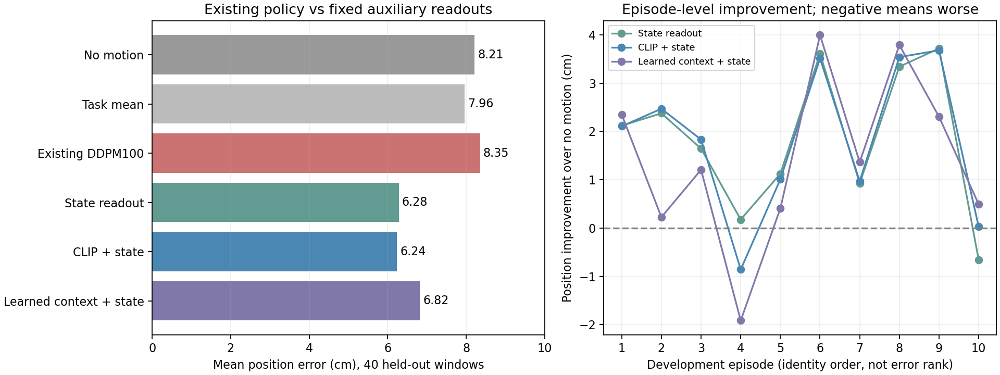

# 固定Bridge留出演示：辅助读出的泛化结果

后续状态：本页读出未重训或调参；“固定状态基础轨迹＋扩散XYZ修正量”205648已完成并独立核验。开发7.185cm优于旧扩散和静止，但旋转16.697°退步，且位置仍差于本页基础预测6.280cm；完整候选失败收口。见[独立结果与边界](BRIDGE_STATE_PRIOR_RESULT_205648_20261015.md)。本页数值与停止规则保持原样。

2026-10-15。按用户要求回到泛化问题，不执行已撤回的Panda特征对齐拟合。复用已有Bridge128个训练窗口（64条演示）和原40个开发窗口（10条独立演示），已获得**优于静止基线的位置预测辅助参照**；原扩散模型尚未修复。

## 本次新增问题与已有检查的区别

原动作范围、画面/状态近邻、当前状态注入、真实历史等诊断均已完成，本次没有重复执行。此前的近邻是按相似度直接检索训练轨迹；本次检验的是：同一简单线性读出从任务和当前状态、冻结视觉描述符或训练后条件中学习的映射，能否在原独立演示上降低位置误差。这与Panda16个已见窗口的拟合检查不同，主要评价对象是Bridge40个留出窗口。

原扩散参照固定为202278真实状态组、初始化43、最终8192更新，训练位姿门槛已通过；采用已保存3次DDPM100采样的距离均值。没有重新生成策略动作、加载模型权重、编码图片或启动神经网络训练。

## 固定方法及信息边界

三个辅助读出均为按任务分组的中心化岭回归，固定正则1.0，不扫描、不依据开发误差选择参数；每组特征只在相应训练子集上减均值、除以整体尺度，各特征块等权。仅使用已存在的128个训练窗口的48个XYZ目标分量求解，随后固定评价全部40个开发窗口：

- 状态读出：任务指令类别、当前末端XYZ和当前旋转矩阵。不是未来状态或目标物体位置。
- CLIP加状态：上述输入加已有2048维冻结视觉描述符（分别归一化的CLS与patch均值），不等同于完整视觉token。
- 学习后条件加状态：上述状态加已有1024维最终条件。这个条件已包含Adapter及真实状态投影等，不能简单称为单独Adapter输出。

所有预测均为同一16个未来实测位置、同一局部参考系及厘米单位。没有换成更近的目标、改变窗口、移位真值或删除失败演示。任务类别来自现有指令，不使用演示编号或未来目标作为输入。已监督训练过的条件编码器看过全部128窗标签，因此其辅助按演示留一读出不能冒充整个神经模型的交叉验证；独立开发集没有进入编码器训练或本次读出求解。

## 原固定40窗口结果

| 方法 | 路径位置误差 | 第16目标位置误差 | 位置优于静止的演示 |
|---|---:|---:|---:|
| 静止 | 8.212cm | 10.565cm | — |
| 训练任务均值（基线） | 7.959cm | 10.390cm | 6/10 |
| 原扩散模型（保存结果复用） | 8.349cm | 10.728cm | 5/10 |
| 状态辅助读出 | **6.280cm** | **7.908cm** | **9/10** |
| CLIP加状态辅助读出 | **6.239cm** | **7.655cm** | **9/10** |
| 学习后条件加状态辅助读出 | **6.823cm** | **8.357cm** | **9/10** |

状态读出相对静止降低位置误差23.53%，CLIP加状态降低24.02%。这是辅助位置预测器的结果，不能写成“原扩散模型泛化已通过”。五个任务的状态读出平均位置误差均低于静止，但不是每条演示都改善：打开抽屉`00030::39`状态读出8.592cm，静止7.933cm；CLIP/学习后条件读出在西兰花`00011::24`仍较差。

原窗口加权指标保持不变，另保留演示等权统计：静止7.960cm、原扩散7.692cm、状态6.124cm、CLIP加状态6.132cm、学习后条件加状态6.540cm。两种权重的改善方向相同。对10条演示做配对bootstrap，状态读出相对静止的演示等权改善约1.836cm，描述性95%区间0.967–2.683cm；相对原扩散约1.568cm，区间0.212–2.870cm。仅10演示且开发集多次用于诊断，不将该区间当成未经多重比较的最终确认性检验。

## 这次缩小了什么范围

1. **当前划分并非所有方法都只能比静止差。** 不用未来输入，任务与当前末端状态就能得到更好的跨演示XYZ预测，说明这些输入里存在可利用的位置关系。
2. **当前扩散配方的已见记忆优势没有转成同样的留出优势。** 原扩散训练路径0.169cm、开发8.349cm；状态读出训练5.460cm、开发6.280cm。更精确地记住训练轨迹不等于更好泛化；不能再将毫米级训练误差作为后续唯一目标。
3. **单独给现有网络加状态不足以解决利用方式。** 202278已经输入真实当前状态，仍比状态辅助读出差；不能把本结果再解释成“忘记加入状态”。
4. CLIP加状态相对状态单独只小幅改变均值，在某些演示反而更差；本次不支持仅凭这点增大视觉网络。学习后条件读出虽优于原扩散，但也更差于状态读出，仍不能据此唯一归因Adapter或U-Net。

这些是对已有输入和训练后映射的限定证据，不是整个数据集没有噪声、不存在其他系统错误、或所有任务均可由当前状态完全决定的证明。不同读出具有不同归纳偏置、正则和训练目标，本对照不构成单模块因果替换。

## 核验、成本与停止

全部输入及保存预测文件指纹、128/40排序、64/10演示不相交通过。第一入口尝试把开发索引误当分区内0–39，输入断言立即停止、尚未求解；核对原导出源码后按全局128–167修正断言，没有重排数据或降低容差，旧入口/计划副本保留。正式计算后未更改方法或参数。

主求解与SVD最大预测差6.22e-14cm；另用独立按块核矩阵/eigen分解重建三个读出的全部训练、开发与64演示排除结果，最大差4.27e-14cm，查询顺序不影响预测。保存数组的全部指标独立复算通过。

主体CPU计算约0.83秒，含图表和审计本次输出约0.95MiB，无新权重、下载、依赖、集群作业或物理回合。辅助线性读出确实使用训练标签求解了系数，不应说成“没有任何学习”；没有训练或修改原神经网络。按一个固定读出协议结束，不扫正则、不挑最好演示或追加窗口。

后续验收以**同一Bridge独立演示的位置/旋转表现**为主，保留训练拟合为约束；以本次状态基准作明确参照，不能用新的已见记忆成绩替代泛化进展。尚未提出或执行新的扩散训练配方，也没有确认唯一根因。当前材料支持将后续问题具体化为“扩散联合映射为何没有保留这个简单可迁移关系”，不支持自动采用某个未经对照的修复。

证据：[固定计划](../reports/bridge_generalization_readout_20261015/plan.json)、[正式数值](../reports/bridge_generalization_readout_20261015/report.json)、[独立复核](../reports/bridge_generalization_readout_20261015/independent_audit.json)、[逐演示](../reports/bridge_generalization_readout_20261015/per_episode.csv)、[逐任务](../reports/bridge_generalization_readout_20261015/per_task.csv)、[逐窗口](../reports/bridge_generalization_readout_20261015/per_window.csv)、[入口代码](../scripts/bridge_generalization_readout_20261015.py)。
