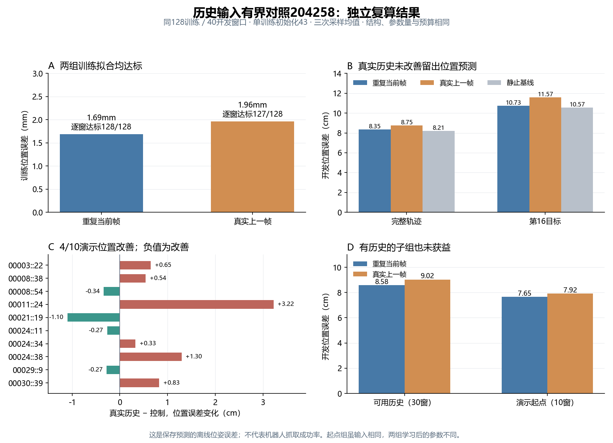

# 有界历史对照204258：独立验收完成，方案关闭

17个约定文件齐全，共10,992,554字节（约10.48MiB），未下载权重。CPU独立复算通过：输入/目标/行索引、共同初始条件、源码快照、每组8192更新/学习率/梯度日志、最终训练门槛、完整40开发窗及逐任务/演示指标均与记录在预设浮点容差内一致。位置指标最大差0.00000162cm，旋转指标最大差0.00605°；不加载模型或重新采样。[独立验收JSON](../reports/bridge_history_generalization_analysis_204258/analysis.json)、[复算入口](../scripts/analyze_bridge_history_generalization_204258.py)。

2026-10-15用户提供Slurm结果：COMPLETED/0:0，A6000，1小时30分29秒。真实历史组8192更新完成，训练平均位置1.965mm、旋转0.542°，原训练拟合门槛通过；开发40窗位置8.749cm、旋转15.614°。这是离线位姿预测，不是机器人任务成功率。[终端证据摘要](../reports/bridge_history_204258_terminal_summary.json)。

## 事前位置筛选门槛未通过

本次实际控制值已从保存预测复算，不再仅依赖旧参考的容差推断：

| 指标 | 重复当前帧控制 | 真实上一帧 | 静止基线 |
|---|---:|---:|---:|
| 训练平均位置 | 1.69mm | 1.96mm | 89.60mm |
| 训练平均旋转 | 0.60° | 0.54° | 13.88° |
| 三次采样均达标训练窗 | 128/128 | 127/128 | — |
| 开发路径位置 | 8.349cm | 8.749cm | 8.212cm |
| 开发路径旋转 | 15.256° | 15.614° | 15.099° |
| 开发第16目标位置 | 10.728cm | 11.572cm | 10.565cm |
| 开发第16目标旋转 | 20.785° | 22.101° | 19.986° |

两组整体训练拟合门槛均通过，真实历史有1窗未过逐窗三采样门槛。真实历史开发位置增加0.400cm（4.79%），旋转增加0.358°；第16目标位置/旋转也更差。只有4/10条演示位置改善，6/10条演示旋转改善，后者不能抵消整体旋转退步。

控制组**全部8192次损失**与原202278完全相同；保存的共同初始、最终训练和开发预测/目标/上下文/行索引也逐元素一致。因而本次对照并没有控制漂移；两组输入身份、初始结构和预算也一致。冻结CLIP/其他参数保护、checkpoint轮转验证仍来自执行报告/保留源码，没有本地下载权重再次核查。

| 开发子组 | 控制位置 | 真实历史位置 | 差值（正为更差） |
|---|---:|---:|---:|
| 真正有上一帧的30窗 | 8.582cm | 9.025cm | +0.442cm |
| 演示起点的10窗 | 7.649cm | 7.922cm | +0.272cm |

这不是单纯因起点窗没有历史而把效果稀释：有历史的子组也退步。起点两组评估输入相同但学习后的参数不同，其差值不能解释为起点历史槽直接改变了输入。三个采样是一个训练初始化的重复输出，窗口重叠；不做独立样本或显著性推断。

西兰花00011::24演示退步最明显，位置13.893→17.117cm，3窗贡献约60.5%的总体位置净增加。这是事后定位线索，不可删掉它改判成功；即便作为诊断计算排除该演示，其余37窗仍平均退步约0.171cm。



事前候选条件结果：位置至少改善10%失败、旋转不恶化失败、至少6/10演示位置改善失败；两组训练与控制重放条件通过。**本方案关闭，不做初始化42复核或其他帧间隔/参数扫描。**这只评价这个共享Adapter历史差分融合方案和固定预算，不证明一切历史信息都无效，或唯一根因已经确定。

下面“新控制尚未读到”的段落是收到终端日志时的历史判读，已经由上述独立完整验收取代。

当前新控制组的具体数字还未读到，不能把旧202278数字冒充新配对控制。已冻结包装器要求新控制开发位置与旧202278的8.349cm差≤0.1cm，因此退出0支持新控制在8.249–8.449cm范围。真实历史8.749cm不可能比该控制降低至少10%，即便旋转或部分演示改善，也不能满足事前候选条件。

所以按[事前有界协议](BRIDGE_HISTORY_GENERALIZATION_BOUND_20261014.md)关闭这一方案：不再加更新、帧间隔、融合宽度或初始化复核。训练拟合通过不能代替留出改善；这不是证明所有历史输入都无效，也不确定唯一CLIP/Adapter/动作头故障。下一步只取回两组保存结果，核验完整训练门槛、实际控制差值、全部40窗和逐演示/任务，以及30个真实历史窗与10个起点窗；不追加模型训练。

## 下载固定结果，不下载权重

集群Bash：

```bash
cd /projects/Zeroshot/runs
tar -czf /projects/Zeroshot/bridge_history_results_204258.tar.gz \
  bridge-history-fit-204258/report.json \
  bridge-history-fit-204258/{repeat_current,real_previous}/{report.json,plan.json,runner_snapshot.py,common_updates.jsonl,reduced_updates.jsonl,common_u0000_train.npz,reduced_u8192_train.npz,reduced_u8192_development.npz}
```

这是根报告加每组8个小文件，共17个文件；没有`.pt`、数据集或CLIP缓存。日志与预测便于独立验收更新预算、控制重放、共同初始输入/目标以及最终指标。文件原始合计约十余MiB，压缩后更小，使用既有本地空间。

本地PowerShell：

```powershell
scp zixiao005@10.97.216.128:/projects/Zeroshot/bridge_history_results_204258.tar.gz "D:/ntu_related/dissertation/Zero_shot/reports/"
tar -xzf "D:/ntu_related/dissertation/Zero_shot/reports/bridge_history_results_204258.tar.gz" -C "D:/ntu_related/dissertation/Zero_shot/reports/"
```

下载后整理本阶段的已确认优化问题、已排除的接口解释与剩余泛化限制，再另行制定单任务/同场景/完整演示留出的最小泛化目标，不直接把旧五任务路线继续扩容或混训。
