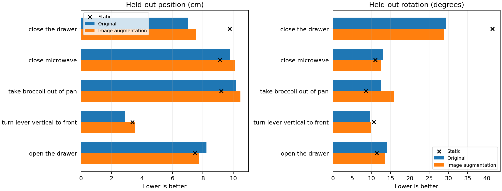

# 图像增强206915：固定预算结果（待工件复核）

**完整工件已独立核验，以下“待下载/复核”为历史记录。** 6,385,359字节压缩包、29文件（正式15＋预检14）、13预测快照、8192更新和两份增强轨迹齐全。安全解压且归档逐字节一致；继承源码/实际执行源码、原128/40标签与168原始输入、相同初始化和状态统计、原缓存评估路径匹配。正式前4步损失/梯度及增强轨迹与预检完全一致，恢复同学习率的损失/预测逐元素一致。8192批次只包含训练窗，每128窗的一个周期完整覆盖、总计每窗512曝光；所有偏移在既定范围，恢复分支重用相同偏移。未在本地逐个重新生成集群Torch2.5偏移。

保存预测float64复算通过：最大位置指标差2.85e-6cm、旋转0.000636°。主要开发结果8.49973289cm/15.76468892°，终点11.12197450cm/21.29966513°，均高于旧控制。10演示中仅4条位置优于旧控制、4条优于静止，6条旋转优于旧控制；演示等权较旧控制也退步，不能改用等权后与静止略优的数值使候选过关。主要原40窗判据保持不变，候选失败并结束。

逐任务位置仅开抽屉改善（8.2283→7.7686cm），其他四任务退步；关抽屉/关微波炉/开抽屉旋转略改善，西兰花12.3941→15.8869°退步。不能因局部改善换任务或评价规则。

实际报告计时3368.539秒、峰值保留5.074GiB、中心视图原编码差0。原缓存/冻结参数/权重回读由固定源码与运行断言检查，最终529,383,042字节非CLIP权重及实际增强编码张量留集群，未下载后独立重载。核验只读报告/数组，未运行任何新模型编码、训练、采样或仿真。

证据：[独立核验JSON](../reports/bridge_image_augmentation_analysis_206915/analysis.json)、[逐演示](../reports/bridge_image_augmentation_analysis_206915/episodes.csv)、[逐任务](../reports/bridge_image_augmentation_analysis_206915/tasks.csv)、[未来目标逐步误差](../reports/bridge_image_augmentation_analysis_206915/horizons.csv)、[审计入口](../scripts/analyze_bridge_image_augmentation_206915.py)。



## 下文为历史终端记录

用户终端：COMPLETED/0:0，gpu-a6000-1，56分43秒，8192更新结束。原40开发窗位置84.9973297mm＝8.49973297cm，旋转15.7645855°。该固定小平移增强没有改善主要泛化指标，按冻结规则结束，不追加步数、强度或种子。

| 原40开发窗主要指标 | 静止 | 原图像控制202278 | 训练图像增强206915 |
|---|---:|---:|---:|
| 路径位置/cm | 8.212326 | 8.349127 | 8.499733 |
| 路径旋转/° | 15.098500 | 15.256048 | 15.764585 |

旧控制和静止列为已独立复算的float64值，新组为终端值，完整报告与预测尚未下载独立复算。新组位置、旋转均高于旧控制和静止，也未达到事前位置≤7.391093cm、旋转≤15.118500°条件。无需等待逐演示分解再决定是否追加训练；单项候选按预算结束，后续核验只确认比较有效性和误差来源。不能删任务、改指标或用拟合门槛False作为延长理由。

最终训练位置7.296445mm、旋转2.548303°，拟合门槛False；旧控制约1.688mm/0.599°。训练误差上升并未换来本轮开发误差下降。已有128窗毫米拟合证据保留，不因这次更困难的训练设置去重复拟合。

本轮仅检验固定±8像素复制边界平移、冻结CLIP在线编码、原图评估这一配方。结果不支持它在当前预算下改善这组开发数据，不能推出所有图像增强都无效，也不能据此唯一判定CLIP或Adapter故障。它借鉴作者训练随机/评估固定原则，不是实际PushT84/96裁剪的精确复现。此处没有独立测试集、未见任务、物体定位或抓取成功结论。

## 剩余工作仅为小工件核验

当前完整报告未在本地取得，终点、各演示/任务、实际资源数值、参数冻结及增强日志待核查。将已有两份run的小报告/NPZ/源码/日志打包，不含最终PT、模型或完整token缓存，不产生新训练/编码/采样。

集群终端执行：

```bash
tar --exclude='*.pt' --exclude='*.partial' -czf /projects/Zeroshot/bridge_image_augmentation_results_206915.tar.gz -C /projects/Zeroshot/runs bridge-aug-fit-206915 bridge-aug-preflight-206895
ls -lh /projects/Zeroshot/bridge_image_augmentation_results_206915.tar.gz
```

本地PowerShell执行：

```powershell
scp zixiao005@10.97.216.128:/projects/Zeroshot/bridge_image_augmentation_results_206915.tar.gz "D:/ntu_related/dissertation/Zero_shot/reports/"
```

下载后只读核验27份原有预检/正式文件加两份增强轨迹日志（预期29个文件，须按实际源码生成清单核对），预计几MB。严禁重跑相同NN试验来生成另一份结果；文件缺失时只补取缺失的小文件。最终非CLIP权重保留集群，保持完整图像控制202278与失败增强组的可复查记录。

协议：[固定计划](BRIDGE_IMAGE_AUGMENTATION_CONTROL_20261016.md)。终端来源：[提交与结果记录](../reports/bridge_image_augmentation_submission_206915.json)。本地尚未提供全工件独立通过结论。
