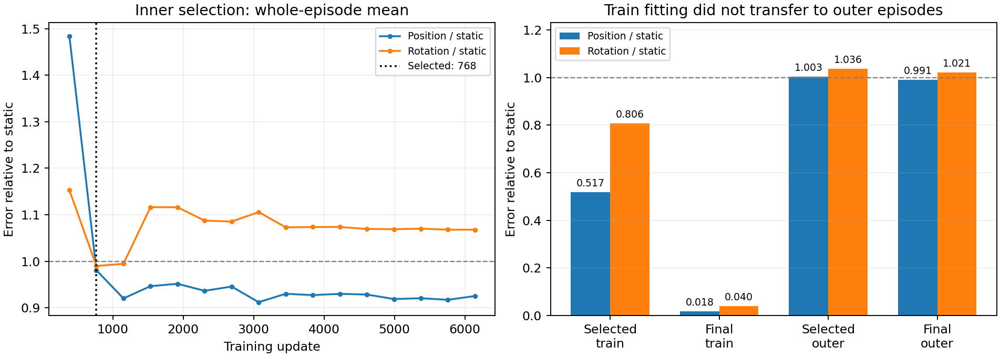

# 内部选模205997：独立复核结果与停止

**最新独立复核已完成。** 下载包5,256,944字节，32个文件齐全（正式25、预检7），共22份预测快照（内部16＋最终评分4＋预检2），归档与解压文件逐字节一致。6144步更新、学习率两阶段、初始参数身份、168原始字段身份/标签、96窗训练统计与48/16/10演示隔离均核对通过。预检与正式前4步损失/梯度日志精确一致；保存数组用float64重新评分，位置最大差1.52e-6cm、旋转0.00196°，不改变门槛或选模。没有模型加载、重编码、新推理、训练或仿真；未下载PT权重或token缓存。参数冻结与权重重载依靠运行时已通过的断言，未在本地重建未下载的权重。

已确认选中**第768步**，不是最后第6144步；16次内部评分按原固定规则确实选出该点，float64复算也同样选中768。选择锁、源码/协议指纹和保存预测一致，未发现这一版本的选模选错步、训练/留出抽样混入或指标计算错误。

| 同次权重 | 训练96窗位置 | 训练旋转 | 原40外部窗位置 | 外部旋转 |
|---|---:|---:|---:|---:|
| 内部选中768步 | 4.670305cm | 10.735068° | 8.235676cm | 15.644526° |
| 最终6144步 | 0.165993cm（1.660mm） | 0.530752° | 8.135241cm | 15.422185° |

最终96/96训练窗在3个采样种子下达到既定位姿拟合门槛，选中早期模型0/96。这里没有要求延长拟合训练；这只是复算本次已保存结果。内部演示等权位置从768步8.585858cm到最终8.100877cm改善，旋转却从15.425374°升到16.642930°，固定两指标的较差比值使768步胜出。原40外部窗没有复制其内部选模收益，两个主要路径指标都略差于最终模型。

这次进一步确认：训练过程能把实际96窗拟合好，且该固定选模规则本身按约定执行；但提前选权重没有让外部预测稳定超越静止。不能把问题简单归结为本次选择了训练终点，也不能排除其他过拟合/覆盖不足/条件泛化机制，更没有唯一定位某个故障层。固定候选按原判据结束，不修改规则、不追加种子/轮数。

证据：[独立分析JSON](../reports/bridge_inner_selection_analysis_205997/analysis.json)、[16次内部评分CSV](../reports/bridge_inner_selection_analysis_205997/inner_history.csv)、[逐窗复算](../reports/bridge_inner_selection_analysis_205997/per_window.csv)、[逐演示外部比较](../reports/bridge_inner_selection_analysis_205997/paired_outer_episodes.csv)、[复算入口](../scripts/analyze_bridge_inner_selection_205997.py)。



## 下文终端阶段记录（已完成独立复核）

最初证据来自用户完整终端摘要：205997为COMPLETED/0:0、33分22秒、gpu-a6000-1。可解析原文及SHA256见[终端数值记录](../reports/bridge_inner_selection_205997_terminal_summary.json)，该文件保留当时尚未下载的历史状态；当前结论以上方独立复核为准。

## 事前主要判据未通过

同一次96窗/48演示优化轨迹，固定6144更新；32窗/16演示内部选模，原40窗/10演示最后评分。原直接x0/DDPM100结构，冻结CLIP及夹爪，没有残差基础预测。比较选中权重与最终权重在同一个外部开发集合上的位置和旋转，要求两项主要误差均降低。

| 原40外部窗口指标 | 静止 | 最终权重 | 内部选中权重 |
|---|---:|---:|---:|
| 全路径位置cm | 8.212326 | 8.135242 | 8.235676 |
| 全路径旋转° | 15.098398 | 15.422080 | 15.644422 |
| 第16目标位置cm | 10.565334 | 10.865918 | 10.103634 |
| 第16目标旋转° | 19.986355 | 23.614828 | 21.086546 |

选中比最终的路径位置高0.100434cm、旋转高0.222342°，两项均未改善。选中模型的第16目标位置和旋转分别改善0.762284cm/2.528282°，但不能在看到结果之后把次要终点改作主要判据。其终点旋转仍差于静止。

最终路径位置仅比静止低0.077085cm（0.771mm，约0.94%），旋转和第16目标位置/旋转更差，不能据此说完整泛化修好了。选中模型路径位置/旋转均差于静止。旧128窗202278模型与本次96窗实际优化集合不同，不能用它来证明选模本身的因果收益。

## 演示权重差异也保留

选中模型有5/10演示位置优于最终、8/10旋转优于最终；但关抽屉00003::22的旋转43.629→58.835°，拖累总均值，不能只数改善演示比例。演示等权位置最终7.482480cm、选中7.452187cm略降，旋转15.087054→15.106065°略升，两项共同改善仍未成立。选中模型7/10演示位置优于静止，最终5/10，不能用这些次要统计替换冻结主要指标。

当时日志末尾仅有4992、5376、5760、6144四个内部评分，不能推断具体选中步数或训练误差。现已从selection_lock.json/report.json及保存数组确认768步选中、最终96/96训练窗通过，详见文首。终端中展示的严格拟合门槛属于外部开发评分，不是训练拟合失败证据。

当前能说的是：这一固定内部生成动作选模规则没有改善两项主要外部误差，不支持“用这项选模规则替代训练终点即可解决”的解释。不能据此排除所有过拟合/早停机制，也不能确定唯一故障模块。没有物理抓取、夹爪学习或未见任务零样本成功证据。

按事前规则结束这一6144更新候选，不加轮数、重训种子、重新挑选时间点或改变指标。现有小工件核验已经完成，不重复下载、评分或提交新训练。

## 历史下载命令（已完成，不重复执行）

集群终端：

```bash
tar --exclude='*.pt' --exclude='*.partial' -czf /projects/Zeroshot/bridge_selection_results_205997.tar.gz -C /projects/Zeroshot/runs bridge-selection-fit-205997 bridge-selection-preflight-205825
ls -lh /projects/Zeroshot/bridge_selection_results_205997.tar.gz
```

本地PowerShell：

```powershell
scp zixiao005@10.97.216.128:/projects/Zeroshot/bridge_selection_results_205997.tar.gz "D:/ntu_related/dissertation/Zero_shot/reports/"
```

只打包两份run目录的小报告/预测/日志/源码，明确排除best.pt、final.pt及临时权重；完整CLIP token缓存在别的目录，不包含在包内。不下载两份约1GB的神经网络权重，不重跑任何评分。
