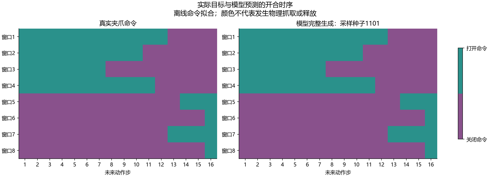

# 自己模型的位姿＋夹爪联合拟合：真实本地结果

2026-10-11，当前冻结CLIP、八层Adapter、多尺度U-Net和原夹爪头，已在小样本训练窗口上同时拟合位姿、闭合命令和打开命令。最终从纯噪声完整100步生成，平均位置1.524mm、旋转0.937°；夹爪状态准确率及平衡准确率100%，4次闭合与4次打开切换全部正确，三个采样种子一致。没有进行PyBullet抓取，不能称机器人抓取成功或泛化通过。

## 三项实际运行

| 实验 | 训练更新 | 路径位置 | 路径旋转 | 夹爪平衡准确率 | 关闭切换 | 打开切换 | 联合门槛 |
|---|---:|---:|---:|---:|---:|---:|---|
| 原8窗口，增加原夹爪监督 | 500 | 2.734mm | 2.016° | 100% | 7/7 | 没有样本 | 已有监督通过，打开能力未检 |
| 4闭合＋4打开窗口 | 500 | 1.253mm | 0.824° | 98.980% | 4/4 | 3/4 | 未通过 |
| 同一4闭合＋4打开窗口 | 1000 | 1.524mm | 0.937° | 100% | 4/4 | 4/4 | 通过 |

每次batch包含全部8窗口，每窗口暴露量等于更新次数。表中事件分母是实际窗口内事件数量，每个采样种子分别达到上述结果，不把三次采样当成三个独立事件或训练重复。1000次结果的窗口终点位置误差1.410mm、旋转0.455°，8/8窗口在所有采样种子下达到位姿门槛。

500次双方向实验只有一个错误命令：第7窗口应在第13步打开，模型在第14步才打开。总体准确率99.219%，仍未满足全部切换正确的门槛，故保留为未通过结果。1000次沿同一初始化和训练配方重放，前0/20/100/500次生成动作与前一次逐元素相同；延长训练后这一错位消失。位姿指标并非都随更新次数下降，1000次位姿略差于500次，但仍达标且夹爪切换完整通过。



## 控制及训练范围

第一项严格沿用[1e-4位姿成功配方](BRIDGE_LR_LOCAL_20261011.md)：同8窗口、同原始图像/文本/目标/当前输入、同初始CLIP/Adapter/解码器哈希、同初始生成。只启用生产train.policy_loss并允许原夹爪模块更新。数据管线、模型和损失源码未修改。

原8窗口有84个打开目标、44个关闭目标、7个关闭切换、没有打开切换，故不能仅靠它宣称完整开合能力。第二项按真实标签覆盖选择已有训练缓存索引[18,39,60,79,17,37,78,94]，前4个闭合、后4个打开；不是按预测误差挑成功样本。它们来自原已选演示中的5条演示，不是8条独立演示。起点0与后段60/68/72/76，窗口不重叠。

第二项包含49个打开目标、79个关闭目标，恒定关闭准确率61.719%、平衡准确率50%。明确增加了监督覆盖，因此它是补充正对照，不是与原8窗口的单变量因果对比。

两项均使用当前__getitem__/TFRecord解析和图像处理，目标与缓存逐元素一致，所有位姿和夹爪监督mask有效。CLIP实际离线前向提取tokens后冻结；Adapter训练dropout=0.1；当前多尺度U-Net down_dims=[256,512,1024]、x0位姿监督。Adam lr=1e-4、wd=0、恒定学习率、batch8、梯度裁剪1。原夹爪权重0.25、state目标、真实频率BCE、不加切换权重。原policy_loss在真实位姿条件下训练夹爪；成功判定使用完整生成位姿条件下的夹爪，不用真实位姿夹爪评估替代完整生成。

初始化seed42，dropout seed430000+update与动作噪声seed420000+update隔离，完整100步采样种子1101/1102/1103。一个训练初始化，不代表三个训练种子。CLIP无梯度且参数不变，Adapter、位姿解码器、夹爪有非零梯度和参数变化，其他状态未变。

位姿门槛沿用前序计划：每采样种子总体位置≤0.5cm、旋转≤5°；至少90%窗口在所有种子下窗口平均位姿达到同样门槛；每种子的总体终点位置≤1cm、旋转≤10°。夹爪门槛在首轮优化前写入计划：各采样种子状态准确率和平衡准确率≥95%，每个实际出现方向的窗口内切换对全正确；不存在的方向记未验证。

## 权重与重载核验

保留两份非CLIP FP32诊断权重，500次和1000次各501.80MiB，共约0.98GiB。CLIP复用现有离线权重，没有重复下载、没有装新包。仅1000次这份达到本次完整联合门槛：

[1000次本人模型权重](../reports/bridge_joint_both_events_1000_local_20261011/final.pt)

权重包含配置、非CLIP模型状态、监督选择和诊断标记。它有明确的bridge_single_task_offline_diagnostic标记，不是正式泛化训练或闭环验收权重。*.pt已在Git忽略规则中，本轮没有上传GitHub。

从磁盘重新加载1000次权重，核验SHA256、Adapter/解码器参数哈希和冻结CLIP哈希；只缺失外部冻结CLIP参数，没有其他缺失或额外键。重新读取8个原始TFRecord图像，执行真实CLIP→Adapter→完整扩散采样。采样seed1101时上下文与动作的最大逐元素差异均为0，开合命令一致。首次核验遗漏了训练使用的deterministic选项，触发数值重放断言；对齐计算设置后通过，没有放宽误差门槛或改动模型权重。

- [首轮同8窗口联合报告](../reports/bridge_joint_gripper_local_20261011/report.json)
- [500次双方向未通过报告](../reports/bridge_joint_both_events_local_20261011/report.json)
- [1000次完整报告](../reports/bridge_joint_both_events_1000_local_20261011/report.json)
- [保存预测独立核算](../reports/bridge_joint_both_events_1000_local_20261011/independent_metrics.json)
- [参数与源码核验](../reports/bridge_joint_both_events_1000_local_20261011/verification.json)
- [权重重载及原始图像完整预测核验](../reports/bridge_joint_both_events_1000_local_20261011/reload_report.json)

三项训练在本地RTX4060 Laptop运行，分别约115.9/119.5/225.1秒，优化阶段峰值保留显存约2.957GiB，不包括CLIP提取阶段。此次报告和图不到数MiB，主要新增空间是两份上述权重；D盘剩余约69.4GiB。

## 已确认及下一步

确认当前动作预测链在这个小样本设置中可以联合学习，含两个方向的精确开合时序；不支持“这些模块组合完全无法学习”的判断。未确定全量任务失败唯一根因，未验证泛化、语言判别、物体定位、完整随机DataLoader或物理接触。

这些演示的任务是sweep into pile，不是Panda抓方块放盘。现有Panda评估器固定语言为pick up the black object and place it on the blue plate；连续实测夹爪输入也与其上一条命令输入不同。具体接口：eval_closed_loop.py在第402/421/438行初始化和输入上一条命令，而dataset.py第1615–1620行计算Bridge实测值2*observed_opening-1。当前闭环加载器明确拒绝此类Bridge离线诊断权重，避免把未验收接口误当任务成绩。

下一步转到一个固定PyBullet抓取场景，先把该场景的相机、实测夹爪输入、末端相对位姿及执行时长对齐，建立同场景抓取训练演示，再用这套已经成功的模型配方进行训练集闭环正对照。原有CLIPort专家回放仅是执行链证据，不能用它代替本人模型闭环动作。此阶段尚未执行；不要把本次时序图当仿真画面。

复用最终实验时使用新的输出目录：

```powershell
D:\miniconda\envs\zeroshot-gpu\python.exe code/fit_bridge_adapter_pair.py --comparison exposure --learning-rate 1e-4 --train-gripper --selection-json reports/bridge_joint_gripper_local_20261011/both_event_selection.json --updates 1000 --save-checkpoint --output reports/bridge_joint_both_events_new
```
