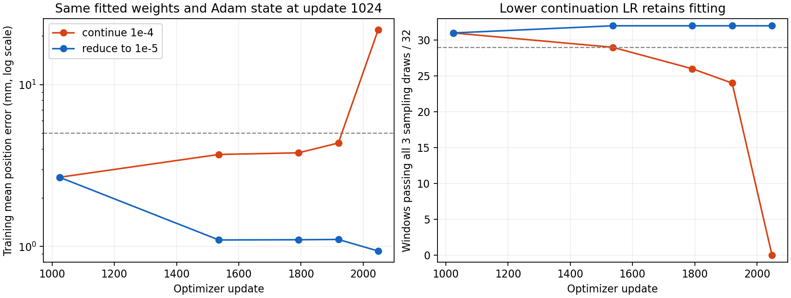

# 后期学习率对照：训练拟合稳定性得到改善

后续状态：200208的42/44完整文件已独立核验，两个降低组在四个继续训练观测点均32/32达标，原控制预测逐元素复现；[三初始化复核结果](BRIDGE_LATE_LR_REPLICATION_RESULT_200208_20261012.md)。下文单初始化描述和“下一步复核”保留为200150的历史阶段。

作业200150的报告、13组预测和3份逐步日志已独立核验。当前只完成一个训练初始化seed43，三个采样种子不是三次训练。结论是降低后期学习率消除了这次运行的拟合退化，并进一步降低训练误差；泛化未改善。

## 同一状态分叉的实际结果

前1024次共同训练使用lr=1e-4，平均路径误差2.676mm/1.429°、31/32窗口达标。之后，两组使用相同参数、完整Adam动量及step计数、相同窗口顺序、全局dropout/动作噪声种子和采样器，仅将降低组的学习率改为1e-5。

| 更新次数 | 原学习率：位置mm/旋转°；达标窗 | 降低学习率：位置mm/旋转°；达标窗 |
|---|---|---|
| 1024，共同状态 | 2.676 / 1.429；31/32 | 2.676 / 1.429；31/32 |
| 1536 | 3.703 / 1.794；29/32 | 1.097 / 0.407；32/32 |
| 1792 | 3.791 / 2.154；26/32 | 1.100 / 0.398；32/32 |
| 1920 | 4.359 / 1.612；24/32 | 1.105 / 0.390；32/32 |
| 2048 | 21.856 / 5.242；0/32 | **0.937 / 0.344；32/32** |

门槛保持原定义：各采样种子的总体路径平均≤5mm/5°、终点平均≤10mm/10°，至少90%窗口在全部三个采样种子下各自的路径平均≤5mm/5°。低学习率组在全部四个后续观测点均通过完整门槛；最终所有32窗口的位置误差都比原学习率组低。

低学习率组最终窗口终点平均误差1.284mm/0.333°。CPU float64重算得到最终最差窗口的平均位置误差1.541mm，全部已保存的三个采样输出中，单个目标位置误差最大3.006mm。这些仅描述本次保存的预测，不保证其他采样种子、任意目标或闭环执行达到同样精度。float64旋转平均为0.347°，与原生float32的0.344°相差约0.003°，属于小角度四元数指标计算精度差异，没有修改预测。

## 因果证据与边界

报告记录的共同参数SHA256和共同Adam状态SHA256在两组一致；分叉后的首步loss及全部模块梯度相同，变化首先来自不同学习率的参数更新。共同0/512/1024预测与200039逐元素一致；原学习率组1536和2048训练预测及最终开发预测也逐元素重现200039。不是不同随机失败的一次碰巧成功。

本实验支持：在当前固定32窗口、seed43和优化配方下，后期保持lr=1e-4会失去原先拟合，而降低到1e-5足以保住并改善训练位姿生成。不能因此宣布全量训练的唯一根因已确定，也不能认定Adapter或U-Net中的某一层损坏。两个模块仍联合训练，夹爪被冻结。

这种对照是在同一个已经拟合的状态之后干预，不能与从初始化开始使用不同学习率的旧8窗口实验混为一谈。

## 留出集仍未改善

| 最终开发指标 | 原学习率 | 降低学习率 | 静止基线 |
|---|---:|---:|---:|
| 路径位置cm | 8.716 | 8.963 | 8.212 |
| 路径旋转° | 18.187 | 19.067 | 15.098 |
| 窗口终点位置cm | 10.670 | 11.101 | 10.565 |
| 窗口终点旋转° | 22.698 | 25.818 | 19.986 |

开发集为反复用于诊断的10条演示、40窗口，不是未触碰最终测试。降低学习率组只有3/10条演示的位置误差比原学习率组低，总体位置/旋转指标均未改善。没有做统计显著性结论。中途未评估开发集，也不能由训练误差下降推断中途泛化变好。

当前可以分别确认“有一项有效的训练稳定性干预”和“独立演示预测仍然不够好”。本轮不运行仿真，不测抓取成功率；窗口终点是第16个监督目标，不是任务最终物体位置。

## 下一步

复核初始化42和44，保持本次共同1024次分叉和两种学习率不变。它们原来的最终训练状态分别是25/32和31/32达标，特别是seed44的原学习率组本来就通过，不能强制要求控制组失败才算复现。

[复核包、已通过的本地预检及集群提交命令](BRIDGE_LATE_LR_REPLICATION_20261012.md)已执行，完整42/44复核200208已独立核验；不再重复提交。

只有这些训练初始化复核后，才决定是否把这项修正作为固定训练设置。泛化需在稳定设置下单独检查覆盖、条件信息和训练/留出分布；本轮不通过换样本筛选来扩大成功结论。

## 核验、资源与文件

上传包源码、清单和执行快照哈希匹配；72窗口身份及同集群处理结果与200039匹配，各预测文件标签一致。全部13组预测的路径/终点指标、逐窗口状态和完整门槛由CPU NumPy float64独立复算。每组后1024次训练每窗口恰好256份抽样；所有逐步模块梯度有限且非零，CLIP/其他冻结参数未改变。

集群GPU为RTX A6000，耗时952.92秒，峰值保留显存3.822GiB。三个可训练参数检查点共2,646,598,193字节，约2.46GiB，保存在集群；本地未下载PT。共同1024次检查点保留完整Adam，可供后续受控干预复用。检查点哈希与读回验证由集群报告记录，本地未读取其实际文件，因此不能声称已在本地复核权重字节。

- [正式原始报告](../reports/bridge-late-lr-fit-200150/report.json)
- [独立核验与指标](../reports/bridge_late_lr_analysis_200150_20261012/analysis.json)
- [曲线表](../reports/bridge_late_lr_analysis_200150_20261012/history.csv)
- [逐窗口表](../reports/bridge_late_lr_analysis_200150_20261012/windows.csv)
- [逐演示开发指标](../reports/bridge_late_lr_analysis_200150_20261012/development_episodes.csv)
- [CPU复算脚本](../scripts/analyze_bridge_late_lr_pair_200150.py)

复算：`D:/miniconda/envs/ee6483/python.exe scripts/analyze_bridge_late_lr_pair_200150.py`。
