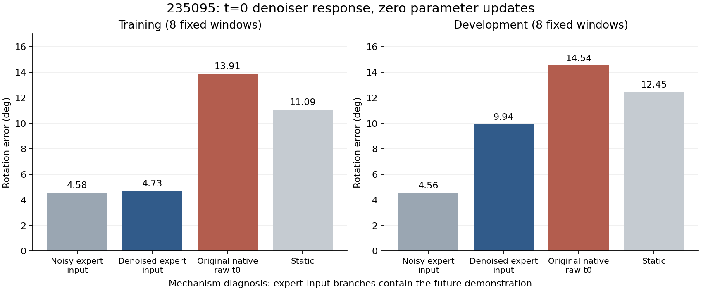

# 235095：低噪声扰动被压低，局部重建偏差仍在

2026-10-30。两文件小包82023字节，SHA`3607b528c45e6af2f68ee9ca14859902ffbd9a1cdf0099434c1c109b3fe6bc87`与日志匹配，ZIP成员与解压内容逐字节相等。当前0更新诊断已完成并收口，不自动追加训练、采样或其他诊断。

## 本次回答了什么

同一234100完整Bridge+x0端点、相同16个固定条件，在eval模式下仅比较t0。新增输入是正确未来7维位姿按原训练公式加小噪声，原生生成末端raw t0输出来自已完成235002，不重新采样。

六组高斯的四元数部分与235002原初始噪声逐值匹配；模型参数、梯度/Adam不变由集群守卫支持。下载后原生t0输出、目标/mask、高斯及前向输入公式复核通过，全部逐窗/均值/区间/分量MSE由独立SciPy与NumPy实现重算一致。

固定条件为训练前8窗、开发前8窗；原3噪声draw，不是3个训练seed。新增训练式输入本身含专家未来轨迹，**不能当作部署策略、零样本评估或新成功率**。完整7维输入一起改变，未单独隔离旋转输入与位置输入的影响。

## 1 接近正确轨迹时，模型没有稳定改善旋转误差

| 旋转误差 | 训练8窗 | 开发8窗 |
|---|---:|---:|
| 加噪专家输入 | 4.576° | 4.564° |
| 模型对该输入的去噪输出 | 4.734° | 9.943° |
| 235002原生raw t0输出 | 13.911° | 14.537° |
| identity不动参照 | 11.093° | 12.447° |

输出减带噪输入：训练+0.158°，8窗中仅3窗改善，95%配对组区间[-1.640°,1.767°]跨0；开发+5.380°，7/8窗变差，区间[2.484°,8.152°]为正。

训练式输出相对原生raw t0则全部8/8窗更好，两组差值-9.177°/-4.593°，区间分别[-17.783°,-3.594°]、[-7.835°,-2.350°]。这说明实际生成路径中的输入偏差仍然相关，但**不能由“比原生结果好”推断正确附近的局部去噪已可靠**。

训练式输出虽比identity更接近专家，输入已包含未来专家信息，所以这种优势不是新策略能力证据。没有改234100的128/64窗评估或原联合gate。

## 2 输出稳定了，但稳定残差保留下来

对三条既有输出的原始四元数分量MSE作精确有限样本分解：

`三抽样总误差 = 三抽样均值到真值的残差 + 三抽样内波动`。

| 描述量 | 训练8窗 | 开发8窗 |
|---|---:|---:|
| 三条带噪输入的平均两两角距 | 6.267° | 6.563° |
| 三条去噪输出的平均两两角距 | 0.606° | 0.539° |
| 输出MSE中三抽样内波动占比 | 0.636% | 0.130% |
| 输出MSE中三抽样均值残差占比 | 99.364% | 99.870% |

输入的随机差异被明显压低，同时去噪输出出现共同偏离真值的残差，开发窗更严重。这支持“此低噪声邻域有稳定重建偏差”的描述，不支持仅靠多抽种子消除本批残差。

这里是原始四元数**分量平方误差**在有限3次draw上的代数分解，不是角距的可加分解，不是梯度贡献，也不是跨训练seed的总体bias/variance估计。不能将输出对这3个扰动较不敏感扩大为模型完全忽略输入。

## 3 局部重建问题也涉及位置

| 位置误差，归一化源记录单位 | 训练8窗 | 开发8窗 |
|---|---:|---:|
| 加噪专家输入 | 0.03981 | 0.04110 |
| 去噪输出 | 0.06091 | 0.06650 |

因此，这批局部t0重建偏差不能只归因于一个四元数后处理函数。以上是接近真值的输入参照；234100完整采样的训练位置优于不动结论继续保留，二者的问题与基线不同。

按原生有效元素/批次分母计算的eval pose MSE：训练0.0012468（xyz贡献0.0008193、四元数0.0004275），开发0.0023166（xyz0.0008449、四元数0.0014717）。这些是此t0/eval/专家加噪输入下的数值损失分量，不是原全训练噪声时域loss或梯度占比，不据此确定一个新旋转权重。

## 结论收敛

连同已有证据，当前可保留以下判断：

1. 234100完整单源训练有位置学习正证据，但旋转联合能力尚未通过。
2. 235002显示原生生成后段的原始旋转方向误差增大，未见对应的范数塌陷、末端单位化或明显随机噪声倍数错误。
3. 235095进一步显示：即使输入来自“正确示教附近”，低噪声局部重建也不稳健，开发窗被明显拉偏；仅把问题归结为生成输入漂移不够。
4. 随机扰动被压低而稳定残差保留，不能据此只改采样种子、做平均或更强单位化，也不能直接宣称换某种损失即可修复。

后续应评审针对**低噪声局部重建偏差及其开发泛化**的受控修复，明确单变量、对照和固定预算；不再重复上述已关闭的只读诊断，也不自动安排训练/变体或LIBERO。当前结果没有隔离容量、条件利用、时间步权衡、联合监督等因素的唯一原因。

报告主体计时48.78秒、reserved2.291GiB，不含排队和开始计时前的CPU准入。完整权重未本地下载，其身份不变由集群验收支持；无sacct最终态。

独立复算：`../reports/bridge_low_noise_pair_235095/independent_array_audit_20261030.json`。

CPU工具：`../tools/audit_bridge_low_noise_pair_235095.py`。本次本地0模型调用、0采样、0更新、0GPU，原数组/模型/gate未变。
