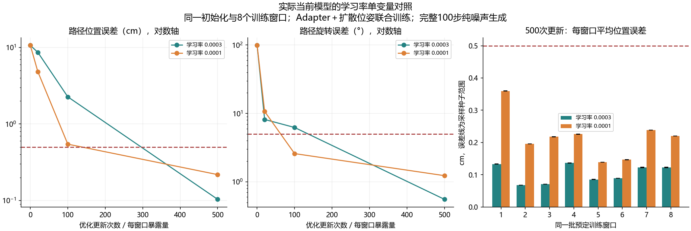

# 当前模型的学习率单变量对照

2026-10-11实际本地运行：将成功小样本配方的恒定学习率从3e-4改为1e-4，同一8窗口训练500更新，两组都通过位姿生成门槛。因此，1e-4本身没有阻止这批小样本拟合；不能单独把此前全量失败归因于这个学习率，也不能根据本次决定哪个学习率泛化更好。

## 真实结果

每次全部8窗口进入batch，每次更新每窗口出现一次。评估使用完整100步扩散采样，从纯高斯动作噪声开始，不向采样器提供真实目标轨迹。

| 学习率 | 每窗口暴露次数 | 路径位置误差 | 路径旋转误差 | 全部三采样种子逐窗口达标 |
|---|---:|---:|---:|---:|
| 3e-4 | 20 | 8.632cm | 8.169° | 0/8 |
| 1e-4 | 20 | 4.827cm | 10.698° | 0/8 |
| 3e-4 | 100 | 2.262cm | 6.234° | 0/8 |
| 1e-4 | 100 | 0.545cm | 2.589° | 5/8 |
| 3e-4 | 500 | 0.103583cm（1.036mm） | 0.555° | 8/8 |
| 1e-4 | 500 | 0.217973cm（2.180mm） | 1.232° | 8/8 |

1e-4组500次的窗口终点误差为0.326728cm（3.267mm）/1.082°，也达到门槛。100次时1e-4更好，500次时3e-4更好，不支持“学习率更大总是学得更快”或“改回1e-4一定学不会”的解释。



## 单变量核验

3e-4基线使用[上一轮实际暴露量实验](BRIDGE_EXPOSURE_LOCAL_20261011.md)保存的完整报告和各阶段预测，本次实际重新训练1e-4组。两组不是把同一份结果改标签。

对照计划除learning_rate外逐项一致：八个预定训练窗口、原始图像/文本/目标/当前输入、CLIP tokens、初始上下文、模型配置和所有初始参数哈希一致。当前models/adapter/dataset/diffusion_decoder等源码哈希相同；只扩展已有诊断入口的学习率参数，未修改生产模型。

初始化seed42；训练时Adapter dropout=0.1；Adam、wd=0、batch8、恒定学习率、梯度裁剪1、x0位姿MSE、500更新。CLIP及夹爪参数冻结，Adapter和解码器联合更新。dropout和动作噪声分别按430000+update、420000+update播种，采样种子1101/1102/1103。两组初始生成、首步损失完全一致；首步损失都为0.4440075457。

从0/20/100/500次保存预测独立重算两组的路径误差、窗口通过数量和完整门槛，均与报告一致。CLIP和夹爪参数未变，Adapter和解码器有非零梯度且参数改变。只有一个训练初始化，三个采样种子不等于三个训练种子；CUDA注意力反向有非确定性提示，不承诺跨平台最终权重逐元素一致。

门槛保持开跑前既有定义：每采样种子的总体平均位置≤0.5cm、旋转≤5°；至少90%窗口在所有种子下窗口平均位姿达到相同门槛；各种子的总体终点平均位置≤1cm、旋转≤10°。不是逐动作点最大误差或机器人任务成功判据。

## 结论范围及下一步

当前八层Adapter与多尺度扩散位姿头在开启dropout、使用1e-4时同样能记住这些训练窗口。之前全量实验还使用AdamW及权重衰减、cosine退火、batch2、夹爪联合损失和更大多任务数据；这些差异尚未对齐。当前成功只涉及位姿小样本记忆，未证明夹爪切换、泛化、语言判别、物体定位或PyBullet操作。

后续已实际完成原八窗口的夹爪联合拟合，位姿与7次关闭切换同时达标。另补充4关闭＋4打开窗口，500次时有一次打开晚一步，保持配方延长至1000次后两个方向切换全对且位姿仍达标。详见[本人模型的联合学习证据](BRIDGE_JOINT_GRIPPER_LOCAL_20261011.md)。这些仍是离线训练集正对照，未运行仿真。

## 证据和资源

- [实际训练报告](../reports/bridge_lr_local_20261011/report.json)
- [开跑前计划](../reports/bridge_lr_local_20261011/plan.json)
- [两组预测独立指标](../reports/bridge_lr_local_20261011/independent_metrics.json)
- [单变量、初始条件及源码核验](../reports/bridge_lr_local_20261011/verification.json)

本地RTX4060 Laptop GPU、PyTorch2.11.0+cu128，耗时114.094秒；优化阶段峰值保留显存2.953GiB，不包括先前CLIP提取阶段。新增约0.32MiB，没有下载数据/权重，没有保存新的大型checkpoint。

复用命令，使用新的输出目录：

```powershell
D:\miniconda\envs\zeroshot-gpu\python.exe code/fit_bridge_adapter_pair.py --comparison exposure --learning-rate 1e-4 --output reports/bridge_lr_local_new
```
