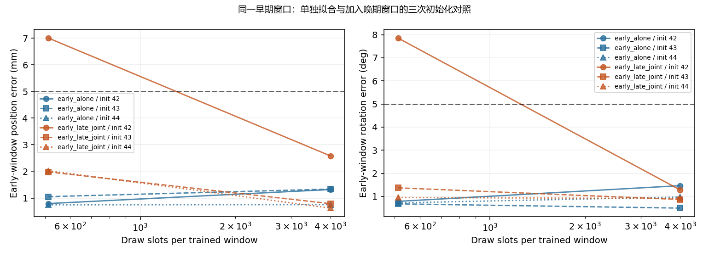
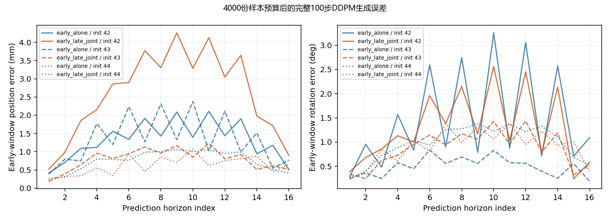

# Bridge同演示最小拟合对照

于2026-10-11启动、10-12完成。三个独立初始化的六个训练运行及全部原生DDPM生成评估已完成，实际预测独立核验通过。

执行前固定的诊断：`bridge_data_v2-train.tfrecord-00008-of-01024::25`，任务 `close microwave`，早期起点0与晚期起点12。此前早期窗口在32/64窗口集合中分别约7.87/7.24mm位置误差，而晚期窗口可较好拟合。只读原始演示审核没有发现这批目标的坐标转换错误或完全相同的冻结视觉Token。

## 固定设计

- 单独组：只训练起点0。
- 联合组：起点0、12交替训练。
- 三个模型初始化种子42、43、44；每个初始化的两组从完全相同的参数开始，优化器分别重新创建。
- 复用此前8层Adapter、冻结CLIP、多尺度x0 U-Net和重复当前图像的两次Adapter调用及历史投影；不替换层结构。历史投影W零初始化，评估时重复图像上下文差为零，训练时两次独立dropout仍保留。
- Adam，固定1e-4，无权重衰减，梯度裁剪1，位姿x0 MSE；夹爪及CLIP冻结。
- 训练批次大小8：同一窗口8个副本，每份噪声/dropout独立。早期窗口的噪声/dropout键在两组共享；联合组插入晚期批次，用另一组固定键。
- 每窗口64次批次更新即512份样本时评估；预先固定继续到500次批次更新即4000份样本，全部组均完成，不能看到结果后挑预算。
- 每次评估使用原生完整100步DDPM，三个采样种子1101/1102/1103。从纯噪声生成，不用带有真实动作信息的输入判断生成能力。

同一批次的8个样本副本不等于8个独立演示。512份预算接近此前每窗口487至518次抽样，但此次批次组成及总优化器步数不同，因此不能把与旧32窗口的差异解释成单一因素效果。联合组的总优化器步数是单独组的两倍；当前对照匹配的是每窗口样本预算、批次大小与初始化。

评估始终同时生成两个输入的输出，保持早期窗口的GPU形状和随机数位置。单独组未学习的晚期输出明确标记为非训练目标，不纳入该组拟合门槛，不作为泛化实验。

## 预先固定门槛

每个采样种子的训练窗口路径平均位置≤5mm、旋转≤5°；至少90%训练窗口在全部采样种子下达标（一个窗口须1/1，两个窗口须2/2）；各采样种子的训练窗口平均终点位置≤10mm、旋转≤10°。三个初始化全部通过才报告复现通过，同时公开每个初始化和检查点。

## 预定解释分支

单独可拟合、联合明显受损时，优先检查条件区分与优化干扰。单独仍不能拟合时，优先检查该轨迹的表示/损失/优化学习难度。两组均能拟合时，回到更大窗口集合的条件区分和训练干扰。这些分支用于缩小范围，不直接证明某层损坏。

本实验没有留出数据、仿真、夹爪训练或成功率评估。CUDA注意力反向运算存在非确定性提示，使用三个初始化减轻一次结果的不稳定性，不把配对种子当成逐位相同的训练保证。

## 执行证据

- [执行计划](../reports/bridge_minimal_pair_fit_20261011/plan.json)
- [训练与实际生成报告](../reports/bridge_minimal_pair_fit_20261011/report.json)
- [预检报告](../reports/bridge_minimal_pair_preflight_20261011/report.json)
- [运行脚本](../code/check_bridge_minimal_pair.py)

资源预检约3.8GB峰值保留显存，配对初始化及首步损失一致、固定种子重放一致。只保存报告、实际预测、最终小型上下文向量和源码快照，没有大型检查点或新下载。

## 完成结果

512份样本预算时，单独组三个初始化全部通过；联合组两个初始化通过，种子42的早期窗口为7.002mm/7.853°，未通过。因此加入另一阶段会在部分初始化下拖慢拟合，不能概括成联合训练必定失败。

按预定计划继续到每窗口4000份样本后，六个运行全部通过。下表位置是路径平均误差，来自保存预测的独立float64重算；每个单元格均是三个扩散采样种子的平均。

| 初始化 | 单独组：早期位置/旋转 | 联合组：早期位置/旋转 | 联合组：晚期位置/旋转 |
|---|---:|---:|---:|
| 42 | 1.320mm / 1.463° | 2.581mm / 1.280° | 0.232mm / 0.307° |
| 43 | 1.336mm / 0.493° | 0.790mm / 0.866° | 0.216mm / 0.277° |
| 44 | 0.754mm / 0.972° | 0.624mm / 0.910° | 0.424mm / 0.267° |

每个训练窗口在各初始化的三个采样种子下均通过原有门槛，并通过终点检查。单独组早期终点误差约0.411至0.767mm，联合组早期终点约0.509至0.898mm。单独组没有训练的晚期输出保持很差，未纳入该组通过结论；这也提醒不能将单窗口记忆当成其他时刻的预测能力。

## 现在能确定什么

1. 此前反复失败的早期窗口，在当前结构和配方下可以记住；两条不同时刻的目标也能同时学好，三个初始化均复现。这不支持“该轨迹在当前模型中根本无法表示/学习”的解释。
2. Adapter、位姿U-Net和历史投影均获得梯度并改变参数，CLIP和其他冻结模块保持不变；使用的是原始图像输入、生产目标转换和完整100步DDPM生成。因此，这套链条具备此小范围下的拟合能力。
3. 加入晚期窗口造成的初期困难可以被后续训练克服，且对初始化有影响。这是优化速度/训练相互影响的证据，尚不能定位某一层或某个公式为根因。

这次没有修复泛化问题，也没有复现全量训练约10cm的失败。4000份预算高于之前约500次抽样，批次采用同窗口副本，因而不能把最终改善全部归因于减少窗口数量，也不能直接得出“全量再加轮数即可”。小样本拟合不能证明硬件时间同步、监督动作语义、夹爪、机器人执行或全部数据集处理都正确。

## 下一项控制变量检查

回到此前失败的相同32个窗口，固定数据、模型初始化、总更新次数和每窗口样本预算，仅比较混合窗口批次与同窗口副本批次。这样检验批次组织和共同训练干扰能否解释拟合差异。该后续实验本轮尚未执行；保留当前结果作为模型可学习的正对照。

## 核验与资源

独立重算12份检查点预测的位移、四元数角度、终点和窗口通过判定，全部与报告吻合。float64重算与运行时float32位置指标最大差约0.00000233cm，旋转最大差约0.01453°，不改变门槛判定。检查三个初始化参数哈希互不相同、每对相等，首步损失相等；种子42与预检的初始参数、首步损失和初始生成指标一致。原始目标与已保存目标逐元素相等，生产源码及执行快照哈希一致。

正式运行约25.05分钟，峰值保留显存3.805GB。预检、训练、预测、图表及日志合计约0.75MB，没有新下载或大检查点。

- [独立核验及逐窗口指标](../reports/bridge_minimal_pair_fit_20261011/verification.json)
- [独立核验/绘图脚本](../reports/verify_bridge_minimal_pair.py)
