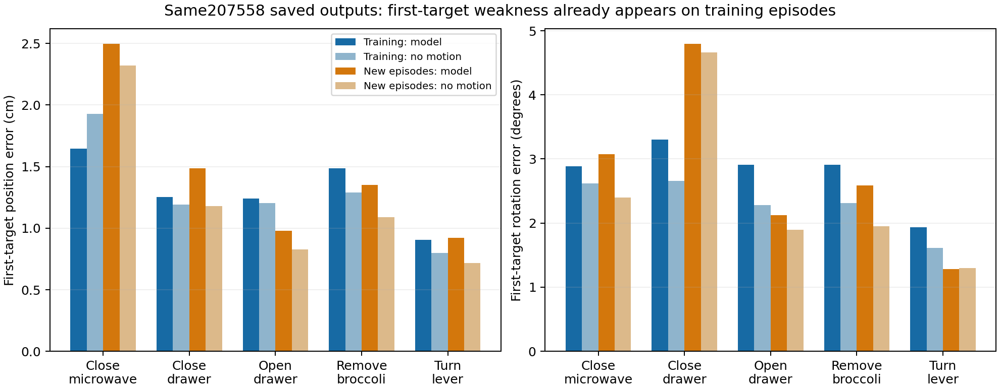

# 近端动作：训练记录也有小位移过度运动，新演示进一步恶化

只复用207558已有训练预测与209481保存的原207558新开发预测，无模型/权重加载、原数据读取、训练或采样。训练NPZ的SHA与历史已验收207558清单一致，1836行索引与原训练清单一致，405训练演示和新10开发演示不交叉。没有再做一次拟合实验。

## 计权对齐后的第一目标

训练五任务演示数不同，新开发每任务两条。以下均采用五任务等权、每任务内演示等权，以减少任务比例造成的混淆；场景/演示/窗口分布仍不同，不是因果匹配实验。

| 第一目标指标 | 训练集模型 | 训练集不动 | 新开发模型 | 新开发不动 |
|---|---:|---:|---:|---:|
| 平均位置距离cm | 1.306 | 1.282 | 1.446 | 1.227 |
| 平均旋转角度 | 2.787 | 2.297 | 2.774 | 2.440 |
| 平方位置距离cm² | 2.572 | 2.878 | 3.132 | 2.486 |

按平均厘米，训练第一目标只是略差于不动（约0.24mm），不能夸大成显著失败；四个训练任务平均位置未胜不动，五任务旋转均未胜不动。新演示第一目标位置五任务均未胜不动。

**关键限定：按平方位置距离，训练模型反而比不动低约10.6%。** 因此不能说训练第一步完全没有学到东西，或只凭平均厘米就证明优化出错。该平方距离是最终采样XYZ的统计，既不是加噪去噪训练loss，也不含四元数分量。到了新开发，平方位置距离也比不动高约26.0%，近端泛化差距仍存在。所有原完整16采用标准保持不变，不通过换指标让209481候选过关。

全16任务等权训练模型4.9997cm/12.1264度，相应不动8.1833cm/13.4443度；新开发5.9863cm/13.7815度，不动8.1106cm/15.5170度。整体轨迹和第一目标不能混为同一结论。这是1836窗当前大训练模型，不是此前32/64/128窗的毫米级拟合权重。

## 最清楚的样本模式：实测下一步很小时仍输出接近1cm动作

以下按真实下一步位移作事后描述分组，所有窗口都保留，组加权可精确还原总体。用未来真值分组仅用于诊断，部署时不能据此决定停/走；0.5cm不是已验证的控制阈值，也不是语义阶段标签。

| 真实下一步位移 | 训练窗数 | 训练模型误差cm | 训练不动cm | 新开发窗数 | 新开发模型误差cm | 新开发不动cm |
|---|---:|---:|---:|---:|---:|---:|
| <0.5cm | 520 | 0.867 | 0.152 | 13 | 0.968 | 0.160 |
| 0.5至1cm | 317 | 0.827 | 0.760 | 9 | 0.878 | 0.766 |
| 1至2cm | 569 | 1.218 | 1.439 | 18 | 1.391 | 1.366 |
| ≥2cm | 430 | 2.298 | 2.883 | 10 | 2.808 | 2.913 |

最低位移组，训练平均真实位移0.152cm、模型输出位移0.879cm；新开发真实0.160cm、模型输出0.969cm。这是当前记录中明确的小位移过度运动模式，训练和新开发同时出现。训练大位移组则有平均距离收益，与平方距离更重视大偏差的现象一致，但不能据此证明哪个损失或模块是唯一原因。

新开发1至2cm组不再有训练中的优势；≥2cm组平均距离仅略好不动，而平方距离更差。这提示额外泛化/大误差问题也不能忽略，不能把所有问题都归结于低位移窗口。

## 下一项建议与停止边界

最有依据的下一项是**针对这些低位移输入核对监督与时间语义**：实测微动是否对应真实保持、控制等待/滞后，原始画面和当前状态是否包含足够线索。先核对已有审计覆盖，使用固定少量训练/开发记录的原始动作和相邻状态作为诊断；不重新运行全套几何、CLIP、噪声表或旧历史训练。不假设原始action的单位、坐标或含义可与state差直接相减，不按效果搜索一个时间偏移改标签。

当前没有证据直接指定新网络、动作幅度阈值、标签改写、近端加权或历史融合；故不提交GPU训练。不在部署时读取真实下一步来强制静止，不删除低位移窗口，也不以此改变原模型/候选的评价判决。25最终数据仍关闭。

这是可观察误差模式及后续审查方向，尚非已确认的泛化根因或修复。离线专家轨迹差异也不直接等于动作不可执行/抓取失败。

结果：[统计JSON](../reports/bridge_near_train_development_20261018/analysis.json)、[逐任务对比](../reports/bridge_near_train_development_20261018/per_task.csv)、[小位移分组JSON](../reports/bridge_near_train_development_20261018/small_motion.json)、[分组CSV](../reports/bridge_near_train_development_20261018/small_motion.csv)。

