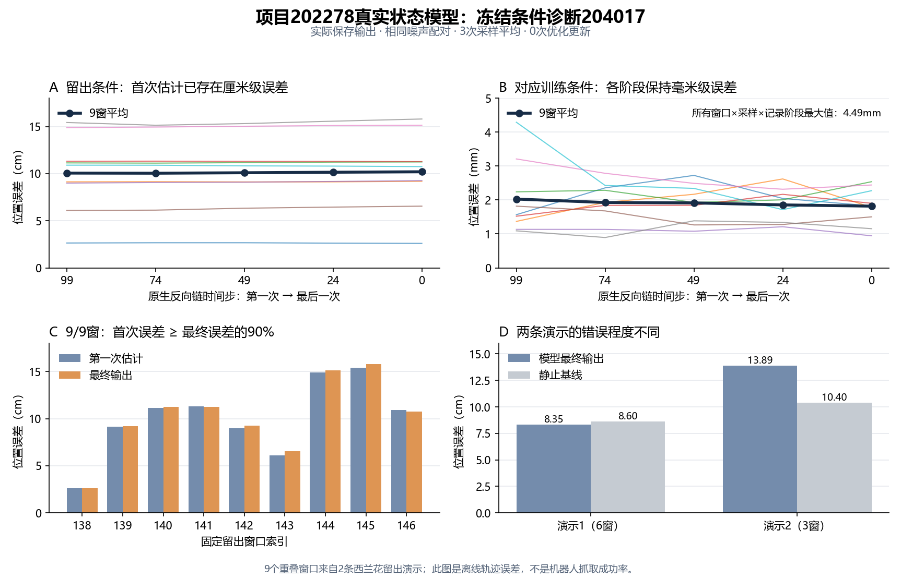

# 项目冻结条件诊断204017：独立复算完成

report.json和predictions.npz已下载并齐全，共387,847字节。独立CPU复算通过：协议/本地可得依赖的哈希、固定9对索引、原/近邻目标与融合条件、完整40窗重放、全部逐窗及原始/裁剪x0阶段指标均一致。未下载权重、加载模型或重新采样。[独立分析JSON](../reports/bridge_project_condition_analysis_204017/analysis.json)、[复算脚本](../scripts/analyze_bridge_project_condition_probe_204017.py)。参数/缓冲区、配对RNG、未选行保护来自集群报告与冻结工具实现，未下载检查点或保存全部干预未选行输出做第二次独立核查。

用户日志显示：COMPLETED，退出码0:0，A6000，耗时3分09秒。本次更新数0。原40开发窗口、三个采样种子1101/1102/1103的原预测重放最大分量差均为0。[日志结构化摘要](../reports/bridge_project_condition_204017_terminal_summary.json)。

以下是固定9对西兰花有效观察、三个配对采样的干净轨迹估计平均误差，不是全部40开发窗口的平均值。原条件和训练近邻条件各自与自己的专家目标比较；换了观察和目标不是泛化修复。

| 原生降噪时间步 | 留出条件位置误差 | 留出条件旋转误差 | 训练近邻条件位置误差 | 训练近邻条件旋转误差 |
|---|---:|---:|---:|---:|
| 99，第一次估计 | 10.056cm | 12.347° | 2.027mm | 0.730° |
| 74 | 10.044cm | 12.253° | 1.926mm | 0.718° |
| 49 | 10.091cm | 12.283° | 1.914mm | 0.663° |
| 24 | 10.148cm | 12.343° | 1.856mm | 0.589° |
| 0，末次估计 | 10.197cm | 12.394° | 1.819mm | 0.632° |

在这组观察对中，留出条件误差在第一次x0读出已经约10cm，后续位置误差仅净增0.141cm，旋转仅净增0.047°；训练条件从最初约2mm保持到最后。两种条件的第一次输出已经相差10.956cm，末次为11.070cm。这些是配对输出变化，不是误差改善。

当前证据不支持把这组留出错误主要解释为“本来准确的轨迹被后续反向链破坏”，也不支持“扩散头完全不响应条件”。故障线索收敛到**新观察条件下的首次动作轨迹读出不足**。这仍不能区分冻结CLIP表征、Adapter融合的可迁移性、状态/任务覆盖与动作头对新条件的映射，也不能定位唯一U-Net层。

这与较早的大规模短预算模型的生成链恶化结果不矛盾：本次使用202278已达128窗口拟合门槛的后期降学习率真实状态模型，模型及优化状态不同。不得把不同检查点的结果混为一谈。

CuBLAS确定性警告不等于本次重放失败：本次已观测原40窗三次输出差0；这也不能保证其他训练或平台完全确定性。`squeue`的Invalid job id对应已结束作业不在活动队列，与`sacct`的COMPLETED一致。

## 逐窗检查排除了均值被单个窗口主导

9/9窗的首次平均位置误差已达到最终误差的90%以上。首次误差范围2.638–15.424cm，末次2.596–15.796cm；每窗首次到最终的误差净变化绝对值最大0.454cm。三次采样首次均值10.069/10.033/10.068cm，末次10.195/10.196/10.201cm。因此，本组明显错误并非单个异常窗口或某一次采样造成。

对应训练条件的所有窗口×三次采样×五个记录阶段，最大窗口平均位置误差4.49mm，最终27个“窗口×采样”位置误差均≤5mm。这是7个独立训练观察被配对使用9次的位姿读出证据，不能当成27个独立样本，更不能代替夹爪切换/闭环成功率。

| 留出演示 | 窗口数 | 首次位置误差 | 最终位置误差 | 静止位置误差 | 最终旋转误差 | 静止旋转误差 |
|---|---:|---:|---:|---:|---:|---:|
| 分片00008，记录54 | 6 | 8.217cm | 8.350cm | 8.604cm | 10.632° | 8.054° |
| 分片00011，记录24 | 3 | 13.736cm | 13.893cm | 10.395cm | 15.919° | 9.652° |

第一条演示位置略优于静止，旋转仍较差；第二条位置和旋转均明显差于静止。两条都从首次估计起有较大位置误差，第二条更严重。对开发集中其他任务或演示的生成阶段，尚无此项阶段记录，不能推广本结论。



图中细线是逐窗三次采样平均，粗线是9窗均值；训练/留出面板纵轴分别为mm/cm。这是保存输出的科学图，不是仿真画面。

五个记录阶段原始XYZ读出均未超±3范围；首次原始/裁剪后XYZ分量最大差0.002374cm，远小于10cm误差，不支持本组位置误差主要由裁剪或浮点转换产生。原始四元数确有分量超±1并被裁剪；首次原始/裁剪旋转平均误差12.330°/12.347°，该平均影响很小。没有保存全部中间含噪输入，不能独立重建每一次裁剪的输入张量，也不能声称这种表示对所有模型均无影响。

## 本项收口与下一项范围

本组已明确：训练条件在纯噪声起点即可读出准确轨迹，新观察条件从首次读出就错，随后链只是小幅改变。可结束对本组“后续降噪破坏准确起点”的追查。剩余问题是输入/融合条件携带的可迁移信息，以及动作头将新条件映射为轨迹的能力；本项没有把它们唯一分开。

下一项优先核对并控制**真实历史观察与重复当前观察**。成功的官方PushT检查点使用2个观察时刻；本项目202278的历史分支使用重复当前输入，差项为0，仅有当前图像/指令与当前状态，不能从该分支得到过去运动变化。先前16条训练演示的历史拟合检查证明该分支可用，却没有检验同一128训练/40开发的留出泛化。应固定当前数据划分、初始化、已有降学习率策略、动作监督和100步生成协议，只改变真实过去观测是否可用，先检查输入身份和历史边界，再决定是否提交一组正式对照。此项尚未准备新包、提交或训练，也不能预先断定增加历史就能改善泛化。

以下为已经完成的下载步骤，保留供结果追溯：

集群Bash：

```bash
cd /projects/Zeroshot/runs
tar -czf /projects/Zeroshot/bridge_project_condition_results_204017.tar.gz bridge-project-condition-204017/report.json bridge-project-condition-204017/predictions.npz
```

本地PowerShell：

```powershell
scp zixiao005@10.97.216.128:/projects/Zeroshot/bridge_project_condition_results_204017.tar.gz "D:/ntu_related/dissertation/Zero_shot/reports/"
tar -xzf "D:/ntu_related/dissertation/Zero_shot/reports/bridge_project_condition_results_204017.tar.gz" -C "D:/ntu_related/dissertation/Zero_shot/reports/"
```

[固定协议与解释边界](BRIDGE_PROJECT_CONDITION_PROBE_202278.md)。
