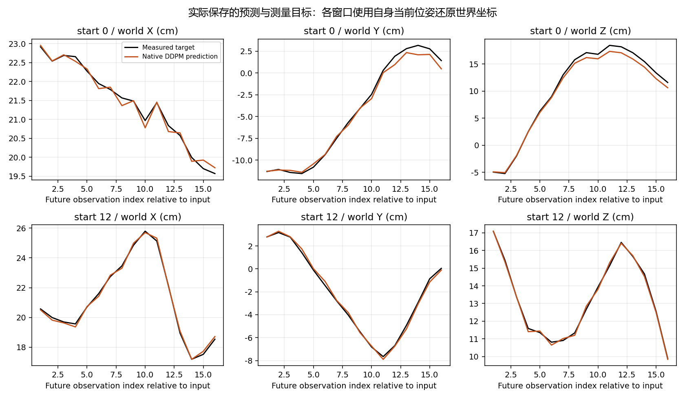
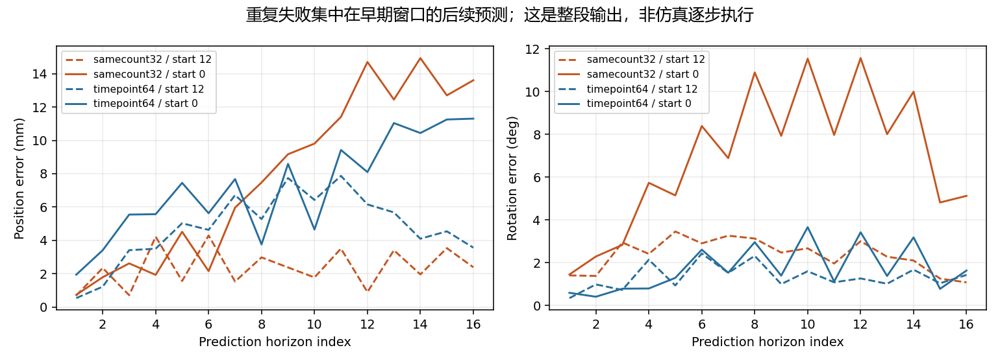

# Bridge重复失败窗口：原始演示、坐标还原与冻结视觉特征审核

2026-10-11。固定检查 `bridge_data_v2-train.tfrecord-00008-of-01024::25`，任务 `close microwave`，配对起点0与12。此轮没有训练、下载、修改生产模型或运行仿真。检查32个既定训练窗口的目标转换和冻结CLIP特征，深入查看其中这一条演示；没有读取留出目标。

## 本轮实际发现

| 同数量32窗口实验，保存预测独立还原 | 起点0 | 起点12 |
|---|---:|---:|
| 路径平均位置误差 | 7.872mm | 2.385mm |
| 路径平均旋转误差 | 6.908° | 2.359° |
| 窗口终点位置误差 | 13.607mm | 2.385mm |

均为同一次训练的三个扩散采样种子平均，不是三次独立训练。起点0在此前64窗口实验也有7.236mm位置误差，终点11.304mm；但其旋转仅1.724°，因此不能声称旋转失败稳定复现。

起点0当前实验的第1/3个预测目标误差为0.731/2.618mm，第12/16个为14.704/13.607mm。主要偏差集中在后半段，世界Y/Z有偏低倾向。三个采样种子的整段平均位置误差分别7.875、7.870、7.872mm。这支持“学到大致轨迹，但后段拟合不足”的局部描述，不支持把差异主要归因于一次随机采样。

**16个未来目标由同一个输入上下文生成。** 图里的横轴是预测目标序号；这里没有执行机器人并把每步误差反馈回来，不能把后段变差称为闭环执行误差累积。

## 数据与目标检查

原始记录包含38步，语言始终为 `close microwave`，图像、状态、动作及RLDS首末标记长度一致；首帧标记0、末帧标记37。所用图像均解码成功，无相邻帧完全重复，状态与动作均有限。查看真实帧可见机械臂移动与门的关闭过程，没有发现明显跳到另一场景的拼接。视觉观察只能支持连续性，不能证明图像与传感器硬件级同步。

起点0使用图像/当前位姿0、未来状态1至16；起点12使用图像/当前位姿12、未来状态13至28。原始getter生成的32窗口目标与已训练保存目标逐元素一致，预处理图像与getter输出也一致。

使用独立float64旋转矩阵 `Rz(yaw) @ Ry(pitch) @ Rx(roll)`，不调用生产相对位姿和逆变换函数，检查局部位移、四元数矩阵以及世界坐标还原。32窗口最大世界位置差约 **0.00000351cm**、旋转差约 **0.0000128°**，远小于目前毫米级预测误差。这里的极小值是**转换实现之间的数值差**，不是模型预测误差。这排除了这32窗口内明显的坐标变换/尺度漏还原错误；不能推广到所有数据集或历史版本。

两个窗口各自使用自己的当前工具位姿作为锚点。起点0的未来16步最大离锚点距离26.77cm、Z跨度23.70cm；起点12分别10.93cm和8.30cm。轨迹长度分别39.43cm和36.50cm。早期窗口的目标范围更宽，可能增加拟合难度，但范围差本身不是因果证明，也不是归一化错误。

原始记录没有时间戳字段。额外探索显示，原生命令XYZ与实测位移在多延后一帧时更接近；这可能涉及控制执行或记录时序。原生命令不保证等于实测位移，因此**不能据此断言dataloader错位或直接改标签**。本轮位姿监督来自未来实测状态而非原生命令XYZ，且夹爪未训练；命令/测量时序与夹爪对齐需要另行检查。

## 视觉输入检查

用与训练相同的生产图像预处理和冻结CLIP视觉编码器，重新提取32张当前输入图像的 `[32,257,1024]` 视觉Token；全部离线加载，编码前后权重哈希不变，未将未来观测用于输入。

该演示起点0与12的全部Token余弦相似度0.667、CLS相似度0.800，Token不相等；相对L2差约0.804。这对在16组同演示配对中相似度排第3，两个时刻互为这32输入中的最近邻。**它们相近，但并没有被编码成相同特征。** 这削弱了“CLIP直接无法区分两张图”的简单解释，不能证明冻结特征包含精确3D位姿、未来动作所需全部信息，也不能证明训练后的Adapter保留了这些差异。

这些训练控制没有保存学习后Adapter/U-Net权重，只有预测与报告，因此本轮没有实际检查学习后的融合向量。当前位姿数字也没有作为位姿去噪网络的条件输入；这属于可检验的输入设计差异，尚未确认是根因。不能据此直接加入状态并宣称修复。

## 收敛后的判断与下一步

本轮没有发现可直接修复的坐标转换或重复图像错误。问题已具体化为：同一演示的早期窗口，在两个小集合中仍有后段毫米级拟合偏差，而晚期窗口可以较好拟合。**这不等于解释了全量训练约10cm的失败，也不意味着数据或扩散层已经全部排除。**

下一项仅做这条演示的最小拟合对照：先单独学习起点0，再与起点12同时学习，保留已成功的模型配方、原始目标及100步原生DDPM评估。预先固定训练暴露量和门槛，使用独立初始化重复，检查逐目标误差。

- 单独能拟合、同时拟合明显变差：优先检查多窗口条件区分和优化干扰。
- 单独仍不能拟合：优先检查该轨迹的表示/损失/优化学习难度，暂不谈泛化。
- 两者都能拟合：再回到32窗口的训练干扰和样本组合；不改数据标签。

这些分支缩小排查范围，不自动确定某一层损坏。上述新训练**本轮尚未执行**，当前结论来自只读审核。

## 证据与复核

- [执行前计划](../reports/bridge_repeated_failure_audit_20261011_v2/plan.json)
- [原始字段、独立几何、冻结特征与保存预测报告](../reports/bridge_repeated_failure_audit_20261011_v2/report.json)
- [世界位置误差独立重算和范围分析](../reports/bridge_repeated_failure_audit_20261011_v2/verification.json)
- [审核脚本](../code/audit_bridge_repeated_failure.py)

保留执行快照、小型原始状态/预测数组和诊断图。首次审核因直接比较原始语言和规范化任务名而停止；随后与既有训练相同地规范化大小写/空白，全部目标仍要求逐元素一致。首次计划/快照也保留，没有修改数据内容。这是审核断言修正，不是模型问题修复。
