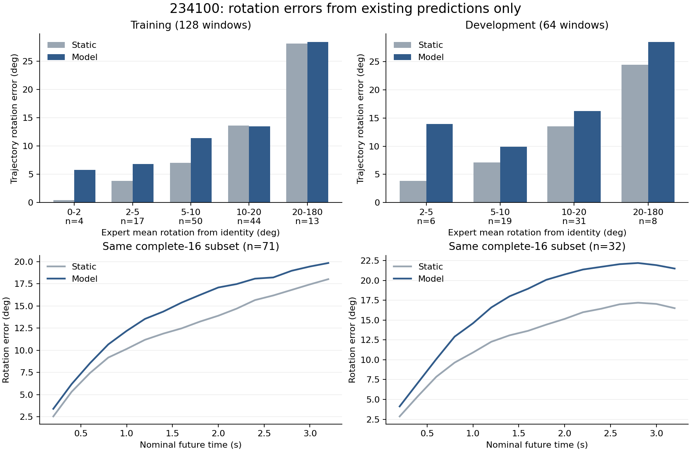

# 234100旋转误差：现有数组与冻结源码分析

日期：2026-10-30。仅CPU处理既有预测/标签和读取冻结源码；未执行新模型前向、采样、训练、仿真或集群操作。原NPZ的SHA、原模型结果和联合gate保持不变。

## 结论与工作优先级

当前多窗旋转问题表现为：小角运动窗口容易被预测的额外旋转损害，旋转方向对齐偏弱，并有明显采样差异；这种问题在训练窗、完整16步窗口和最短0.2秒目标上都存在。开发集还表现为多个转角组的误差普遍高于不动。

现有证据不足以宣布损失权重、扩散采样、条件利用或标签表示中的某一项为唯一根因。后续应围绕**旋转监督怎样成为完整生成中的正确旋转**审阅，而不是重开骨干/空间读出、追加训练预算、恢复旧旋转权重扫描或放行LIBERO。

这次分析已完成了符号、幅度、方向、低运动窗口、采样差异和时距/尾窗的定位。新的模型诊断必须另立具体问题；本报告没有隐含安排下一项GPU作业。

## 1 标签符号与评分未发现对应异常

检查当前完整Bridge子池10352窗的130668个有效目标四元数：

- 最大单位范数偏差3.92e-8，所有w非负；最小w为0.18133，未接近w=0的180°半球分支。
- 120316对有效相邻目标中，点积为负的数量为0。相邻几何转角中位2.227°、99分位12.708°、最大19.619°。
- 本轮192评价窗的目标和最终预测也没有负w。没有观察到q/-q混用造成的标签对消或相邻半球跳变。
- 对全部既有预测用SciPy独立SO(3)乘法重算角距，与原有`2 acos(abs(dot))`的最大差2.44e-11°。已用0°/90°/180°及q/-q已知几何检查。

这是标签仓内部一致性及评分检查，不能证明源传感器约定、Euler到姿态的物理含义或跨机器人标定全部正确。当前没有证据支持“修个四元数正负号即可恢复能力”。

## 2 小角旋转是训练窗的重要薄弱点

按每窗专家相对identity的平均转角分组，分界0/2/5/10/20/180°用于描述，不更改gate或选择新测试集。

| 专家平均转角 | 训练窗数 | 模型角误差 | 不动角误差 | 开发窗数 | 模型角误差 | 不动角误差 |
|---|---:|---:|---:|---:|---:|---:|
| 0–2° | 4 | 5.78° | 0.42° | 0 | — | — |
| 2–5° | 17 | 6.80° | 3.88° | 6 | 13.93° | 3.88° |
| 5–10° | 50 | 11.41° | 7.01° | 19 | 9.93° | 7.09° |
| 10–20° | 44 | 13.46° | 13.63° | 31 | 16.21° | 13.50° |
| 20–180° | 13 | 28.40° | 28.09° | 8 | 28.46° | 24.44° |

训练专家小于10°的71窗，对总体“模型减不动”误差贡献+2.273°；总体差为+2.247°，其余57窗合计略微抵消。因此这些小角窗口解释了训练均值为何没赢过不动。训练专家小于5°的21窗均未优于不动。

开发小于10°的25窗贡献+1.784°，总体差为+3.600°；较大转角组也有劣势，不能把开发问题全部归于低运动场景。这些都是复用的开发窗口，不是新的最终泛化测试。

## 3 幅度、方向与采样各有贡献

最终预测平均转角为训练9.339°、开发10.291°，专家分别10.804°、12.063°。整体预测角度更小，仍然角误差更大；不能把问题简单描述为全部转得过猛。已有最短旋转向量方向余弦窗口均值约0.182/0.093，接近零的小旋转轴已排除。

保留每个预测的角度、假设其轴恰好正确，可得到几何误差下界7.884°/9.290°；实际角误差13.051°/15.663°。这个使用专家信息的下界仅帮助区分幅度与方向的影响，不能当成可部署修正，也不能把差值解释成某个独立因果因素。

三个已保存采样之间的平均两两角距为10.661°/10.814°，采样差异明显。但每个采样种子的总体角误差都高于不动：

| 既有采样seed | 训练128窗 | 开发64窗 |
|---|---:|---:|
| 1101 | 13.16° | 14.04° |
| 1102 | 13.27° | 15.69° |
| 1103 | 12.73° | 17.26° |
| 不动 | 10.80° | 12.06° |

仅将三条既有四元数用不依赖真值的Markley共识重新汇总，描述性误差降为11.490°/14.056°，仍高于不动。开发“共识减不动”95%组区间为[0.218°,3.993°]；训练为[-0.455°,1.898°]。没有把共识当新策略、修改原评分或替换gate，也没有新增采样。该结果说明已有三次采样汇聚并未完整解决问题，不能推断无限采样行为。

误差最短左旋转向量的全局均值平方只占相应均方量约1.13%/1.77%。在该描述坐标下，一个全局常量偏移仅占很小部分；不据此拟合开发集纠偏器或宣称所有坐标问题已排除。

## 4 短时距、完整窗同样存在问题

全部可用窗口的首个0.2秒目标，训练模型3.655° vs不动2.539°，开发3.645° vs2.664°。旋转劣势在短期就已存在，不能全部归于远期累积。

为避免尾窗导致每个时距的评价人群变化，另固定有完整16个目标的71训练窗和32开发窗：

| 固定完整窗人群 | 0.2秒：模型/不动 | 3.2秒：模型/不动 | 全轨迹：模型/不动 |
|---|---:|---:|---:|
| 训练71窗 | 3.387° / 2.531° | 19.833° / 18.010° | 14.341° / 12.246° |
| 开发32窗 | 4.121° / 2.857° | 21.500° / 16.504° | 17.126° / 12.840° |

完整16步窗口仍弱，尾部mask不是这些失败窗存在的必要条件。长短窗口任务分布不同，此处不是对尾部填充训练效应的因果实验。

## 5 训练目标与几何角误差之间的具体接口

以本次部署包内冻结源码为准：

- `code/models.py::diffusion_loss`：sample/x0分支直接以干净7维位姿为目标，预测的四元数分量没有在训练损失前单位化。
- `code/train.py::policy_loss`：该扩散分支用7维有效元素的平方误差和除以有效元素数，位置与四元数没有独立角距目标。`regression_rotation_weight`只在回归分支使用，**不能只改这个参数就认为加强了当前x0分支的旋转监督**。
- `code/models.py::sample`：完整反向过程中有分量裁剪，最终才对四元数单位化；最终合法单位四元数不保证方向正确。

当前完整Bridge标签在“零位置差＋identity旋转”参照下，各分量平均数值平方误差为：xyz约[0.2910,0.6256,0.2388]，qx/qy/qz/qw约[0.00294,0.00317,0.01757,0.00102]。这说明表示数值尺度不同；它不是实际训练中各噪声t的误差、损失或梯度贡献，也不足以决定一个新旋转权重。

旧Bridge旋转权重已有位置/旋转取舍证据，不能据上述统计重新扫权重。当前没有保存每个噪声t的原始去噪四元数输出或分量梯度，只有最终已归一化轨迹；CPU分析不能从这些结果反推是哪一层/哪个损失导致错误，也不能证明换成角距损失必然修复。

## 文件与边界

- `../reports/bridge_rotation_analysis_234100_20261030/analysis.json`：全部标签符号、角度分组、时距、采样、几何描述及范围。
- `../reports/bridge_rotation_analysis_234100_20261030/per_window.csv`：192窗描述值与原身份。
- `../tools/analyze_bridge_rotation_234100.py`：CPU复算及绘图入口，使用现有数值仓和预测，不读取权重。
- 原NPZ SHA仍为`a698e585329dd6c0e1bb830b8701558a1e499d74c8bd05980b4c77f946e63c2f`；原固定四项指标和两个gate未变化。

本次0新模型调用、0新采样、0更新、0GPU。保留位置正证据，本轮不追加预算、变体、seed或LIBERO。
