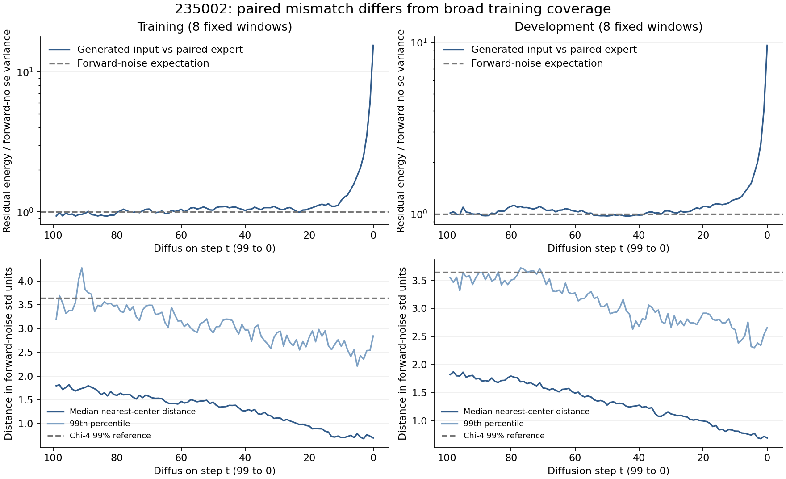

# 235002：训练式前向噪声参照与实际生成输入

本轮只用已下载的235002旋转追踪、归档噪声系数及完整Bridge训练旋转标签，0模型调用、0新采样、0更新、0GPU。未修改原结果或gate。

## 1 没有看到明显的反向随机噪声尺度错误

在clip开启的原生路径，已知每一步的当前输入、裁剪clean和归档后验系数，可从下一步输入反推出该步实际加入的随机量。99个实际加噪步骤汇总如下：

| 16窗中的人群 | 推回随机量均值 | 标准差 | 均方 |
|---|---:|---:|---:|
| 训练8窗 | -0.00114 | 1.00078 | 1.00157 |
| 开发8窗 | -0.00203 | 1.00185 | 1.00371 |

四个四元数通道各自标准差约0.997–1.006，低噪声t1–10汇总标准差1.00877/1.00555。末步t0没有新随机项，按保存后验均值式重建与最终单位化前四元数的最大分量差约2.98e-8。

这支持原路径没有明显的随机噪声倍数错误，不证明统计独立性、整个采样器最优或所有数值错误均已排除。没有用新随机数模拟来替代原观测。

## 2 后段与当前示教方向的偏差超过普通前向噪声量级

训练的声明输入为`x_t=sqrt(alpha_bar)*x0+sqrt(1-alpha_bar)*epsilon`。以当前对应示教为x0，将实际生成输入的残差除以前向噪声标准差，再计算每分量残差能量。若输入正是该示教按训练规则加噪，该统计期望为1。

| 扩散t | 训练8窗 | 开发8窗 |
|---|---:|---:|
| 99 | 0.935 | 1.010 |
| 25 | 1.043 | 1.028 |
| 10 | 1.207 | 1.215 |
| 5 | 1.810 | 1.506 |
| 1 | 6.000 | 4.061 |
| 0 | 15.418 | 9.613 |

均为窗口等权，不能与元素池化数字混用。偏差在低噪声末端突出，而且包含沿同一未来轨迹共同偏移的成分；并不只是独立白噪声振动。

**此统计只比较一个对应专家后续。** 生成了另一条可能的轨迹、条件匹配错误及累积误差，都可能使它变大。前向高斯在数值空间处处有密度；不能把它直接叫“完全在训练支持之外”，也不能从单个示教证明其他轨迹一定不合法。

## 3 总体旋转覆盖与条件匹配是不同的问题

有效原始四元数单位长度近似1时，训练式带噪四元数范数有已知的非中心chi参照，与具体旋转方向无关。t0观察到约95.9%/96.6%的生成输入范数落在该参照中央98%区间内；没有整体范数塌陷或整体放大的迹象，但也不声明分布严格相同。

另将实际旋转输入与全部10352窗的130668个有效训练旋转前向均值作最近距离检查。t0的最近距离中位仅约0.699/0.696个前向噪声标准差，最大3.346/3.502；低于4维标准高斯长度99%参照3.644。

该检查非常宽松：允许借用任何训练图像、语言、当前位姿、未来时刻中的单个旋转。因此它只支持“没有明显脱离全局单四元数数值范围”，不能证明当前条件下的16步轨迹正确或训练/生成分布完全一致。

## 4 已经知道什么，仍缺什么

- 已知：末端相对对应示教的方向偏差显著；范数、噪声倍数和全局旋转覆盖没有给出相应明显异常；问题需要放回当前条件与去噪响应中解释。
- 未知：模型在**同一条件、同一低噪声t**的“示教加噪输入”上是否能纠正旋转。现有trace只记录实际生成输入的响应，不能从输入统计推断另一种输入上的网络输出。
- trace只保存了4个旋转分量，无法评价完整7维输入的联合分布、隐藏条件，或分离位置误差对旋转的影响。

下一项若执行，应复用235002已有on-policy t0输出，只增加234100端点的训练式t0输入响应；不重新跑旧epsilon/条件置换五t检查，不再重放整条100步生成。它仍是0更新诊断，不能据此直接决定新训练或损失权重。

完整数据：`../reports/bridge_rotation_input_gap_235002_20261030/analysis.json`。复算：`../tools/audit_bridge_rotation_input_gap_235002.py`。已检查前向标准化、后验随机量还原的已知数值案例及非中心chi分位数往返；原trace字节SHA保持不变。
