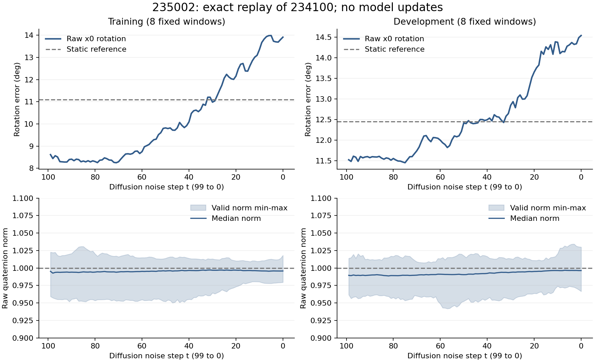

# 235002：方向误差在去噪后段增大，末端单位化不是主要解释

2026-10-30。已下载三文件小包并完成独立CPU复算；本轮只读诊断已结束，不自动新增采样、训练、变体或LIBERO。

## 证据准入

包4614522字节，SHA256为`485315e848dbebf2b6bffd26615ec5a078d9f88e8576f3ace359c3d68b5e88aa`，与日志相同。ZIP三个成员与解压文件逐字节一致；保存的有效采样源码SHA与冻结插桩源码一致。

16个固定窗的目标/mask、3个原采样seed的最终输出，与234100原NPZ逐值相等。全部100步的摘要重算通过；另外以SciPy独立SO(3)角距及原始范数/方向分解核对一致。没有改动原预测、模型、192窗评分或gate。

16窗为原训练顺序前8窗及开发前8窗，原seed1101/1102/1103；只有一个训练模型。这是机制样本，不代表全192窗或10352训练窗。

## 1 最明确的新观察：后段原始方向估计退化

下表均为同一未来16步轨迹上的原始x0旋转估计误差，按有效目标、窗口及3采样汇总。t是**扩散噪声步**，99→0表示反向去噪进程，不是未来动作时距。

| 扩散步/参照 | 训练8窗 | 开发8窗 |
|---|---:|---:|
| t99原始x0 | 8.615° | 11.524° |
| t75原始x0 | 8.431° | 11.452° |
| t50原始x0 | 9.818° | 12.416° |
| t25原始x0 | 12.061° | 12.994° |
| t0原始x0 | 13.911° | 14.537° |
| 最终单位化轨迹 | 13.912° | 14.538° |
| 不动 | 11.093° | 12.447° |

从固定t99到t0，训练8/8窗、开发6/8窗的采样平均误差增加；总体分别+5.296°、+3.013°，逐窗差值中位+3.027°、+2.111°。按这8个组重采样的95%区间为[2.068°,9.786°]、[0.877°,5.984°]。小样本、重复开发、单训练seed限制保留；这不是对某一采样器参数的因果干预。

同一批窗口中，预测的平均旋转幅度从t99的4.673°/4.374°增到t0的7.628°/8.572°；非零旋转向量方向余弦窗口均值却从0.544/0.232降到0.168/0.090。不能只用“幅度逐渐接近专家”判断生成正在改善。

早期x0是中间条件估计，可能较保守；没有验证其位置、夹爪、动作执行或其他窗口的完整能力。**不能按开发真值挑一个最优t替换策略，也不能从这16窗认定提前停止生成是修复。** 原始100步策略和原gate维持不变。

## 2 未发现范数塌陷或末端单位化引入明显旋转

全部100步的有效原始四元数范数范围：训练0.9503–1.0308，开发0.9419–1.0343；没有小于0.1或接近零的情况。

末端单位化前有效范数范围为0.9797–1.0182、0.9666–1.0253，中位0.9958/0.9964。identity fallback计数为0。

单位化前后表示的旋转平均只差1.92e-7°/2.10e-7°，最大单点约2.23e-6°/1.61e-6°，属于浮点归一化舍入量级。非零四元数的单位化在数学上本来就保留其旋转；本次数据也不支持范数塌陷后被单位化放大的解释。

在末端原始四元数分量MSE的精确范数/方向分解中，方向项占99.896%/99.703%，范数项不到0.3%。这是分量MSE的几何分解，不是训练梯度、角误差方差或某个模块的因果贡献。

## 3 重建与分量裁剪的即时量级小

原生x0→epsilon→clean数值重建，所有步中最大的窗口等权平均角度改变量为0.00820°/0.00838°，出现在高噪声端附近；t0的分量最大差仅7.45e-9。没有在这次追踪发现与3–5°后段退化同量级的单步重建偏差。

所有步的四元数裁剪只发生在w通道，qx/qy/qz均没有分量越过[-1,1]。最大单步窗口等权平均旋转改变量为0.00349°/0.00398°；t0 raw与clipped角误差只差约0.00052°/0.00101°。

上述结果约束的是**原路径上每步的即时数值作用**，没有运行关闭clip或改变采样公式的对照，不能证明多步扰动的累计效应绝对为零。也不能只因某些w被裁剪就关掉clip重跑。

## 当前结论与后续优先级

1. 保留234100的位置学习正证据、旋转联合gate未通过，以及235002的0更新/精确重放证据。
2. 当前最值得解释的是：同一固定条件下，原始x0方向在实际生成后段为何变差。范数约束、末端单位化或简单符号修正没有得到本次证据支持为主要修复点。
3. 现有on-policy追踪还不足以区分：低噪声监督是否足够、训练/生成输入分布差异、条件利用、随机反向过程及其相互作用。训练全局loss和既有最终轨迹都不能替代这些条件证据。
4. 新的诊断/修复如有必要，应围绕上述明确问题准备单一对照及预算；不能重开旧骨干、epsilon/x0、旋转权重扫描或无预算续训。本报告不授权下一项GPU作业。

报告计时71.02秒、峰值reserved2.291GiB，不含排队等。本地未下载完整权重/Adam，其参数不变身份由集群验收报告支持；没有sacct最终态。原生GPU追踪0优化更新，本地复核0模型调用/0采样/0更新/0GPU。

完整逐步与逐窗差值：`../reports/bridge_rotation_trace_235002/independent_array_audit_20261030.json`。

CPU复算工具：`../tools/audit_bridge_rotation_trace_235002.py`。
