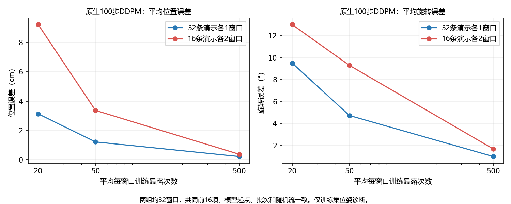

# 同数量对照：换演示，还是换时间点

## 执行前协议

上一轮64窗口的原生DDPM平均误差3.47mm/0.96°，57/64达标，未达到预设90%覆盖门槛；7个位置未达标项中6个属于关闭微波炉。但窗口数量和时间点同时变化，不能唯一归因于动作时刻。

本轮固定总数32、任务比例、模型、初始参数、优化器、训练暴露量和批次随机流，只替换后16项的来源。

| 分组 | 前16项 | 后16项 | 演示数 | 总窗口数 |
|---|---|---|---:|---:|
| 已完成参考 | 原16条演示的中间窗口 | 同任务的另外16条演示中间窗口 | 32 | 32 |
| 本轮处理组 | 完全相同的前16项 | 原16条演示各自另一时间点 | 16 | 32 |

- 原16项来自 `bridge_history_fit_20261011/repeat_current`。同数量参考来自 `bridge_scale32_fit_20261011`，已完成2,000更新并32/32达标，不重跑它。
- 后16项选同一演示距原起点最远的训练窗口；相同距离取最早，与此前64窗口的选择规则相同，不根据预测误差或目标值选样本。此规则在当前原16条演示中选起点0。
- 固定原来的8层Adapter、重复当前图像路径和历史投影、冻结CLIP、多尺度x0 U-Net、100步余弦DDPM；位姿MSE、夹爪冻结，Adam lr1e-4、batch8、恒定学习率、梯度裁剪1，随机初始化种子42。模型架构及生产源码不变。
- 两组均2,000更新，平均每窗口500次暴露。复原已完成32窗口参考的完整批次顺序及dropout/加噪随机种子，包括后16项的随机流；匹配各索引的实际抽样次数。后组使用参考的 `200000+key`，而不是此前64窗口实验的 `400000+key`。
- 冻结文本编码保持16一批、视觉编码2一批；核对共同原始输入和目标、初始参数、共同前4窗口的初始生成指标和首步loss，完整批次/随机种子/抽样次数与参考一致后才正式拟合。
- 预检只6次更新。在80、200、2,000更新使用纯高斯噪声经原生100步DDPM生成全部32项，三个采样种子1101/1102/1103，分别报告全部、共同前16项和后16项，保留实际预测以独立重算。
- 沿用窗口平均位置≤0.5cm、旋转≤5°，至少90%窗口在三个种子下均达标（32项至少29项），总体和终点的既定门槛；不根据结果改门槛。
- 起点0的前帧重复当前帧，标记无有效真实历史，绝不读取负索引末尾图像。重复当前图像路径不使用真实前帧。

## 判断与边界

若同数量处理组明显更难拟合，支持样本来源/时间点覆盖使当前学习更困难，避免把现象仅归因于数量翻倍。若处理组也充分拟合，则64窗口结果可能涉及规模、训练随机差异或局部样本，不能称时间点冲突已确定。

“另外一条演示”与“同一演示早期时刻”仍包含图像、动作分布和独立演示数量差别；结果不能唯一分离时间理解、视觉特征或优化因素。保留32窗口参考的单次训练，不是独立多训练种子统计实验；注意力反向非确定实现提示仍沿用原设置。本轮是训练集位姿诊断，无验证泛化、夹爪或抓取结论。

## 运行与证据

复用现有诊断入口，增加同数量参考核对，不新建模型模块、不下载、不保存大权重；脚本拒绝覆盖已有输出，运行快照保留。

```powershell
D:\miniconda\envs\zeroshot-gpu\python.exe code/check_bridge_history_pair.py --stage preflight --updates 2000 --batch-size 8 --windows 32 --arm repeat_current --phase-reference reports/bridge_history_fit_20261011 --comparison-reference reports/bridge_scale32_fit_20261011 --output reports/bridge_samecount32_preflight_20261011
D:\miniconda\envs\zeroshot-gpu\python.exe code/check_bridge_history_pair.py --stage fit --updates 2000 --batch-size 8 --windows 32 --arm repeat_current --phase-reference reports/bridge_history_fit_20261011 --comparison-reference reports/bridge_scale32_fit_20261011 --output reports/bridge_samecount32_fit_20261011
```

预检和正式拟合均已实际执行，以下效果判定来自保存的生成预测；执行通过不代表拟合或效果改善通过。

## 实际核验与结果

6步预检通过。共同原16项的原始输入和目标逐项匹配，初始参数与两个参考均相同；共同前4项的初始生成指标以及首步loss差异为0。完整2,000批次、dropout/加噪种子和逐窗口抽样次数与同数量参考一致，文本编码仍为16一批。正式运行747.625秒（约12.5分钟），峰值保留显存3.883GiB。

| 每窗口平均暴露量 | 参考位置cm | 本轮位置cm | 参考旋转° | 本轮旋转° | 本轮跨三种子达标 |
|---|---:|---:|---:|---:|---:|
| 20次 | 3.1330 | 9.2297 | 9.5115 | 13.0231 | 0/32 |
| 50次 | 1.2207 | 3.3695 | 4.7338 | 9.3043 | 0/32 |
| 500次 | 0.2242 | 0.3758 | 0.9976 | 1.6867 | 25/32 |

| 最终分组 | 参考位置mm | 本轮位置mm | 本轮旋转° | 参考达标 | 本轮达标 |
|---|---:|---:|---:|---:|---:|
| 共同前16项 | 2.234 | 3.215 | 1.425 | 16/16 | 14/16 |
| 替换后16项 | 2.251 | 4.300 | 1.948 | 16/16 | 11/16 |
| 全部32项 | 2.242 | 3.758 | 1.687 | 32/32 | 25/32 |

本轮终点位置3.892mm、旋转1.167°；静止路径基线为7.649cm/12.067°。平均误差明显优于静止，但25/32=78.125%不足既定90%窗口覆盖门槛，因此整体拟合未通过。共同和后组各16项至少需15项达标，当前14项和11项均未通过分组门槛。



## 未达标项和重复失败样本

7项全部位置超过5mm，其中1项同时旋转超过5°。关闭微波炉3/8项、关闭抽屉3/6项、取西兰花1/6项未达标；打开抽屉和转动杆均0/6项未达标。不能沿用上一轮“失败主要集中微波炉”作为本轮全部结果的概括。失败窗口的三个采样种子平均位置误差最大差距0.0458mm。

| 索引/组别 | 分片尾号/记录 | 任务 | 起点 | 位置mm | 旋转° |
|---|---|---|---:|---:|---:|
| 6 / 共同 | 00006 / 26 | 关闭抽屉 | 16 | 5.159 | 1.294 |
| 11 / 共同 | 00015 / 26 | 关闭抽屉 | 12 | 5.719 | 1.655 |
| 16 / 替换 | 00002 / 39 | 关闭微波炉 | 0 | 6.996 | 2.393 |
| 19 / 替换 | 00002 / 21 | 取西兰花 | 0 | 5.364 | 1.572 |
| 21 / 替换 | 00003 / 8 | 关闭微波炉 | 0 | 7.916 | 2.338 |
| 22 / 替换 | 00006 / 26 | 关闭抽屉 | 0 | 5.960 | 1.355 |
| 26 / 替换 | 00008 / 25 | 关闭微波炉 | 0 | 7.872 | 6.908 |

本轮目标与此前64窗口对应子集逐元素一致，包含4个旧失败样本。00003::8起点12由7.368mm降到3.781mm，00006::10起点0由5.178mm降到2.840mm，00009::20起点0由7.944mm降到2.550mm，三项本轮通过。**00008::25起点0仍失败：位置7.236mm→7.872mm，当前旋转6.908°。** 该重复失败项值得优先检查，但仍不能单独证明其数据或某层损坏。

## 成对预测和目标范围

在解码器使用的相对坐标表示中，每对早晚时刻的目标XYZ序列平均差异为3.37至23.68cm，实际预测差异为3.37至23.08cm。模型已经生成了明显不同的动作，不支持“两个时刻输出完全相同”的简单坍缩解释。每对的差异向量误差已保存。由于两窗口各自使用不同当前工具位姿作为锚点，这些数值是表示空间比较，不能当作同一世界坐标下的两条物理路线距离。

两组位移目标均无分量超过既定±3归一化范围；当前采样范围对应0.1m位置单位下的±0.3m。目标分布仍有差别：参考XYZ标准差约[0.497,0.571,0.398]，本轮约[0.539,0.575,0.515]，早期窗口的Z位移范围更宽。这不是重新计算或替换归一化统计，也不是确认归一化有错；它是替换样本实际带来的任务难度差异。

## 判断和下一步

在相同N、起点、批次、训练暴露量和配方下，本轮早期学习较慢，最终覆盖更低，因而“只因为窗口数量翻倍”不足以解释观察结果。这支持检查样本来源、动作阶段和相应分布带来的学习困难。

这不是唯一根因定位：输入和目标内容、同演示窗口相关性、独立演示数量都随替换改变，且只运行一个训练初始化。结果没有重现全量约10cm的整体失败，也没有证明扩散公式或Adapter没有学习能力。

下一步先固定反复失败的 `bridge_data_v2-train.tfrecord-00008-of-01024::25` 起点0，并配对查看其原时刻：核对实际图像与当前/未来位姿的时间对应、监督轨迹、CLIP特征区分度和逐步预测偏差，再决定一个有针对性的输入或训练因素对照。保留已成功的其他窗口作为参考，先不扩数据、不同时改Adapter、U-Net和采样器。该深入审核本轮尚未执行。

## 证据和存储

三个阶段的实际预测均独立重算位置、四元数角度、终点和逐窗口跨种子门槛，与运行报告一致。核对两组超参数、共同目标、完整批次哈希、独立重建的随机种子哈希、逐窗口暴露向量、同演示配对、训练划分及源码/执行快照哈希。CLIP和其他冻结模块未改变。

- [正式报告](../reports/bridge_samecount32_fit_20261011/report.json)
- [执行前计划](../reports/bridge_samecount32_fit_20261011/plan.json)
- [独立核验、逐窗口和成对分析](../reports/bridge_samecount32_fit_20261011/verification.json)
- [6步预检](../reports/bridge_samecount32_preflight_20261011/report.json)

只保存小报告、预测、运行快照和学习曲线，无新下载或大检查点。此诊断仅训练集位姿拟合，无泛化、夹爪或抓取成功率结论。
