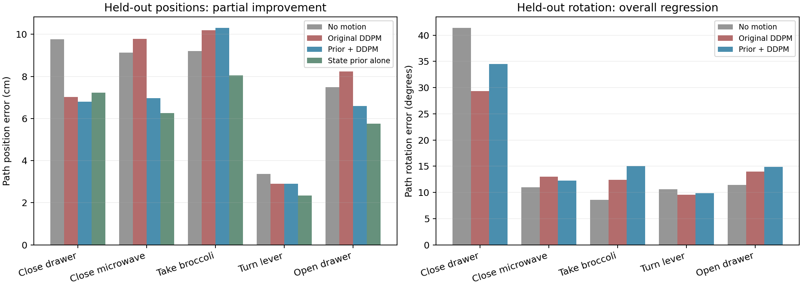

# 205648独立核验：位置部分改善，完整候选未通过

原128训练窗口/64演示、40开发窗口/10演示、初始化43、8192更新、原生DDPM100和三个采样种子保持原协议。205648完成0:0，gpu-a6000-1，Slurm用时37分钟。27个下载结果文件、13份预测快照、8192条正式更新及预检恢复记录已独立核验；本轮只分析保存数组，没有新训练、推理、编码或作业。

**最终结论：这批固定留出演示的位置误差改善成立，但旋转退步，未满足事前完整判据；候选结束，不追加轮数、种子或混合比例。** 当前没有完整泛化修复或抓取成功结论。

## 原固定40开发窗口的结果

所有位置和旋转均按原单位及全部16目标评分。原扩散对照202278直接复用，没有重训；基础位置预测器只用原训练集求解系数。

| 方法 | 路径位置cm | 路径旋转° | 第16目标位置cm | 第16目标旋转° |
|---|---:|---:|---:|---:|
| 静止 | 8.212 | 15.099 | 10.565 | 19.986 |
| 原扩散202278 | 8.349 | 15.256 | 10.728 | 20.785 |
| 新基础＋扩散修正205648 | **7.185** | **16.697** | **9.323** | **22.920** |
| 固定状态基础预测器 | **6.280** | 不预测 | **7.908** | 不预测 |

新组位置比静止降低12.51%，比原扩散降低13.95%；完整旋转均值和第16目标旋转却退步。状态基础单独使用仍有更低的位置误差，不能把位置收益全部当作扩散修正的新增价值。第16目标是窗口末端，不是任务完成时刻。

10条开发演示中，新组位置8条优于旧扩散、7条优于静止、4条优于基础预测器；旋转4条优于旧扩散、5条优于静止。位置改善具有多演示支持，但没有覆盖全部演示。

| 任务（每任务2条开发演示） | 旧位置→新位置cm | 旧旋转→新旋转° |
|---|---:|---:|
| 关抽屉 | 7.033→6.806 | 29.330→34.501 |
| 关微波炉 | 9.786→6.966 | 13.022→12.241 |
| 从锅里拿西兰花 | 10.197→10.308 | 12.394→15.044 |
| 拨杆 | 2.906→2.896 | 9.589→9.834 |
| 开抽屉 | 8.228→6.594 | 14.012→14.886 |

关微波炉是位置和旋转均改善的任务均值；其他任务并非全面改善。西兰花一条演示`00011::24`位置从13.893变15.011cm，仍比静止10.395cm及基础10.221cm差。关抽屉`00003::22`旋转从39.229变45.426°。这些失败全部保留，没有删除演示或改变权重。

## 训练与留出的差距现在体现在哪里

训练128/128窗口通过原位姿门槛，路径位置1.419mm、独立旋转复算0.634°。但是对“扩散修正是否增加价值”的直接比较是：

| 同一基础轨迹加修正 | 训练位置cm | 开发位置cm |
|---|---:|---:|
| 不加扩散修正 | 5.460 | 6.280 |
| 加学到的扩散修正 | **0.142** | **7.185** |

当前修正几乎消除了已见训练误差，却在开发均值上拉低了基础预测，只有4/10演示比基础更好。可以将失败现象具体描述为**学到的轨迹修正没有稳定迁移**，不能由此直接判定Adapter或某个U-Net算子存在唯一bug。

对保存XYZ误差做精确平方距离分解，开发基础误差54.476cm²、修正自身幅度平方26.825cm²、交叉纠错项−7.838cm²，最终73.464cm²。修正有部分抵消误差的方向，但其变动幅度总体抵消了这部分收益。该代数描述没有估计全部随机分布，不替代原平均距离指标，也不据此事后选择缩小修正的系数。

## 原筛选与不确定性

原训练门槛通过、开发位置优于静止及旧模型、至少6/10演示位置改善均满足；**旋转不劣于旧模型**不满足（上限15.276°，实际16.697°），因此整体候选False。没有修改门槛或将位置单项成功写成整方案通过。

演示等权位置也从旧7.692cm、静止7.960cm下降至新6.851cm，基础6.124cm仍更好；演示等权旋转由旧14.826°变为新16.056°。对10条演示的描述性配对bootstrap，新组相对静止的位置改善区间跨0（约−0.594至2.732cm）。当前总体均值下降在这批固定开发集上成立，不能据此声称广泛新场景上已经稳定获益。

开发集多次用于诊断、只有10条演示；三个种子是采样重复，只有一次神经训练初始化。没有触及预留最终测试，没有训练夹爪或执行物理抓取。不能将训练位姿拟合或离线位置收益换成抓取成功率。

## 独立核验范围与成本

- 27个下载结果文件与压缩包逐文件一致；无PT。正式/预检入口及辅助代码、原核心源码、协议、128/40排序、原始数据身份、训练初始化均吻合。
- 基础系数只来自128训练标签，实际输入只取当前状态/任务；各快照基础预测与独立重算逐元素相同。
- 全13快照满足保存预测＝残差＋基础轨迹并应用声明边界，逐元素差0；原四元数/夹爪部分未被位置还原改动。最终训练和开发没有发生XYZ还原裁剪。
- 原目标与已核验202278相同，全16未来监督身份保留。8192正式更新及学习率阶段、梯度记录通过，旧对照未重训；正式复用缓存由报告记载，缓存张量未下载。
- 预检恢复同学习率的损失、参数指纹和保存预测一致。CLIP/冻结夹爪不变由运行报告和已冻结执行路径核验；未下载权重作新的张量级独立核验。
- 独立float64指标与报告最大差位置约1.24e-6cm、旋转约0.00152°，不足以改变本结论。正式报告峰值保留3.924GiB，内部计时约2193秒；原检查点529,410,946字节留集群，报告记载回读一致，本地未验证其张量。

本轮仅新增CPU分析、CSV及图表，不启动后续训练。按冻结停止规则收口，保留位置收益、旋转退步和未达到基础预测的证据；不能为了更好分数再扫描残差比例或重选种子。

证据：[完整独立分析](../reports/bridge_prior_analysis_205648/analysis.json)、[全部逐演示配对](../reports/bridge_prior_analysis_205648/paired_episodes.csv)、[全部逐任务](../reports/bridge_prior_analysis_205648/paired_tasks.csv)、[逐窗口](../reports/bridge_prior_analysis_205648/per_window.csv)、[13快照指标](../reports/bridge_prior_analysis_205648/history.csv)、[复算入口](../scripts/analyze_bridge_prior_205648.py)、[事前协议与候选要求](BRIDGE_STATE_PRIOR_CANDIDATE_20261015.md)。
