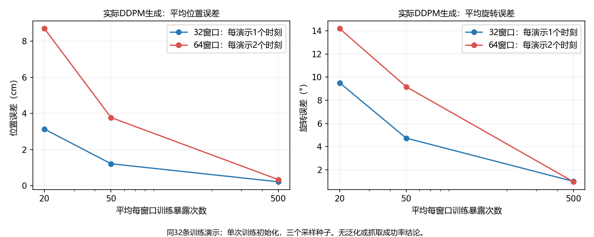

# 固定32条训练演示，增加时间窗口的对照

## 开跑前协议

参考为 `reports/bridge_scale32_fit_20261011`：32条训练演示，每条一个窗口，位姿拟合32/32通过。本轮保持这32条演示，每条增加一个不同起点的窗口，共64窗口。新增起点按与原起点相距最远选择，相同距离取最早；不用目标值或预测误差挑选。这代表不同录制时刻，不保证每一对都是不同语义动作阶段。

- 前32项原始图像、语言、当前夹爪输入、动作目标、初始参数与参考逐项一致。后32项与前32项一一对应同一演示、同一任务，起点不同。仅使用既定训练划分。
- 沿用重复当前图像的控制路径、冻结CLIP、8层Adapter、多尺度x0 U-Net、100步余弦DDPM、位姿MSE；夹爪冻结。Adam lr1e-4、batch8、恒定学习率、梯度裁剪1，模型从头初始化。
- 复原参考32窗口的2,000批次及随机种子，在每批之后插入新增时间窗口对应批次，共4,000更新。原窗口的抽样顺序、dropout和加噪种子保持一致；新增窗口使用独立种子。每对实际抽样次数相同，平均每窗口500次。新增梯度必然改变后续参数和Adam状态，不声称训练轨迹不变。
- 文本编码维持参考实际的16一批、视觉编码2一批，避免改变冻结编码器运算形状。先核对原始前缀、批次哈希、初始生成指标和首步loss，预检只6更新。
- 新窗口允许起点0，其不存在的前帧重复当前帧并标记无有效历史，绝不读取负索引的末尾图像。本轮重复当前图像路径不使用真实前帧。
- 在160、400、4,000更新评估全部64窗口、原32及新增32，对应平均20、50、500次暴露。实际动作从纯噪声经100步DDPM生成，采样种子1101/1102/1103，保留小体积预测NPZ以独立重算。
- 沿用窗口平均位置≤0.5cm、旋转≤5°，总体及终点门槛和至少90%窗口跨三种子达标的既定标准，不根据结果修改门槛。
- 同演示窗口可能重叠，64窗口不等于64独立演示。无验证集泛化、抓取、仿真结论，也没有保存大检查点或下载数据。

## 判断方式

若两组均能拟合，说明这些演示的多个时间窗口仍可学习，尚未找到全量失败的转折点。若原32或新增32失败，先检查每对时间窗口的输入区分度、标签和误差，再决定后续实验。单次初始化不能证明唯一根因。此正对照的优化配方与原正式训练的AdamW、退火、batch2、夹爪联合损失仍有差别。

## 运行

复用 `code/check_bridge_history_pair.py`；生产模块不修改，实际执行脚本保存快照，输出目录拒绝覆盖。

```powershell
D:\miniconda\envs\zeroshot-gpu\python.exe code/check_bridge_history_pair.py --stage preflight --updates 4000 --batch-size 8 --windows 64 --arm repeat_current --phase-reference reports/bridge_scale32_fit_20261011 --output reports/bridge_timepoint64_preflight_20261011
D:\miniconda\envs\zeroshot-gpu\python.exe code/check_bridge_history_pair.py --stage fit --updates 4000 --batch-size 8 --windows 64 --arm repeat_current --phase-reference reports/bridge_scale32_fit_20261011 --output reports/bridge_timepoint64_fit_20261011
```

预检与正式4,000更新均已实际执行。以下拟合结论依据生成预测，不以执行通过或训练loss下降代替效果判断。

## 已完成的预检

6次更新预检通过，峰值保留显存3.898GiB。原32项的原始输入和目标、初始参数、共同批次与参考一致，初始生成四项指标及首步loss差异均为0。生产模块和CLIP不变。独立清点确认逐窗口暴露次数与参考完全相等，平均500次。

初始生成指标的核对范围是共同前4窗口、采样种子1101；原始输入和目标的逐项核对覆盖全部共同32窗口。不要将前4窗口的初始化检查误写为全部32窗口的生成重放。

确定性选择实际选出了每条演示起点0的窗口；它与原起点相距4、8、12或16个录制步。两条16步目标序列会有0至12个相同的绝对未来时刻，但各自相对当前位姿的目标不同。32对预处理图像和目标均不逐元素相同。图像字节不同不等于CLIP特征必然能充分区分它们。

训练器提示注意力反向存在非确定实现；当前使用与参考相同的固定随机种子和 `warn_only=True` 设置。共同起点已核对，但这仍是单次训练初始化对照，不能把微小差异解释成稳定的因果效应。

## 实际生成结果

运行耗时1,503.25秒（约25.1分钟），峰值保留显存3.902GiB。每个窗口实际抽样487至518次，平均500次，原32项和新增配对项的抽样次数与参考逐项相同。CLIP、生产源码与其他冻结参数未改变。

| 平均暴露次数 | 更新数 | 路径位置cm | 路径旋转° | 终点位置cm | 终点旋转° | 三种子均达标窗口 |
|---|---:|---:|---:|---:|---:|---:|
| 20 | 160 | 8.6864 | 14.1896 | 12.8024 | 19.5694 | 0/64 |
| 50 | 400 | 3.7742 | 9.1711 | 5.3169 | 12.5040 | 0/64 |
| 500 | 4,000 | 0.3466（3.47mm） | 0.9627 | 0.3432（3.43mm） | 0.9227 | 57/64 |

静止基线的路径位置为8.4061cm、旋转12.2963°。最终平均值明显优于该基线，但57/64=89.06%，没有达到既定至少90%窗口跨三种子达标的门槛；需要至少58项。因此整体 `pose_fit_passed=False`，不得将执行检查通过写为拟合完全通过。

| 最终分组 | 路径位置mm | 路径旋转° | 终点位置mm | 达标窗口 | 分组拟合门槛 |
|---|---:|---:|---:|---:|---|
| 上一轮32项单独训练 | 2.24 | 1.00 | 2.73 | 32/32 | 通过 |
| 本轮原32项 | 3.26 | 0.95 | 3.04 | 31/32 | 通过 |
| 本轮新增32项 | 3.67 | 0.97 | 3.82 | 26/32 | 未通过 |
| 本轮全部64项 | 3.47 | 0.96 | 3.43 | 57/64 | 未通过 |



## 已定位的未达标样本

7项均为位置不达标，旋转均≤5°，不是平均旋转偏差导致的判定失败。三个采样种子的位置平均误差最大差距仅0.0735mm，当前结果不能用采样运气差来解释。

| 组别/窗口索引 | 分片尾号/记录 | 任务 | 起点 | 路径位置mm |
|---|---|---|---:|---:|
| 原组5 | 00003 / 8 | 关闭微波炉 | 12 | 7.368 |
| 新组40 | 00006 / 10 | 从锅中取出西兰花 | 0 | 5.178 |
| 新组42 | 00008 / 25 | 关闭微波炉 | 0 | 7.236 |
| 新组47 | 00009 / 20 | 关闭微波炉 | 0 | 7.944 |
| 新组53 | 00011 / 31 | 关闭微波炉 | 0 | 5.378 |
| 新组58 | 00023 / 4 | 关闭微波炉 | 0 | 5.862 |
| 新组63 | 00029 / 40 | 关闭微波炉 | 0 | 6.682 |

关闭微波炉为6/16项未达标；关闭抽屉、打开抽屉、转动杆均为0/12项未达标，取西兰花为1/12项未达标。原组窗口5在上一轮32窗口中位置误差为2.756mm，本轮为7.368mm。这是应当具体检查的退步样本。

## 能说明什么，下一步怎样区分

这轮大部分训练窗口已经学到毫米级动作，没有重现全量训练中约10cm、差于静止基线的整体失败。它支持当前Adapter与扩散位姿链在此控制配方下能学习同一演示的两个时间窗口，但拟合覆盖仍不完整。没有泛化、夹爪、仿真或唯一根因结论。

加入初始时刻后学习变慢，位置未达标集中在微波炉任务，是可复查的线索。与此同时，窗口数量从32变为64；不能单独将效果归因于“时间阶段混淆”，也不能从这一轮推断全量失败只需加轮数。

下一步先做同数量对照：从原16条演示取原窗口＋各一个新增时间窗口，仍为32窗口，与已完成的“32条不同演示、各一个窗口”比较。两组都从原16项起步，保持相同初始参数、任务比例、batch8、2,000更新及同一批次/加噪种子，平均500次暴露。只替换后16项的来源；核对参考初始前缀后再运行。该同数量实验本轮尚未执行。若不同来源组仍出现稳定差异，再集中检查微波炉窗口的视觉区分度、时间内位置误差和监督目标，不同时修改多个模块。

后续同数量实验现已完成：位置3.76mm、旋转1.69°，25/32项通过，未达到拟合覆盖门槛。任务内失败分布不再仅集中微波炉。详见[同数量控制结果、重复失败样本与下一步](BRIDGE_SAME_COUNT32_20261011.md)；上段保留当时尚未执行的计划状态。

## 独立核验与证据

三个阶段的全部预测均独立重算位置、四元数角度、终点、逐窗口跨种子达标数量和整体门槛，与运行报告一致。核对64项属于同32条训练演示、每对选择确为最远另一个时刻、没有留出演示重叠，原32目标与旧预测文件逐元素相同，实际暴露量与参考一致。源码、执行快照、预测文件及计划/报告哈希均已记录。

- [正式报告](../reports/bridge_timepoint64_fit_20261011/report.json)
- [执行前计划](../reports/bridge_timepoint64_fit_20261011/plan.json)
- [独立核验、逐窗口结果和误差分解](../reports/bridge_timepoint64_fit_20261011/verification.json)
- [6步预检](../reports/bridge_timepoint64_preflight_20261011/report.json)

本轮只保存小体积报告、执行脚本快照、预测和学习曲线，没有新增大检查点或下载数据。
