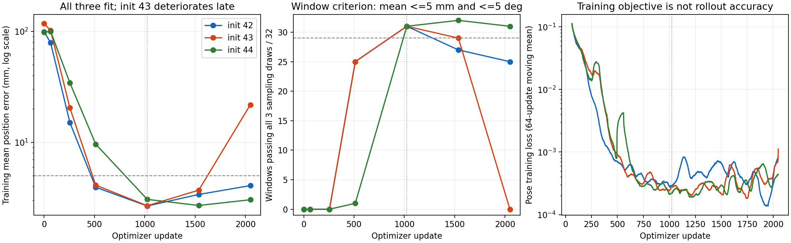

# 训练过程追踪：已经拟合，随后发生退化

正式作业200039在RTX A6000上完成2048次更新、三个训练初始化。本地只读取下载的报告、梯度日志和预测，独立复算全部24组预测，没有新增训练或修改模型。

关键收获：三个初始化都在第1024次更新达到原有训练位姿拟合门槛，各有31/32个窗口跨三个采样种子达标。此前最终表现最差的seed43并非一直学不会：它先达到2.68mm/1.43°，随后最终位置误差升至21.86mm，全部32窗口的位置误差都比1024次时大。本次最终训练及留出预测与198871对应混合组逐元素相同，曲线解释的是重现后的同一结果，而非一次未重现旧失败的新运行。

## 实际训练结果

所有位置均为窗口内16个目标位姿的平均路径位置误差；不是最大误差，也不是机器人任务成功率。

| 更新次数 | seed42：位置mm/旋转°；达标窗 | seed43：位置mm/旋转°；达标窗 | seed44：位置mm/旋转°；达标窗 |
|---|---|---|---|
| 256 | 15.04 / 7.41；0/32 | 20.44 / 7.31；0/32 | 34.37 / 7.74；0/32 |
| 512 | 3.93 / 1.99；25/32 | 4.11 / 2.35；25/32 | 9.63 / 6.01；1/32 |
| 1024 | 2.66 / 2.21；31/32 | 2.68 / 1.43；31/32 | 3.06 / 0.88；31/32 |
| 1536 | 3.38 / 1.75；27/32 | 3.70 / 1.79；29/32 | 2.69 / 1.37；32/32 |
| 2048 | 4.07 / 2.06；25/32 | 21.86 / 5.24；0/32 | 3.03 / 1.62；31/32 |

完整门槛未调整：每个采样种子的总体路径平均≤5mm/5°、终点平均≤10mm/10°，且至少90%窗口在所有三个采样种子下各自的路径平均≤5mm/5°。32窗口至少需29个达标。第1024次的各组终点误差分别为3.03mm/1.26°、3.16mm/1.03°、3.38mm/0.90°，也满足原有终点要求。

seed42在1024次通过，1536和2048次不再满足窗口覆盖门槛，最终平均位置仍只有4.07mm。seed43在1536次仍通过，退化到失败发生于1536～2048次之间，位置误差是1024次的8.17倍。seed44在1024、1536和2048三个观测点均通过。监测点稀疏，不能说已经找出退化开始的精确更新次数，也不能保证两次观测之间一直达标。

## 梯度和训练损失

三个初始化、三个可训练模块组（Adapter、多尺度U-Net、历史投影）的每次记录均为有限非零梯度；参数均变化，CLIP及其他冻结参数未变化。没有看到全模块断梯度或NaN。每个模块的总梯度非零不代表内部每层都正常，也不能仅凭梯度范数比较判断某个模块是根因。

更新513～2048各组均没有触发全局梯度裁剪，不能把后期退化解释为裁剪持续限制更新。seed43在1537～2048次的裁剪前全局梯度最大值为0.520，小于既定裁剪阈值1；末两次训练loss分别约0.0143和0.0098，有局部抬升。513～1024、1025～1536、1537～2048三段平均loss分别为0.000355、0.000268、0.000464，整体仍处于很低的量级。

因此，训练loss低不足以证明纯噪声开始的完整100步生成仍保持精确。已观测到的是“训练集生成表现后期退化”；恒定学习率、联合更新导致条件或解码映射漂移、不同噪声时刻的优化影响等均尚待干预实验，不能直接宣布其中某项为唯一根因。

## 能证明与不能证明的部分

这次进一步证明：当前输入处理、冻结CLIP特征、八层Adapter与多尺度扩散位姿头组成的整条链，能在三个初始化下达到同一批多任务训练窗口的位姿拟合门槛。不是只记住一个窗口，也不是给采样器输入真实目标后恢复；评估仍从纯动作高斯噪声出发执行原生DDPM100。

这不构成所有数据处理场景无缺陷的保证，更不证明全量训练或泛化成功。固定数据仍只有16条训练演示、32窗口、5种任务。夹爪冻结、未执行仿真或抓取。最终留出位置/旋转仍分别为seed42的9.18cm/18.48°、seed43的8.72cm/18.19°、seed44的9.21cm/19.05°，均差于8.21cm/15.10°静止基线。

中途没有评估留出集，无法说1024次时泛化较好，不能把1024次当作已证明的最佳泛化检查点。当前只有最终可训练权重在集群，中途仅保存了预测和上下文，不能从NPZ还原第1024次模型。

## 下一项有依据的对照

优先检验后期更新幅度，而非加数据或直接延长训练。预先固定失败最明显的seed43，重现共同前1024次训练并保存参数及Adam状态；从该同一状态分成两组，后1024次分别保持lr=1e-4或降为1e-5。其余模块、批次顺序、dropout/加噪随机键、裁剪、动作表示和DDPM100不变，保存共同分叉点和最终检查点。

两组采用完全相同的训练评估点，重点看是否保持已经达到的门槛；留出仍只作为最终开发指标，不用它挑选分叉时刻。原学习率组需要重现此次退化，才能解释干预效应。如果降低学习率保留拟合，只支持后期更新幅度影响稳定性，不能宣布泛化已解决或唯一坏层已定位；若仍退化，再考虑冻结Adapter的模块隔离。此前8窗口初始学习率3e-4与1e-4比较不能替代这一“共同已拟合状态之后”的对照。

后续已准备[后期学习率对照包与提交说明](BRIDGE_LATE_LR_PAIR_20261012.md)，短预检确认恢复参数及Adam状态后与连续训练逐元素一致。正式集群干预尚未提交或执行，不能把预检通过当作拟合改善。

## 复核与文件

核对上传清单、9份冻结源码、执行快照、72窗口原始身份/数值容差、训练/留出演示不重叠、每窗512抽样、初始参数及首步loss；全部匹配。24个NPZ的标签逐元素一致（各自分区内），最后6个训练/留出预测与198871逐元素一致。用NumPy float64独立复算路径、终点、逐窗口通过状态和完整门槛，与报告吻合；最大位置指标差异约0.0000012cm，旋转差异约0.0013°，属于指标计算精度差异，不是模型预测误差。

本地新增分析约0.5MiB，下载的原始小文件约6.4MiB；没有下载`.pt`权重。

- [原始正式报告](../reports/bridge-trace-fit-200039/report.json)
- [独立核验结果](../reports/bridge_trace_analysis_200039_20261012/analysis.json)
- [训练曲线表](../reports/bridge_trace_analysis_200039_20261012/history.csv)
- [梯度分段表](../reports/bridge_trace_analysis_200039_20261012/gradient_blocks.csv)
- [逐窗口表](../reports/bridge_trace_analysis_200039_20261012/windows.csv)
- [CPU复算脚本](../scripts/analyze_bridge_training_trace_200039.py)

复算：`D:/miniconda/envs/ee6483/python.exe scripts/analyze_bridge_training_trace_200039.py`。生产模型和冻结实验包未修改。
