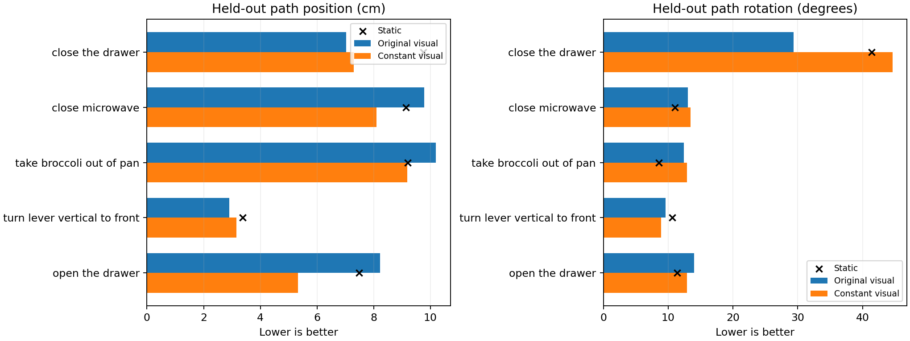

# 视觉条件变化对照206274：独立核验结果与范围

**最新：完整小工件已取得，独立核验完成。** 压缩包5,622,545字节、27文件齐全（正式14＋预检13），解压与归档逐字节一致，13份预测快照及8192更新日志核验通过。输入、标签、128/40整演示划分、相同初始化、状态统计、实际生成源码与原202278控制匹配；预检与正式前4步损失/梯度日志精确一致，预检恢复的参数、损失与预测一致。固定视觉均值在预检/正式的指纹相同，源码及运行断言只使用128训练观察，不使用40开发图像拟合。实际均值张量、完整token缓存及PT未下载，未在本地重建权重或独立复算均值张量本身。

保存预测float64复算通过，最大位置指标差1.29e-6cm、旋转0.000636°，不改变结论。当前没有新训练、编码、模型采样或仿真。固定候选因旋转条件失败收口，不追加预算、种子或视觉强度。

## 新增的逐演示定位

- 位置改善不是只有一条演示：10条开发演示中，8条位置优于静止、6条优于原完整图像模型；旋转只有4条优于原模型、1条优于静止。
- 关抽屉两条演示共6窗，旋转由原图像组29.3305°升到44.5976°。按全40窗加权，它们贡献总旋转变化＋2.2901°；全体净变化为＋2.1400°，其他四任务合计略抵消。这是描述性误差分解，不能删掉这6窗另判通过。
- 开抽屉位置8.2283→5.3341cm、旋转14.0121→12.8696°，两项均改善；关微波炉与取西兰花位置也改善，但旋转略退步。转杆位置略退步、旋转改善。因此不能笼统判断所有视觉信息有害或所有任务都不需要视觉。

| 原40窗按任务汇总 | 原图像位置→固定视觉/cm | 原图像旋转→固定视觉/° |
|---|---:|---:|
| 关抽屉 | 7.0333→7.2894 | 29.3305→44.5976 |
| 关微波炉 | 9.7856→8.0960 | 13.0223→13.4776 |
| 从锅中取西兰花 | 10.1972→9.1859 | 12.3941→12.9236 |
| 转杆 | 2.9055→3.1526 | 9.5892→8.9007 |
| 开抽屉 | 8.2283→5.3341 | 14.0121→12.8696 |

演示等权的方向相同：原图像位置7.6925cm→固定6.6896cm，旋转14.8259°→17.4252°。正式原窗口加权主要指标保持不变，不能改用其他权重使候选过关。

固定视觉组训练8.4371mm/3.1599°，51/128窗达到三采样种子的原窗口位姿门槛，整体门槛False；这符合移除视觉后拟合变差的观察，但不因此追加拟合。它与位置泛化改善同时出现，再次说明训练误差不是本轮主要目标。一个非CLIP权重530,437,264字节留在集群，运行报告记载回读精确，本地未下载。

本次收获是对原40窗建立了**同一DDPM配方下输入消融的任务/输出差异证据**：完整视觉变化在此训练配方中未稳定转成位置收益，却在某些旋转任务有价值。尚未唯一确定CLIP、Adapter、状态融合或动作头哪一层有故障；本次也没有试验不同视觉正则、分支结构或更多数据的效果。

证据：[独立核验JSON](../reports/bridge_visual_variation_analysis_206274/analysis.json)、[10条演示及训练演示表](../reports/bridge_visual_variation_analysis_206274/episodes.csv)、[任务表](../reports/bridge_visual_variation_analysis_206274/tasks.csv)、[逐窗表](../reports/bridge_visual_variation_analysis_206274/windows.csv)、[核验入口](../scripts/analyze_bridge_visual_variation_206274.py)。新增审计输出约156KiB，无大文件下载或模型执行。



## 下文为终端阶段记录（现已复核）

收到COMPLETED/0:0、37分20秒、A6000日志，固定8192更新结束。以下保留原终端值及当时信息边界；当前工件状态以上文为准。

## 原40窗的主要结果

| 指标 | 静止 | 原完整图像202278 | 固定视觉206274 |
|---|---:|---:|---:|
| 路径位置/cm | 8.212326 | 8.349127 | 6.966390 |
| 路径旋转/° | 15.098500 | 15.255946 | 17.395943 |

位置比静止低15.17%、比原图像组低16.56%，通过事前位置≤7.3911cm条件；但旋转高于静止及原图像组，也超出事前15.1185°上限，故完整候选未通过。不能在看到结果后改成只看位置。现已复核第16目标：固定视觉8.982843cm/22.897032°，原图像10.728351cm/20.784513°，同样位置改善、旋转退步；逐任务/演示见文首。

原控制202278与本轮使用同128训练窗/64演示、原40开发窗/10演示、初始化43、8192预算、相同DDPM100配方；原控制复用而没有重训。不能用205997的96窗训练结果作单因素控制。待核对工件身份及实际生成入口后，再认定严格匹配范围。

固定视觉组最终训练位置8.437mm、旋转3.160°，原位姿拟合门槛False；原完整图像组约1.688mm/0.599°、128/128通过。训练拟合变差与去掉样本间视觉变化一致，但不能单独证明图像是必须的信息、存在输入碰撞或预算不足，也不以此为理由追加拟合。当前主结论是开发位置改善、旋转变差。

状态辅助岭读出的开发位置仍更低（6.280cm），但它与本轮不是相同网络，不能用此差值唯一归因某个模块或把回归成绩记作扩散成功。

## 可以与不可以得出的结论

日志提供了一条具体方向：在这一固定配方和开发集上，移除视觉输入变化后，跨演示位置预测有部分改善，而旋转恶化；视觉变化对两种输出可能有不同作用。尚不能把CLIP或Adapter判定为bug，更不能笼统说图像无用。完整视觉、语言、状态与扩散仍是项目目标，这个定位对照不是最终无视觉策略。

仅一次训练初始化，原40窗反复诊断使用，3个采样种子不是3次训练。没有夹爪学习、新任务零样本、物体定位误差或真实抓取结论。保留测试未使用。

按[事前协议](BRIDGE_VISUAL_VARIATION_CONTROL_20261016.md)结束这一组，不加轮数、种子、视觉均值强度或正则变体。小工件核验现已完成，不重复下载或评分。原终端值留在[数值记录](../reports/bridge_visual_206274_terminal_summary.json)，其中未下载状态为当时记录，当前以上方独立分析为准。

## 历史下载命令（已完成，不重复执行）

集群终端：

```bash
tar --exclude='*.pt' --exclude='*.partial' -czf /projects/Zeroshot/bridge_visual_results_206274.tar.gz -C /projects/Zeroshot/runs bridge-visual-fit-206274 bridge-visual-preflight-206269
ls -lh /projects/Zeroshot/bridge_visual_results_206274.tar.gz
```

本地PowerShell：

```powershell
scp zixiao005@10.97.216.128:/projects/Zeroshot/bridge_visual_results_206274.tar.gz "D:/ntu_related/dissertation/Zero_shot/reports/"
```

仅两份run的小JSON、NPZ预测、日志和源码；排除全部PT及临时权重，完整token缓存位于其他目录，不会打包。不下载新数据或模型。
