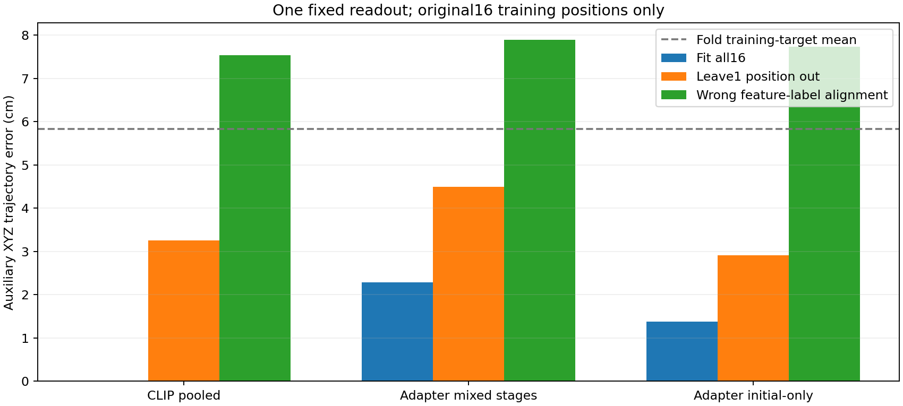

# Panda初始训练观察的特征读出对照

2026-10-15。本项只复用已保存的16个初始训练观察的CLIP/Adapter数组，补充此前未做的同方法读出对照；不重新编码图像、不加载模型、不运行扩散、不更新神经网络、不使用4条开发或5条测试演示。辅助线性映射会使用训练标签拟合，不能将它描述为完全没有拟合。

## 为什么没有重复旧实验

此前Bridge203876检查过余弦近邻轨迹，Panda检查过图像交换与噪声恢复；这些结果没有比较同16张Panda图像在CLIP和两组Adapter后的几何可读性。本项使用它们已经保存的数组，不重跑生成或训练。输入、脚本和输出指纹保存在[固定计划](../reports/panda_feature_readout_20261015/plan.json)。

## 固定方法

三种输入均为1024维：冻结CLIP的`0.5*(CLS+patch mean)`、原8192更新模型的Adapter条件、1024更新初始专项模型的Adapter条件。目标仅为原16步未来末端的相对XYZ，不含旋转/开合，不把物体坐标或目标作为输入。

使用同一中心化岭回归，固定正则系数0.001；每次仅用当前拟合子集计算均值和总方差尺度，不做参数搜索。除全部16样本拟合外，再逐次拿出1个原训练位置，仅用其余15个拟合辅助读出；错配对照在这15行内部固定平移特征顺序，不使用被拿出样本的标签。另有其余15条目标均值基线。两种线性代数实现（对偶求解/SVD）预测最大差1.77e-13米，保存预测的独立误差复算和文件身份核对通过。

**Adapter权重此前已在这16条监督上训练过。这里“留一个位置”只排除该样本参与辅助读出的拟合，没有把它从Adapter原训练中排除，因此不是独立策略泛化验证。** CLIP冻结预训练模型与Adapter也有这一学习历史差别。

## 结果

均为XYZ轨迹路径位置误差，单位cm；辅助线性读出不是完整扩散策略。

| 输入表示 | 全16拟合后评价同16 | 辅助读出每次留1 | 特征标签错配对照 |
|---|---:|---:|---:|
| CLIP池化特征 | 0.00775 | 3.253 | 7.538 |
| 原混合阶段Adapter | 2.282 | 4.492 | 7.890 |
| 初始专项Adapter | 1.377 | 2.907 | 7.740 |

每次其余15条目标均值基线为5.836cm。CLIP/原Adapter/专项Adapter分别有14/16、9/16、16/16位置优于这个均值，但仍不是精确位置能力通过。原扩散完整输出在这些已见初始训练窗口为7.152cm，专项扩散输出4.293cm；这些是不同读出机制的结果，不能把辅助回归分数冒充扩散模型分数。

## 能说明什么

1. **冻结CLIP池化特征允许对这16条已见接近轨迹做高精度拟合。** 约0.08mm只是1024维特征对16条已见样本的读出结果。高维映射容易记忆，逐次留1仍有3.25cm，所以不能据此宣布视觉定位或泛化成功。
2. 相同正则读出在原Adapter后表现较差，专项Adapter部分改善；这提供了后CLIP条件表示及读出值得重点检查的证据，**没有唯一证明Adapter损坏或丢失了位置信息**。全部16个向量仍各不相同。
3. 表示差异的数值结构明显不同：CLIP第一主成分占图像间变化约30.0%，两个Adapter分别约98.9%和98.2%。这里是同阶段样本间变化，不是1024个特征里“信息只剩一个”；较小变化方向仍可能含有位置。固定正则会更强地压低这些方向，故不能把读出差距直接等同于不可逆的信息损失。
4. 本项没有检查冻结CLIP的全部patch token，也没有得到可执行的旋转/夹爪轨迹或新物理结果。正式留出抓取仍0/12。

## 停止与后续范围

本问题已经有记录，不再更换正则系数或读出模型寻找好看的分数。当前最直接的未完成问题仍是：如何使现有Adapter/扩散链可靠利用已见初始画面的差异。下一项若要改变训练或接线，应先提出可区分假设的单项对照，并核对[已有证据索引](DIAGNOSTIC_EVIDENCE_INDEX_20261015.md)，不得重跑本项或先前的尺度/调度/缓存检查。没有确认唯一根因，不将回归读出替换为论文主方法。

入口：[唯一计算脚本](../scripts/readout_panda_initial_features_20261015.py)。结果：[报告](../reports/panda_feature_readout_20261015/report.json)、[独立核验及数值结构](../reports/panda_feature_readout_20261015/independent_audit.json)、[逐位置误差](../reports/panda_feature_readout_20261015/per_window.csv)。无新模型权重、图片或数据下载。
