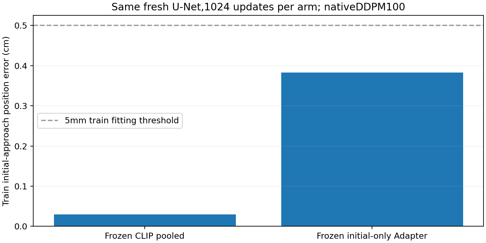

# 冻结CLIP与Adapter条件的扩散头配对

2026-10-15。用户同意继续排查后，依据[已有证据索引](DIAGNOSTIC_EVIDENCE_INDEX_20261015.md)补充这一项尚未做的对照。之前的线性读出不运行DDPM，之前的初始专项训练同时更新Adapter与动作头，均不能回答“只训练同一个U-Net时，两种冻结条件有什么区别”。不重跑前述实验。

## 固定问题与范围

只使用原16个初始训练窗口，缓存输入分别为CLIP的`0.5*(CLS+patch mean)`和已经训练过的初始专项Adapter条件。后者原训练看过这些标签，两组不能当成独立留出验证，也不能按结果唯一判定Adapter好坏。

两组都用当前16条训练特征的逐维均值居中，再除以一个全局RMS尺度，不白化，不用动作标签计算条件统计。这样保持1024维条件总体变化尺度可比；这是两组共同的诊断处理，不修改原模型或动作归一化。它与原联合训练接线不同，不能声称精确复现原专项配方。

复用既有缓存动作头包装和当前生产`diffusion_loss/sample`函数，不加载或前向CLIP/Adapter。只用同一新初始化43的77,670,023参数多尺度U-Net，原100步余弦x0目标和原生DDPM100生成，位姿MSE、Adam、梯度裁剪1。每组1024更新、batch8、各窗口512抽取，前512次1e-4、后512次1e-5；样本顺序与逐步随机种子相同，实际含噪动作及时间步逐次记录哈希。

夹爪参数冻结，不参与损失和结论；样本仅有打开目标，本项不学习完整抓取。只评价各组最终模型全部16窗×原3采样种子，沿用5mm/5°及90%窗口一致的位姿门槛。没有开发/预留测试、物理回合或中途模型选择。每组只保存一份缓存头最终权重，总计小于1GiB，无优化器/中间权重、数据或依赖下载。

## 结果如何解释

- 若两组都拟合：两种冻结表示在本设置允许U-Net拟合，原联合优化及条件使用仍需单独解释。
- 若CLIP组拟合而Adapter组未拟合：表示来源影响本设置可学习性，但统计条件和有限预算等仍可能影响，不能直接证明Adapter存在代码bug或不可逆信息损失。
- 若两组都未拟合：该预算没有建立成功动作头参照，不能用这项对照指认唯一模块，按规则停止，不再加更新/种子/条件变体。
- 任一结果均不是新位置泛化、闭环抓取成功或以回归替换扩散主方法。

## 当前状态

两组各1024更新、最终原生DDPM100评价、权重回读及独立CPU复核已完成。**CLIP条件组通过全部16个初始训练窗口的位姿门槛；Adapter条件组多数达到毫米级，但14/16不足90%，整体门槛未过。**

| 最终固定检查点，3采样均值 | 冻结CLIP池化条件 | 冻结初始专项Adapter条件 |
|---|---:|---:|
| 路径位置误差 | **0.301mm** | **3.832mm** |
| 路径旋转误差，独立复算 | 0.252° | 0.951° |
| 第16目标位置误差 | 0.366mm | 5.394mm |
| 第16目标旋转误差 | 0.266° | 1.009° |
| 三采样均达标窗口 | 16/16 | 14/16 |
| 原整体位姿拟合门槛 | 通过 | 未通过 |

虽然Adapter组全体平均位置小于5mm，但`xy_2_4`和`xy_3_4`窗口未达标：三采样平均6.83mm与17.28mm，后一窗口最差一次采样21.39mm。不能因为总体平均较低改写门槛。图中虚线只表示平均位置阈值，不包含逐窗一致性条件。

## 新增证据及其边界

- **在这批不同位置的初始训练观察上，现有多尺度U-Net、x0训练和100步DDPM链可以生成精确接近轨迹。** 这是真实神经扩散输出，不是前次辅助线性读出、低噪声给答案或专家重放；它提供了本任务上的训练集成功参照。
- 同一预算/头初始化下，冻结Adapter表示的精度与一致性较弱，但也允许多数窗口毫米级拟合。因此不能宣称Adapter完全没有位置信息或已唯一定位某个坏层。
- 这项训练冻结条件，并对两种条件做相同的训练集居中/整体尺度处理，只优化位姿头；与原联合训练的可变Adapter、条件数值、头随机起点和夹爪联合目标有差异。**不能直接把改善全部归因于条件归一化或冻结Adapter。** 两组之间的差值才是本项有效配对。
- 没有新图像编码、CLIP/Adapter前向或优化；所有16个输入都来自已见原训练位置，Adapter原训练也见过其标签。未评价4个开发位置或5个预留测试，不代表新位置泛化。
- 没有训练夹爪或执行物理回合。这两个缓存头不是可直接运行整任务的策略，原正式模型留出抓取仍0/12。

## 验收与存储

两组初始U-Net指纹相同，全部1024次实际含噪动作和时间步哈希逐项一致；目标和冻结条件与源数组一致，输入源码保持原指纹。每组最终权重从磁盘回读，所有张量与保存前逐项相同，首个采样batch预测重放差0。独立CPU复算总体和逐窗门槛通过。

每组训练约60秒，含最终评价/保存/回读各约79秒；峰值保留显存1.598GiB。两份缓存头权重共623,856,841字节（约595MiB），不含CLIP/Adapter或优化器。没有依赖安装或下载。

本配对按预算结束，不重跑这两组或追加更新。若下一项继续，最小单变量问题是**相同冻结Adapter条件，原样输入与当前居中/尺度处理是否不同**；处理组直接复用本次结果，只需新增原样组，并保留相同初始化、batch、随机流和预算。该下一项尚未启动；不能预先认定条件处理就是根因。

后续经用户同意已仅新增原样组并完成：原样10.465mm/2窗一致达标，原处理组3.832mm/14窗，位置改善63.39%、15/16窗改善；实际1024个噪声/时间步哈希等保护通过。该因素在本固定设置有证据，原配对未重跑。仍未达到整体门槛，也未验证联合训练或泛化。见[单组补充结果与限制](PANDA_RAW_CONDITION_CONTROL_20261015.md)。

入口：[单次配对训练及CPU复核](../scripts/compare_panda_frozen_conditions_20261015.py)。证据：[冻结计划](../reports/panda_frozen_condition_heads_20261015/plan.json)、[完整报告](../reports/panda_frozen_condition_heads_20261015/report.json)、[独立复算](../reports/panda_frozen_condition_heads_20261015/independent_audit.json)、[逐窗口结果](../reports/panda_frozen_condition_heads_20261015/per_window.csv)。已有运行目录禁止覆盖。
