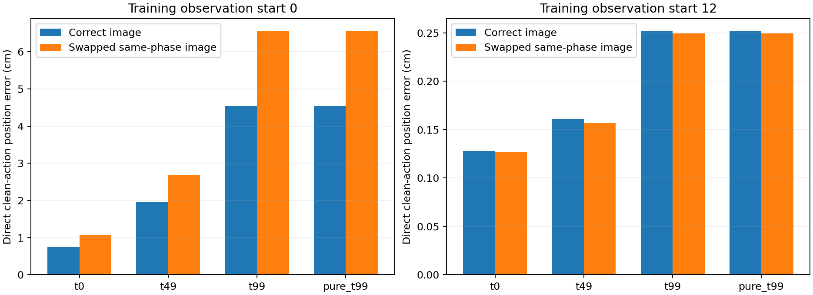
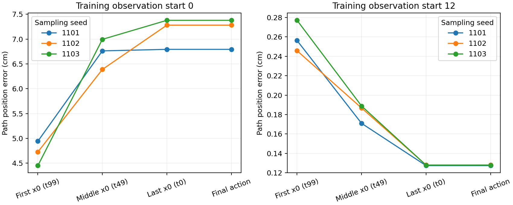
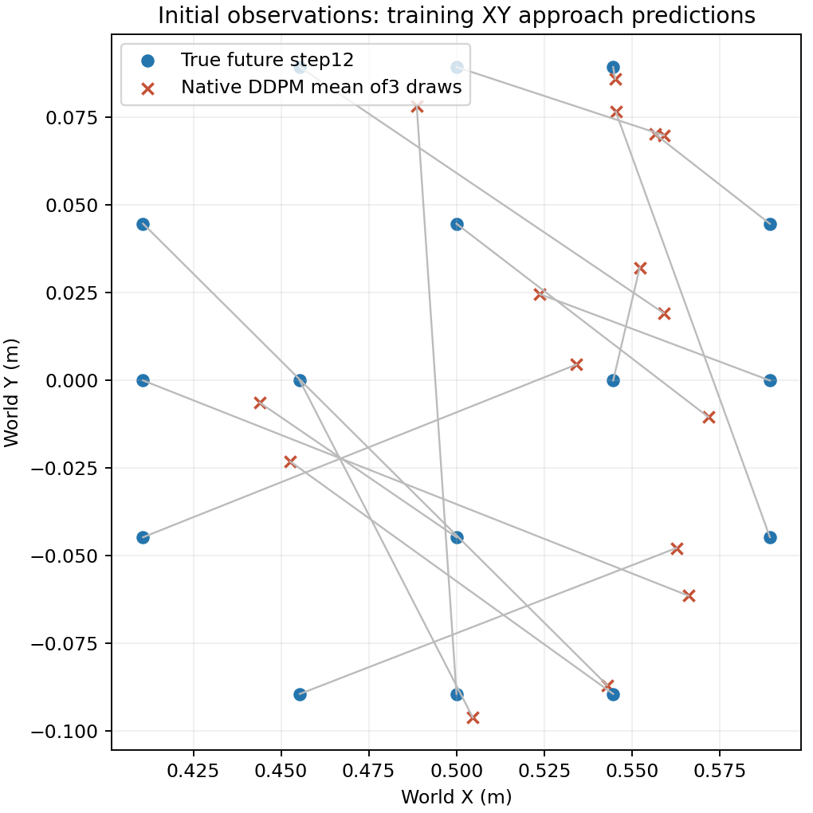

# Panda初始接近阶段冻结诊断

2026-10-15。承接[Panda固定预算实验](PANDA_SPATIAL_FIXED_TRIAL_20261015.md)，本轮只检查其最终检查点的16条训练演示，不训练、不读取开发/测试目标、不执行新的物理回合。正式实验仍为留出抓取0/12；本页不是修复成功报告。

## 本次确认的区别

**训练初始接近预测不准确，并且原生生成链会进一步放大这段位置误差。后续阶段的毫米级结果不能证明物体定位已经学好。**

训练数据由同一个脚本专家在16个位置采集。初始观察的机械臂位姿、夹爪和指令相同，方块画面位置不同，正确接近轨迹必须因位置而变。对准之后的脚本动作几乎都是同样的向下、闭合、抬升，转成相对于当前末端的动作后，各位置的目标极其相似。

为量化这一点，对每条训练演示用另外15条演示的同阶段平均轨迹预测：初始阶段位置误差5.836cm；已对准的起点12仅0.064cm，起点24/36等更接近0。这是使用已知专家阶段的目标变化诊断，不是可部署策略，也不是留出成绩。它说明之前后续阶段好看，很大程度上可能只需要读出共同动作模板；尚不能据此证明视觉几何定位成功。

## 接口检查

- 32个训练窗口：16个初始观察和同演示16个起点12观察。原始未来实测位置经独立矩阵反变换，最大重建差1.20e-8米；XYZ归一化分量最大1.034，小于既定裁剪3。没有发现这一段的索引或尺度错误。
- 训练缓存token路径与在线编码路径的上下文最大分量差1.43e-6，与此前保存上下文差2.38e-6。用原保存上下文重放原生采样后，全部32窗×3采样最终预测逐元素差0。未发现足以解释厘米级错误的缓存或在线预处理错配。
- 专家记录的请求与实测位置在这些窗口平均差0.057cm，仅用于控制跟踪背景，不是新策略准确率，也不证明任意预测都能成功执行。
- 全部参数与生产源码在检查前后保持相同，最终权重SHA仍为`967abf071dfdefd8121652e5b974690bc3b9f9ede01a7d45d06a04b961481d7b`。无优化器、额外权重、依赖安装或下载。

## 从含噪动作恢复的结果

固定每个窗口的噪声和扩散时间，只交换同一阶段、另一训练位置的图像融合条件；指令不变，直接调用冻结U-Net预测干净动作。表中是16窗×3噪声采样的路径位置误差，单位cm。

| 输入 | 初始：正确图像 | 初始：换图像 | 已对准：正确图像 |
|---|---:|---:|---:|
| 低噪声真实轨迹 t0 | 0.735 | 1.074 | 0.128 |
| 中噪声真实轨迹 t49 | 1.958 | 2.683 | 0.161 |
| 高噪声真实轨迹 t99 | 4.527 | 6.557 | 0.252 |
| 完全纯噪声，t99 | 4.527 | 6.557 | 0.252 |

t99的信号保留`alpha_bar=2.43e-7`，接近纯噪声。初始条件换图像会改变输出并增加误差，说明图像条件没有完全被忽略；但正确图像也不足以生成准确接近动作。低噪声结果含有真实目标信息，只能看作恢复测试，不能当作无需答案的预测成绩。这里的“噪声”加在动作轨迹上，不是把图片弄模糊。

## 同一条原生生成链追踪

使用正式实验原保存上下文和原随机流，保持原生DDPM100不变，仅加只读钩子记录干净动作估计。没有重新选择采样种子或替换推理器；三个原种子的最终预测全部精确重放。

| 原生链中的干净动作估计 | 初始观察位置误差 | 已对准观察位置误差 |
|---|---:|---:|
| 第一轮 t99 | 4.706cm | 0.260cm |
| 中间 t49 | 6.716cm | 0.182cm |
| 最后一轮 t0 | 7.152cm | 0.128cm |
| 最终动作输出 | 7.152cm | 0.128cm |

初始16窗中，三个采样分别有11/16、12/16、14/16从首次估计到最终位置误差增加；平均增加约2.45cm。已对准阶段平均改善。首次估计本来就不准确，不能解释成“已经生成正确路线，只被最后后处理毁掉”；同时也不能解释成“所有误差都只在第一步出现”。相对于当前真值的误差增大不等于DDPM更新公式存在错误，仍可能是学到的条件去噪映射不足、训练分布与自身生成输入不同等因素。

## 下一步范围与边界

当前优先级是验证**同一批16个初始观察能否被可靠映射到各自的不同接近轨迹**。下一项应围绕这一训练映射，分开检验冻结视觉特征、Adapter条件和动作读出，固定样本身份与动作定义；先回答这一具体问题，再讨论完整任务或新位置。当前尚不能唯一判定CLIP、Adapter或U-Net中的某层故障，不能根据本诊断直接宣布某个修复方法有效。

本轮到此结束，不改变正式训练配方或继续增加数据/轮数。不会把后续阶段模板拟合、单次x0恢复或图像敏感性替代实际抓取成功。

随后另行执行了一个预先限定的初始阶段训练能力检查：同16个训练位置、相同初始化和每窗512次抽取，移除其他阶段、共1024更新。初始训练位置误差7.152→4.293cm，仍未拟合，0/16窗三采样达标；重载输出精确一致。未追加更新或新物理回合，不修改原正式实验结果。见[专项检查及限制](PANDA_INITIAL_ONLY_FIT_20261015.md)。

证据：[冻结检查报告](../reports/panda_initial_approach_probe_20261015/report.json)、[原生链报告](../reports/panda_initial_approach_probe_20261015/trace_report.json)、[独立CPU复核](../reports/panda_initial_approach_probe_20261015/independent_audit.json)、[同阶段目标变化诊断](../reports/panda_initial_approach_probe_20261015/phase_constant_diagnostic.csv)。入口：[冻结检查](../scripts/probe_panda_initial_approach_20261015.py)、[精确链重放](../scripts/trace_panda_initial_approach_20261015.py)、[独立复算](../scripts/analyze_panda_initial_approach_20261015.py)。
