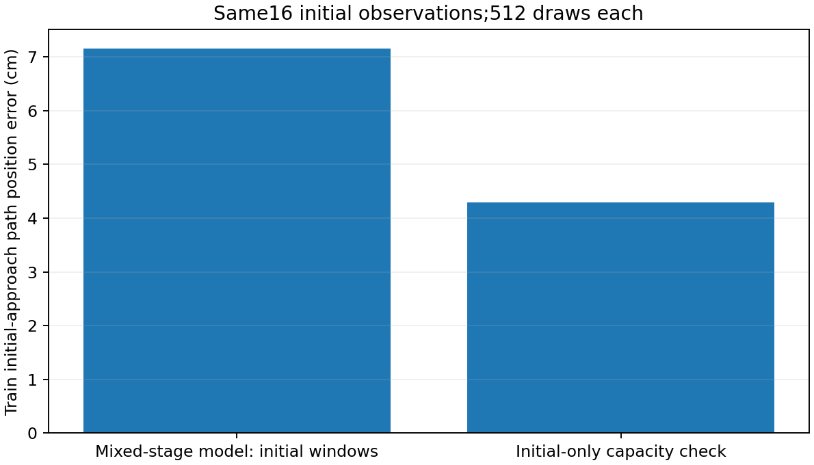

# 16个初始接近窗口的训练能力验证

2026-10-15。用户同意优先解决训练位置的初始接近后，先完成[冻结诊断](PANDA_INITIAL_APPROACH_PROBE_20261015.md)，再执行本项单独的训练能力验证。它不覆盖或修改原8192步联合实验，也不重新评价开发/预留测试。

## 固定范围

仅使用原16条训练演示的起点0，共16窗，动作仍是原16个未来实测到达位姿及全打开夹爪标签。从与原实验相同的初始化43重新开始，冻结CLIP，原8层Adapter、多尺度x0扩散及夹爪联合训练，保持原损失、batch8、Adam和裁剪。不是回归替换，不接续旧权重。

从原8192个batch的样本顺序中筛出全部初始窗口抽取，保持这些抽取的先后次序，再组成batch8，共1024更新；每窗512次，与原实验该窗口曝光次数一致。前512次1e-4、后512次1e-5，两阶段各窗分别256次。移除其他阶段会改变混合梯度、优化器更新次数及批次/RNG组合，因此这是初始映射能力检验，不是唯一根因的单因素证明。

只评价最后固定更新，用原1101/1102/1103采样种子、原生DDPM100、全部16训练窗，不以中途结果选权重。使用原位姿门槛：每次采样总体路径位置≤5mm、旋转≤5°，至少90%窗口在三个采样均达标，各采样总体终点≤1cm/10°。没有开发目标、图像坐标特征或专家手动修正。只存一份小于1GiB的最终非CLIP权重，无中途/优化器权重，失败不自动增加更新、位置或初始化。

这些窗口夹爪目标始终打开，没有闭合/释放监督，结果不能代表完整抓取或新位置泛化。无论通过与否，都不将这个阶段专用模型替换正式整任务策略。

## 当前状态

固定1024次训练、全部训练窗评价、独立CPU复算与磁盘权重重载均已完成。**位置有所改善，仍未达到拟合门槛。**

| 同样16个初始训练窗 | 原混合阶段模型 | 本次初始专项模型 |
|---|---:|---:|
| 路径位置误差 | 7.152cm | 4.293cm |
| 第16目标位置误差 | 10.942cm | 6.508cm |
| 路径旋转误差（独立复算） | 0.606° | 0.673° |
| 三次采样均达标窗口 | — | 0/16 |
| 整体位姿拟合通过 | 否 | 否 |

本初始子集的静止位置基线为5.520cm。新模型平均位置优于该基线，但各采样平均位置分别4.896/3.504/4.478cm，距5mm拟合门槛仍远。未进行留出评价或新物理抓取，因此正式实验的留出物理0/12不变。

所有夹爪目标均为打开，100%准确率与“一直打开”相同；关闭和释放均不可评价，不据此宣称夹爪学习成功。CLIP保持冻结、非CLIP起点与原初始化逐项一致，三个可训练模块均已改变。专门训练初始阶段提供部分改善，但本固定预算仍未拟合，不能把问题唯一归为其他阶段干扰，也不能说模型无法学习或视觉特征一定无效。

训练约200秒，训练/最终评价/保存共约221秒，峰值保留显存3.018GiB。最终非CLIP权重526,174,679字节，SHA256=`e5d37f6d7251a0fe5581a93715504eaf182ac7414ed577f7e322b2d5cb99ec1f`。独立重载后参数指纹一致，在线编码上下文最大分量差1.19e-6，使用保存上下文的三个采样全部预测逐元素差0。

按1024更新停止，不加轮数、种子或位置。下一项应在同16张训练初始图像上对冻结CLIP特征与Adapter条件做相同的几何读出检查，先区分位置能否在这些表示中被简单读出；读出失败也只能说明该读出方法不足，不能直接证明特征不存在信息。当前没有确认唯一根因或得到完整策略修复。

这项读出现已仅用已有数组完成，无重编码或神经训练：CLIP全16拟合约0.08mm，辅助留1为3.253cm，两个Adapter为4.492/2.907cm，未得到唯一故障层或泛化结论。见[固定读出与边界](PANDA_FEATURE_READOUT_20261015.md)。后续不重复本专项训练或读出扫描。

随后不同问题的冻结条件U-Net配对已完成：共用条件居中/尺度处理，CLIP条件0.301mm、16/16通过；本专项Adapter冻结条件3.832mm、14/16，仍未过整体一致性门槛。它只更新位姿头，与本页联合配方不同，不能把改善唯一归因于冻结或条件尺度。原正式整任务结果保留。见[配对完整记录](PANDA_FROZEN_CONDITION_HEAD_PAIR_20261015.md)。

入口：[训练与完整最终评价](../scripts/fit_panda_initial_only_20261015.py)、[磁盘重载](../scripts/reload_panda_initial_only_20261015.py)、[独立复算（--initial-fit）](../scripts/analyze_panda_initial_approach_20261015.py)。证据：[冻结执行计划](../reports/panda_initial_only_fit_20261015/plan.json)、[训练及最终报告](../reports/panda_initial_only_fit_20261015/report.json)、[独立核验](../reports/panda_initial_only_fit_20261015/independent_audit.json)、[重载报告](../reports/panda_initial_only_fit_20261015/reload_report.json)。
