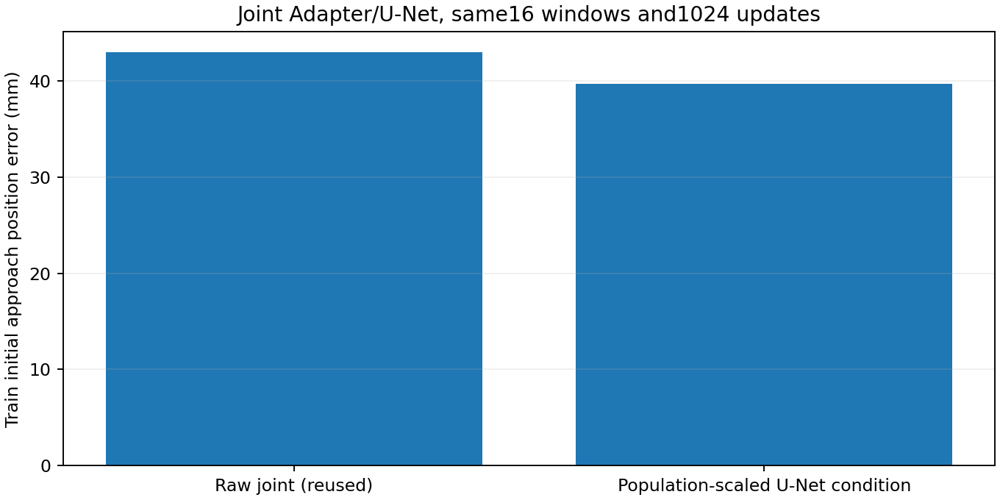

# 条件处理进入Adapter联合训练的单组验证

2026-10-15。承接[固定条件处理收益](PANDA_RAW_CONDITION_CONTROL_20261015.md)，本项补充“Adapter也更新时是否仍有效”，不重新执行冻结头实验或原样联合训练。

## 新组与复用控制

复用原16个初始训练窗口、完整模型初始化43、1024更新、batch8、每窗512次、原分段学习率/Adam/梯度裁剪、Adapter dropout0.1和夹爪联合损失。控制为已完成的[原样联合训练](PANDA_INITIAL_ONLY_FIT_20261015.md)，最终训练路径位置4.293cm。新组只在U-Net输入端增加非训练参数的条件变换；夹爪头继续读取原Adapter条件，生产模型和旧检查点不改。

联合训练期间Adapter输出会变，因此不直接沿用冻结Adapter算出的统计量：每步更新前，用当前Adapter的eval模式对全部16条训练观察计算逐维均值和一个全局RMS。校准无梯度、不消耗随机数，不包含动作标签或开发/测试输入；随后原训练batch在原dropout模式下按`(context-mean)/scale`进入U-Net。统计量作为常量，不反向传播。最终权重再用同16条训练观察校准一次，保存均值与尺度，推理只读取固定统计，不使用当前推理batch重算。

这是一项明确的联合训练候选实现，与此前固定条件统计不能视为完全同一设置。它测试自适应训练人口统计的U-Net条件接口，不将任何结果直接解释为整个项目唯一根因。

## 验收与停止

构建新模型后逐组参数指纹必须匹配原联合初始化。只重放一次原样首batch损失验证入口，0次旧控制优化。实际动作加噪和时间步每步核对已有同数据/顺序/种子记录；所有原始目标及核心源码保持原身份。

只评价最后固定更新：16个已见窗口、原3采样种子、原生DDPM100与原位姿门槛。无开发/测试、物理回合、中途选权重或种子搜索。若未过门槛则记录部分改善/失败，到1024步结束，不扫描其他统计量或处理方法。该初始子集夹爪始终打开，无法验证关闭、释放或完整抓取。

旧运行未保留完整CLIP token序列，只有池化摘要；本次联合训练必须补算16个token序列一次，核对既有池化缓存并保存完整token，以供后续直接复用。只存一份最终非CLIP权重（小于600MiB）及小型token/数值缓存，无优化器或中间权重，无新依赖/数据下载。

## 最终结果：候选未通过，不采用

新组1024次更新、最终原生DDPM100评价、独立CPU复算和新进程重载均已完成。下面均为同16个已见训练窗口、3个固定采样种子的结果；旧原样控制没有重训。

| 指标 | 原样联合训练（复用） | 动态条件处理联合训练（新增） |
|---|---:|---:|
| 路径位置误差 | 42.926mm | 39.707mm |
| 路径旋转误差，独立float64复算 | 0.673° | 2.507° |
| 第16目标位置误差 | 65.077mm | 58.687mm |
| 第16目标旋转误差 | 0.763° | 1.739° |
| 三采样均达标窗口 | 0/16 | 0/16 |
| 原整体位姿拟合门槛 | 未通过 | 未通过 |

位置误差仅下降7.50%，旋转变差，两个组均0/16一致达标。**此前冻结Adapter条件下约63.39%的位置收益，没有在这套联合训练实现中重现；这项动态统计候选不采用。** 此结果不证明所有联合训练条件处理均无效，也不唯一定位某一模块或整个项目的根因。每组只有一次训练初始化；3个种子只是采样重复。

## 执行与重载核验

初始参数与原联合模型相同，未启用处理时首batch损失重放差0，全部1024步实际含噪动作及时间步与已有记录完全相同。CLIP未变化，Adapter、实际U-Net核心和夹爪参数已更新。条件统计仅用16条训练观察，最终全局尺度0.0203434；保存的变换对推理batch大小不敏感，推理不更新统计。

新进程加载同一份最终权重及训练统计，参数指纹全部吻合；使用保存条件的16窗×3采样最终预测逐元素差0。重新前向Adapter的上下文有微小浮点差异（最大9.54e-7），首batch动作分量最大差约1.08e-4，未将其写成逐元素精确重放。重载期间没有重新校准统计、训练或使用开发/测试数据。

最终非CLIP权重526,179,663字节，SHA256为`2bf2a07b10882e3ae431a92682d02ab9abfc9cefd0312f17ba90a273ab6ad672`；完整16条CLIP token缓存16,218,818字节已保存，今后同输入可直接复用。含评价、保存和首次回读约311秒，峰值保留显存3.025GiB，无下载或依赖安装。

本轮没有开发/预留测试或物理回合，初始子集全打开标签不验证开合或抓取。整任务原留出抓取0/12没有改变。生产核心和默认配方保持原样，新增包装器只用于显式诊断候选。

## 停止与证据

按原1024更新预算结束，不追加步数、初始化、统计变体或参数扫描；失败候选、原控制与缓存全部保留。执行核验通过不等于拟合通过。下一项工作必须先查[避免重复索引](DIAGNOSTIC_EVIDENCE_INDEX_20261015.md)，不能把此候选换名称再跑。

入口：[新组训练与独立复算](../scripts/joint_panda_condition_transform_20261015.py)、[显式条件变换](../code/population_condition_transform.py)、[新进程重载](../scripts/reload_panda_joint_condition_20261015.py)。证据：[固定计划](../reports/panda_joint_condition_transform_20261015/plan.json)、[执行报告](../reports/panda_joint_condition_transform_20261015/report.json)、[独立复算](../reports/panda_joint_condition_transform_20261015/independent_audit.json)、[重载结果](../reports/panda_joint_condition_transform_20261015/reload_report.json)、[逐窗结果](../reports/panda_joint_condition_transform_20261015/per_window.csv)。
