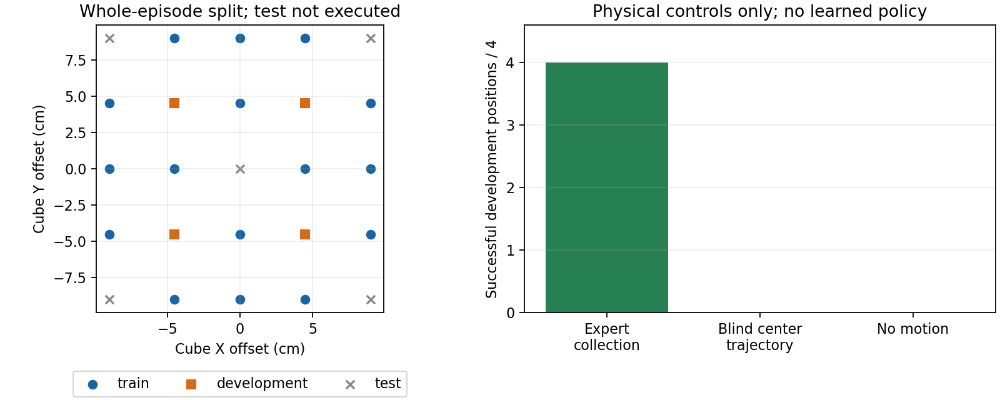

# 同场景新位置抓取的最小对照准备

2026年10月15日。已建立一份固定相机、固定Panda机器人、固定方块外观的新位置对照，并通过物理采集、动作重放和6次更新的GPU预检。**正式模型尚未训练，尚无本轮学习模型的抓取或泛化结果。** 这项对照用来验证自有模型在含义明确的环境中能否学到可迁移的动作，不用于宣称已经修复Bridge，也不代替公开benchmark或零样本实验。

## 为什么选这个对照

Bridge现有文件不能严格确认相机外参与原始时钟；重新选择同目录片段不能自动建立同场景控制。已有PyBullet单演示正对照则有明确的机器人、相机、物理步长和控制器，可以固定它们，只改变方块的初始XY。

每条演示都独立重置并进行物理采集，但来自同一参数化脚本专家，不是独立人工操作者或新任务。模型只接收当前RGB、同一句指令和实测手指开度。采集专家可读取方块位置，学习模型不能读取它；物体高度和接触日志只用于验收，不作为特征。各演示起始机器人位姿与夹爪输入实测完全相同，初始RGB则20张均不同。

## 在训练之前拦住一个无效评价设计

最初网格间距2cm，开发方块偏移为两个方向各±2cm。专家在4个开发位置都成功，但**完全不看图、总按桌面中心执行的同一固定轨迹也4/4成功**。这种任务即使模型完成，也不能证明学到了定位。第一版数据、协议及结果保留，不进行正式拟合，不把它包装成泛化成功。

第二版在任何正式学习前冻结网格间距4.5cm，其他机器人、物体、相机、阶段和16/4/5划分索引不变。开发偏移为两个方向各±4.5cm，训练网格覆盖到±9cm。第二版数据没有执行第一版预留测试位置；中心点在历史单演示实验中出现过，因此“预留测试”仅指本轮配方未使用，并非全项目从未见过的状态。

第二版事前物理资格门槛为：20个训练/开发位置的专家都成功，盲中心轨迹在4个开发位置最多成功1个。实际专家20/20、盲中心0/4，静止0/4。它们是物理控制成绩，**不是模型成绩**。



## 固定的数据与动作含义

| 项目 | 已冻结设置 |
|---|---|
| 任务 | 抓起同一黑色4cm方块并抬升；不测新物体、指令或机械臂 |
| 机器人及相机 | 原有Panda、link11、双指电机；固定224×224 RGB相机 |
| 训练 | 16条演示，每条8窗，共128窗 |
| 开发 | 4条完整独立演示，每条8窗，共32窗，初始XY与训练不重合 |
| 预留测试 | 5个位置，本轮未生成演示或执行rollout |
| 动作长度及尺度 | 每窗16个目标；当前工具系XYZ/0.10m、xyzw四元数、开正闭负命令 |
| 时序 | 240Hz物理步，每次电机命令24步，即0.1秒；103个观测、102个有效命令 |
| 标签 | 输入obs[t]，未来位姿state[t+1:t+17]，配command[t:t+16]夹爪命令 |
| 模型输入 | 当前RGB、固定指令、实测手指宽度；本轮不增加当前末端状态端口 |

原始文件同时保存了实际观测、请求的绝对电机目标和有效命令，便于区分“命令下发前”与“执行后到达”。不使用无效末步action，不跨演示拼接窗口。所有窗口都有16个真实未来观测，无补齐标签。

方块只在初始观测之前设定位置，任务过程中只通过机械臂和手指电机操作，不绑定或传送物体。成功沿用已有标准：最后10个执行动作中物体持续高于初始位置10cm，最终有双指接触。这不要求精准停在某个高度，也不验证释放/放置能力。

## 已实际执行的验收

| 检查 | 结果 | 能说明什么 |
|---|---:|---|
| 训练及开发专家采集 | 20/20成功 | 场景、接触和采集专家可完成任务 |
| 4条固定训练演示原生命令重放 | 4/4成功，实际位置逐项差0 | 该环境中控制器可重放所记录命令 |
| 同4条未来实测位姿重放 | 4/4成功 | 这些实际到达位姿可作为该Panda控制器目标 |
| 第二版开发盲中心轨迹 | 0/4成功 | 固定中心抓取不能蒙混通过这一对照 |
| 第二版开发静止 | 0/4成功 | 保持当前位置不能完成物理任务 |
| GPU首步梯度及6步参数变化 | Adapter、位姿头、夹爪均有；CLIP无 | 联合训练入口和冻结规则可运行 |
| 完整100步原生DDPM输出 | 有限，形状2×16×8，四元数单位化 | 预检生成入口可运行，不代表动作准确 |

预检在本地RTX4060 Laptop 8GiB进行，batch8峰值分配约2.83GiB，峰值保留约3.01GiB，暖更新约0.156秒。没有保存新权重，没有在开发集上运行模型，没有安装或下载依赖。六次更新不能证明拟合、夹爪切换学习或泛化。

第一GPU包装入口继承CPU采集模块的`CUDA_VISIBLE_DEVICES=-1`，在加载模型和更新前失败。失败记录保留在`reports/panda_spatial_control_v2_gpu_preflight_20261015/failure.json`；随后在新进程直接调用GPU入口通过。冻结采集源码和生产模型均未修改。复用预检应使用新独立入口，不使用CPU准备包装器的旧`preflight`子命令：

```powershell
& 'D:/miniconda/envs/zeroshot-gpu/python.exe' scripts/run_panda_spatial_gpu_preflight_20261015.py --output reports/panda_gpu_preflight_new
```

已有结果无需重复运行。当前通过报告在`reports/panda_spatial_control_v2_gpu_preflight_fixed_20261015/report.json`。

## 下一项正式实验的边界

保留冻结CLIP、8层Adapter、多尺度x0扩散及原生DDPM100，**同时训练位姿与夹爪**，从初始化43重新开始，不接续6步预检权重。协议预设batch8、8192更新，前4096次学习率1e-4，后4096次1e-5，仅评价最终固定检查点，不凭开发结果挑选权重或换种子。

训练只使用16条训练演示；开发先报告全部32窗的离线指标和静止基线，再用真正学习模型闭环执行4个新位置，每个3个采样种子，每次生成16步执行前4步再观测，固定总112个执行动作。初步物理筛选要求至少3/4位置在至少2/3次采样中成功，所有结果完整报告；这是小规模实践门槛，不是统计显著性或论文benchmark成功标准。即使通过，也只说明同物体、同相机下的新位置能力，不能自动声称视觉因果定位、语言泛化或Bridge迁移成功。

固定预算失败后不自动追加轮数、网格、初始化或删除位置。后续8192次正式训练及重载评价现已完成：离线位置误差优于静止，严格训练拟合未过，学习模型开发物理抓取0/12，按规则停止；见[最终结果及阶段拆分](PANDA_SPATIAL_FIXED_TRIAL_20261015.md)。本页仍记录准备阶段的前置数据/控制/资源验收，专家和6步预检结果不随正式训练完成而变成模型成绩，没有提交集群作业。

两版原始采集共约203MiB；保留第一版是为了记录为何停止，而不是删除不利结果。准备阶段没有下载新模型、复制环境或保存新大权重；后续正式阶段另存最终非CLIP权重约502MiB。

复查：[第二版冻结协议](../reports/panda_spatial_control_v2_preparation_20261015/protocol.json)、[独立轨迹核验](../reports/panda_spatial_control_v2_preparation_20261015/verification.json)、[物理基线](../reports/panda_spatial_control_v2_preparation_20261015/physical_baselines.json)、[GPU预检](../reports/panda_spatial_control_v2_gpu_preflight_fixed_20261015/report.json)、[第一版盲执行结果](../reports/panda_minimal_generalization_preparation_20261015/physical_baselines.json)。
