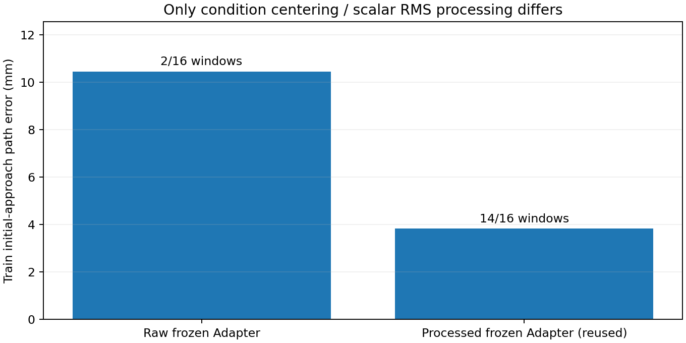

# Adapter条件处理的单组补充对照

2026-10-15。用户同意后，只新增原样Adapter条件这一组，处理组直接复用[已完成的冻结条件扩散头配对](PANDA_FROZEN_CONDITION_HEAD_PAIR_20261015.md)，不重新训练或推理该组。

## 唯一改变与固定范围

同一初始专项Adapter的16个已保存初始训练条件：处理组减去16条训练条件的逐维均值，再除以整体RMS；新组直接使用原条件。改变的是进入U-Net的1024维条件向量处理，不是图像预处理、动作归一化或DDPM调度。

复用相同缓存头构建函数、新U-Net初始化43、16个目标、每窗512抽取、1024更新、分段学习率、Adam、位姿MSE、梯度裁剪以及原生DDPM100。新组每次真实含噪动作和时间步必须匹配旧处理组的相应哈希，首个不匹配即停止。编码器和Adapter均不前向或更新，夹爪冻结且不参与结论。

只评价最终固定检查点的全部16训练窗×原3采样，保留既定位姿拟合门槛，不使用开发/测试、不做物理回合。只保存一份小于400MiB的缓存头最终权重，无优化器/中间权重、依赖或数据下载。按1024步结束，不追加步数、种子或分别搜索居中/缩放变体。

如果处理组更好，只能确认该完整条件处理在这个固定冻结头训练设置中有贡献，不能区分居中与尺度各自的作用，也不能自动解释原联合训练、Bridge或泛化失败。若两组都好或都未通过，不从中宣布唯一根因。

## 当前状态

单组1024次训练、最终DDPM100评价、权重回读及独立CPU核验已完成。**在此固定设置下，条件处理有明确收益，但尚未达到整体拟合门槛。**

| 相同冻结Adapter、相同新U-Net训练 | 新增原样条件组 | 已有处理组（直接复用） |
|---|---:|---:|
| 路径位置误差 | 10.465mm | 3.832mm |
| 路径旋转误差，独立复算 | 1.296° | 0.951° |
| 第16目标位置误差 | 15.419mm | 5.394mm |
| 三采样均达标窗口 | 2/16 | 14/16 |
| 原整体位姿门槛 | 未通过 | 未通过 |

处理组位置误差下降63.39%，16窗中15窗改善。它仍只有87.5%窗口一致达标，未达到原至少90%的标准；不更改门槛或隐藏剩余失败窗口。每组仅一次训练初始化，3个种子是采样重复，不是独立重训复核。

## 本次确认与未确认

本次两组唯一输入处理差别是：对条件向量做训练集居中和全局RMS尺度处理。初始头指纹相同，全部1024步的实际含噪动作/时间步哈希、学习率、样本计划相同，目标及冻结Adapter来源相同；因此该处理是**本实验中影响U-Net可训练性的具体因素**。它没有改变动作标签、DDPM更新公式或图像输入，原处理组的训练和推理没有重跑。

不能据此宣称找到整个项目的唯一根因：没有分开居中与缩放的贡献，也没有在原Adapter联合更新、完整任务或独立演示上验证。尤其不能只在旧模型推理端加上新处理；训练端和推理端必须一致，并绑定同一份训练集统计。当前生产模型和正式训练配方均未修改。

原整任务模型留出抓取仍0/12，本次未训练夹爪，没有开发/预留测试或物理执行。不能把缓存头位姿结果冒充完整策略修复。

联合训练后续现已完成：仅新增一个动态训练人口统计处理组，原联合控制未重训。位置42.926→39.707mm，仅下降7.50%，旋转0.673→2.507°变差，均0/16一致达标；候选不采用。这不否定本页冻结头设置的收益，但该收益没有在该联合实现中重现。见[最终结果、核验与停止条件](PANDA_JOINT_CONDITION_TRANSFORM_20261015.md)。

## 验收与停止

新组仅1024更新，原处理组0次新更新/推理。最终权重311,907,039字节（约297MiB），保存前后所有张量一致，磁盘重载后的首个采样batch预测差0；完整保存预测的独立位姿和门槛复算通过。训练约60秒，含评价/保存/回读共约79秒，峰值保留显存1.598GiB。没有依赖或数据下载。

按预算结束，不重跑该原样/处理对照，不继续扫描居中、缩放强度、步数或种子。入口：[单组补充与CPU独立复算](../scripts/check_panda_raw_condition_20261015.py)。证据：[固定执行计划](../reports/panda_raw_condition_control_20261015/plan.json)、[报告](../reports/panda_raw_condition_control_20261015/report.json)、[独立复算](../reports/panda_raw_condition_control_20261015/independent_audit.json)、[全部逐窗差值](../reports/panda_raw_condition_control_20261015/per_window.csv)。已有运行目录禁止覆盖。
