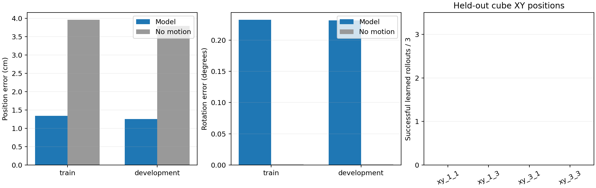
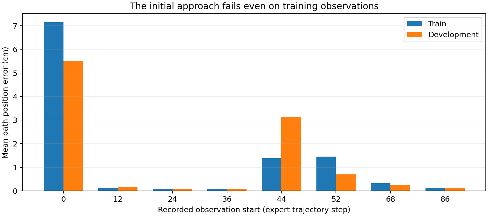
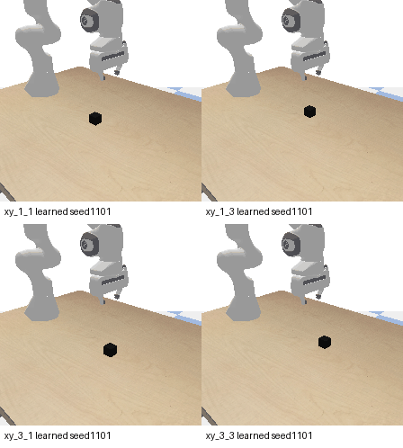
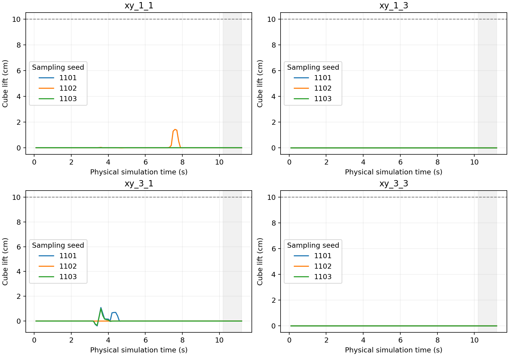

# Panda新位置固定预算联合训练

2026年10月15日。8192次联合训练、最终权重重载、全部离线评价和12次真实PyBullet闭环已完成，并经独立CPU复核。**离线位置误差优于静止，但训练拟合门槛未通过，留出位置物理抓取0/12，本轮失败。** 本实验承接已冻结的[数据与物理控制准备](PANDA_MINIMAL_GENERALIZATION_PREPARATION_20261015.md)，不将专家采集成绩当作模型结果。

后续仅做冻结训练样本检查：原生链32窗×3采样精确重放，初始接近误差从首次估计4.706cm增至最终7.152cm；已对准阶段从0.260降到0.128cm。图像确实影响初始输出，但各位置后续相对动作目标几乎一致，后续低误差不足以证明定位成功。未训练或运行新物理回合，见[阶段诊断与边界](PANDA_INITIAL_APPROACH_PROBE_20261015.md)。

## 最终结果

下表是同一个最终检查点、3个采样种子均值；采样重复不是3次独立训练。位置单位cm、角度单位度。旋转采用独立float64复算值，与生产float32约差0.003°；本固定姿态任务静止旋转误差约0，不能声称旋转优于静止。

| 指标 | 训练128窗 / 16演示 | 开发32窗 / 4演示 |
|---|---:|---:|
| 模型路径位置误差 | 1.339 | 1.255 |
| 静止路径位置误差 | 3.959 | 3.794 |
| 模型路径旋转误差 | 0.232° | 0.231° |
| 模型第16目标位置误差 | 1.919 | 1.758 |
| 夹爪准确率 / 平衡准确率 | 100% / 100% | 100% / 100% |
| 打开→关闭相邻目标对正确数（每次采样） | 16/16 | 4/4 |
| 关闭→打开目标对 | 0，不可评价 | 0，不可评价 |
| 三次采样均达标窗口 | 88/128 | 23/32 |
| 原定整体位姿拟合门槛 | 未通过 | 未通过 |

完整执行4个开发位置×3采样：`xy_1_1`、`xy_1_3`、`xy_3_1`、`xy_3_3`均为0/3。没有一回达到最后1秒持续抬高10cm及最终双指接触的成功条件。部分回合有短暂触碰或小幅抬升，不能算成功；保护边界在后两个位置有裁剪，具体次数保留在逐回合CSV。没有调用专家、传入物体坐标或人工绑定物体；5个预留测试位置未采集、未执行。



## 本轮明确了什么

把全体离线结果按专家记录的观察起点拆开，错误集中在初始接近阶段，而不是均匀分布。下面各起点含训练16窗、开发4窗，数字仍为3次采样的路径位置均误差（cm）。这些是专家轨迹观察上的预测，不是闭环执行时刻的误差。

| 观察起点 | 训练 | 开发 |
|---|---:|---:|
| 0：初始画面、尚未对准方块 | 7.152 | 5.513 |
| 12 | 0.128 | 0.174 |
| 24 | 0.074 | 0.076 |
| 36 | 0.075 | 0.073 |
| 44 | 1.383 | 3.131 |
| 52 | 1.452 | 0.701 |
| 68 | 0.325 | 0.254 |
| 86 | 0.124 | 0.117 |

初始起点占训练窗口的1/8，却贡献约66.8%的平均位置误差。初始机器人位姿、手指测量和指令在各位置相同，RGB不同，模型必须从画面读取物体位置才能决定不同的接近动作；这个阶段在训练观察上已经不准确，不能仅解释为新位置过拟合。输出并非全部恒定，现有证据不能直接归因CLIP、Adapter或扩散头中的某一层。其他若干阶段的毫米级精度也不能弥补起步失败。



离线100%夹爪指标指给定专家观察时的标签分类。闭环观察和机械臂位置由模型自己产生，接近不准、开合时机或后续状态偏离均可能阻止抓取；它不能证明实际接触成功。训练只覆盖每条演示8个指定起点，而闭环每4个动作重规划，实际输入也可能偏离这些专家观察。该覆盖差异是限制，尚未通过单变量干预确认为唯一原因。

## 独立验收与停止决定

独立脚本检查8192条更新、分段学习率、每训练窗口512次抽取、源码与最终权重SHA、训练与评价均使用同一最终检查点；CLIP未改变，Adapter/扩散头/夹爪已改变。另用原始轨迹和独立旋转矩阵重建标签、复算位姿/夹爪指标及全部12次物理判据。真实重规划参考与实际末端/宽度记录差0，独立世界位置解码最大差3.67e-8米。检查通过只说明记录和计算一致，不等于任务成功。

本轮按原停止规则结束，不追加轮数、初始化或删除失败位置。下一项应先围绕**初始训练观察→接近动作**做有界诊断，区分视觉条件读取和动作生成环节，固定其余输入与评价；在这段训练映射尚不准确时，不继续扩展数据集或宣称仅剩泛化问题。现在尚未确认唯一根因，也未得到修复。

完整数值：[独立分析](../reports/panda_spatial_fixed_trial_analysis_20261015/analysis.json)、[阶段CSV](../reports/panda_spatial_fixed_trial_analysis_20261015/observation_start.csv)、[全部物理回合CSV](../reports/panda_spatial_fixed_trial_analysis_20261015/rollouts.csv)。四个位置统一展示固定第一个采样种子，无成功回合筛选：





## 本轮执行约定

- 使用同一固定Panda、相机、黑色方块和指令，仅改变初始方块XY。16条训练演示共128窗、4条开发演示共32窗，整条演示及初始XY不重叠；5个预留测试位置不参与本轮。
- 冻结现有CLIP，训练已有8层交叉注意力Adapter、多尺度x0扩散动作头及夹爪。无当前末端状态端口，无物体坐标特征。真实末端位姿仅用于把相对输出解码为控制目标。
- 初始化43重新创建非CLIP参数，不加载6次预检权重、旧单演示抓取权重或作者机器人策略。
- batch8，固定8192次更新，每个训练窗口总计抽取512次。连续Adam状态，前4096次1e-4，后4096次1e-5；既定梯度裁剪和dropout不变。开发集不参与优化，不选择最优开发检查点。
- 只保存最终一份非CLIP权重，不保存中间权重或优化器。准备协议中的“无本地新权重”限定于准备阶段；当前用户已同意正式训练，执行清单限定本阶段最终文件小于1GiB。

## 如何判断

训练完成后，评价入口从磁盘重新载入最终文件并验证参数哈希，使用采样种子1101/1102/1103，完整计算128训练窗及32开发窗的位姿、夹爪和平衡准确率、夹爪切换指标。无释放事件会明确报告不可评价。静止位姿基线与专家对齐误差只属于离线指标，不作为物理抓取成功率。

随后用该学习模型在4个留出XY位置各执行3次闭环回合。每回合重新设置初始场景，当前RGB与实际手指宽度进入模型，原生DDPM100生成16步，执行前4步后再观测，共28次重规划、112个0.1秒动作。工作空间保护沿用原有固定边界，不读取物体位置来修正动作，不调用专家或人工绑定方块。

物理成功沿用准备阶段的判据：最后10个执行动作中物体持续高于初始位置10cm，最终左右两指均有有效接触。它不是精确高度停位或释放放置测试。事前筛选标准为至少3/4位置在至少2/3次采样中成功，全部12回合都报告。单次训练及小规模同物体位置变化不能代替公开benchmark、未见物体/指令泛化或Bridge迁移结论。

结果不满足时记录失败，不自动加轮数、换种子、改变网格或删除位置。即使离线误差与物理结果不同，也分别保留，不能事后只挑好看的指标。

## 执行与文件

使用本地RTX4060 Laptop 8GiB和现有`zeroshot-gpu`环境，复用本地CLIP资产，无新下载或依赖安装，无集群提交。训练约27.93分钟，峰值保留显存3.135GiB。只保存最终一份非CLIP检查点526,176,087字节（约502MiB），SHA256为`967abf071dfdefd8121652e5b974690bc3b9f9ede01a7d45d06a04b961481d7b`。训练及评估入口为[固定实验脚本](../scripts/run_panda_spatial_fixed_trial_20261015.py)。执行清单、训练、离线与物理原始报告位于`reports/panda_spatial_fixed_trial_20261015/`；[独立复算脚本](../scripts/analyze_panda_spatial_fixed_trial_20261015.py)和[制图脚本](../scripts/render_panda_spatial_fixed_trial_20261015.py)不依赖GPU或新推理。

以下命令用于复查流程；已有运行目录不可覆盖，不应重复启动：

```powershell
& 'D:/miniconda/envs/zeroshot-gpu/python.exe' scripts/run_panda_spatial_fixed_trial_20261015.py fit
& 'D:/miniconda/envs/zeroshot-gpu/python.exe' scripts/run_panda_spatial_fixed_trial_20261015.py offline
& 'D:/miniconda/envs/zeroshot-gpu/python.exe' scripts/run_panda_spatial_fixed_trial_20261015.py rollout
```

三个阶段已经顺序完成，已有运行目录禁止覆盖。这是同方块、同相机的局部位置变化实验，不是Bridge迁移、零样本测试、未见物体/语言泛化或公开benchmark复现。
