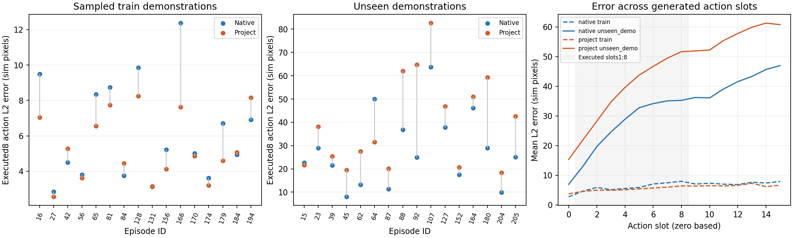
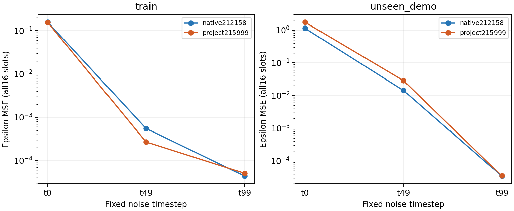
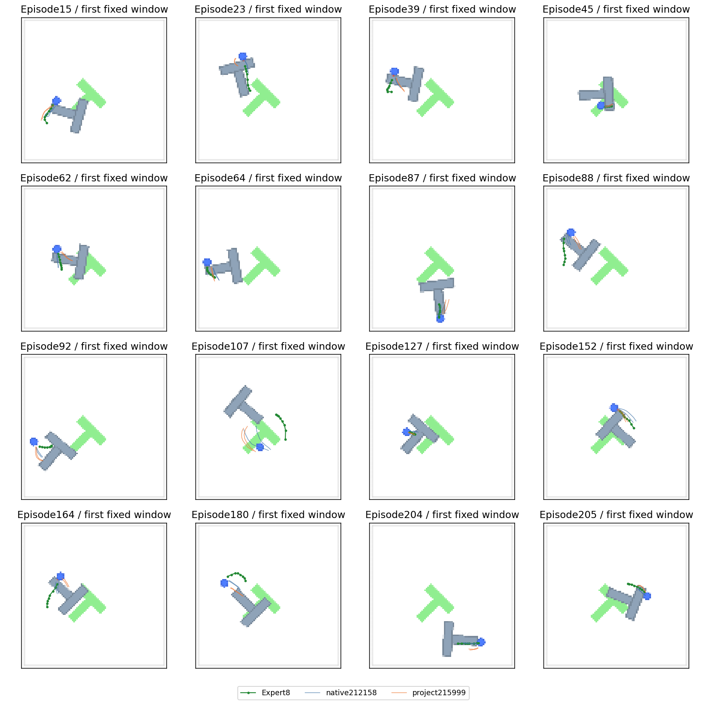

# 冻结端点动作诊断219129：泛化差距已在专家观测上出现

2026-10-22。5个小文件齐全，本地原verify_output.validate验证通过；重新核对帧/选窗/动作切片、预测与输入SHA、两模型噪声轨迹、逐演示动作统计与辅助epsilon误差，均与服务器报告一致。无模型加载、新训练、仿真或GPU作业。大权重仍在服务器；不声称本地重验权重字节。

本次恢复到A40后实际Python诊断耗时131.01秒（约2分11秒，不含排队），只读原生212158和项目215999原84168更新端点EMA。此前A6000裸CUDA初始化失败没有模型介入，不能作为算法失败。

## 核心结果

固定16条已见训练演示/32窗与16条未参与策略训练的演示/32窗，两个采样种子平均、按演示等权；实际执行切片为1:9，选中窗口均无padding。单位为512画布中的模拟像素，非机器人厘米。

|动作坐标L2误差|原生训练|项目训练|原生未见|项目未见|静止未见|
|---|---:|---:|---:|---:|---:|
|全16槽|6.471|5.805|32.456|45.671|64.460|
|实际执行8槽|6.202|5.392|27.928|39.508|47.758|

项目在抽查训练演示中并不比原生差，16条中12条动作误差更低；未见演示中14/16更高，2/16更低。项目未见均值仍比静止低约17.3%，但只在11/16条演示优于静止；原生为15/16。因此“平均优于静止”不等于每条未见演示都有效。

项目减原生的执行8槽误差，在训练角色为-0.810像素、按演示配对bootstrap95%区间[-1.553,-0.140]；未见为+11.580像素，区间[5.236,17.895]。逐个删去一条未见演示，均值差仍在+9.704到+13.586之间，差距不由单个异常演示主导。这些是本16条固定演示的描述性区间，不是多个独立策略训练种子的置信结论，也没有多重比较校正。

两个采样种子方向一致：

|未见执行8槽误差|seed1001|seed1002|
|---|---:|---:|
|原生|27.708|28.148|
|项目|40.004|39.012|
|项目减原生|+12.296|+10.864|

## 不只是在闭环跑偏之后才出现问题

辅助检查使用相同专家动作的前向加噪输入、相同观测和噪声，没有任何环境执行。

|指定时刻epsilon MSE（原目标全部16槽）|原生训练|项目训练|原生未见|项目未见|
|---|---:|---:|---:|---:|
|t0|0.156805|0.155249|1.140875|1.745289|
|t49|0.000551|0.000269|0.014384|0.028814|
|t99|0.00004390|0.00005085|0.00003434|0.00003480|

t49项目未见误差约为原生2倍，13/16条演示更高；训练侧则14/16更低。t0未见15/16更高。说明无需经过闭环环境，甚至无需先走完整反向链，当前项目在未见专家观测上的条件去噪差距就已存在。因此不能把整个前端差距只解释成采样随机运气或执行偏离后的累积。

t99两者都小，不能据此证明条件理解正确：在当前余弦扩散表末端，输入已几乎是噪声，epsilon预测本来就可接近输入。不同t的噪声MSE也不能直接当成同一物理精度比较。

## 图像与动作示意核对

已查看16条未见演示各自预先固定第一个窗口的当前图像及专家8槽/两个模型各两个seed的动作坐标叠图。图上绿色折线是专家未来控制坐标，蓝/橙折线是原生/项目分别生成的动作；蓝色圆点、灰色T与绿色目标来自原始观测图像。坐标按96/512缩放。不是新rollout，折线也不是物体实际运动轨迹，不能由视觉方向差认定某条替代动作必然失败。

可见多个窗口的项目/原生动作都靠近当前控制点但专家后续路径不同；例如107、180等窗口存在较大路径分歧。此示意支持按窗口解释动作距离，不足以认定所有失败都由对象定位错误、方向反转或某种伪关联造成。图中所有16条演示均展示，不按误差选案例。

## 排查收敛与后续边界

已有证据不支持继续把首要问题放在“网络完全学不动”“需要再做一次小样本拟合”“首次补多层FiLM”或“只要再训练更久”。在本固定样本上，项目前端能配合相同扩散后端生成准确的已见动作，但迁移到未见演示时比原生弱；这一差距在自由生成和中等噪声的监督去噪中均存在。下一阶段重点应是前端如何形成可迁移的动作条件，而不是继续扫扩散调度或延长失败旁路预算。

尚未隔离：冻结视觉表示、八层Adapter的变换、全局汇总与投影之间各自的因果贡献；动作多解和未见演示分布难度也可能影响专家距离。不能把空间线性读出变弱直接等同于不可逆信息丢失，更不能声称这次已经修好泛化或找到了唯一根因。早先旁路217820继续关闭，不因此追加种子/预算/变体，保留215999与封存final50。

本项到此完成并归档，不再重跑。仅有一个源训练seed、32+32固定窗及复用的诊断演示角色，不是完整训练集评估、独立最终测试或新任务成功率。后续任何模型改动仍需单独给出机制、短验证的判据和预算；此结果不自动触发长训练。LIBERO正式四条件×3seed准备继续按老师要求作为独立主线，不等于暂停至所有Push-T疑点解决。

原始文件：`reports/pusht_action_audit_219129/`。
复算与图表：`reports/pusht_action_analysis_219129_20261022/`。
脚本：`scripts/analyze_pusht_action_audit_219129_20261022.py`（只读现有结果）。
