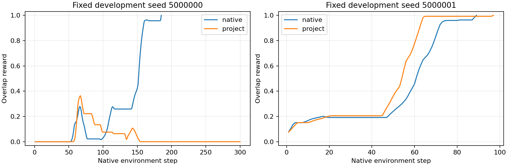

# Push-T前端对照：已收到端点报告和视频

本地已收到5个所需文件，压缩包成员与解压内容一致。启动检查嵌在`report.json`和`latest.json`中，二者完全相同，不缺独立`startup_checks.json`。

## 可确认的比较

| 固定开发20场景、每组84168次更新 | 原生组212158 | 项目组214273→215999 |
| --- | ---: | ---: |
| 平均每场最高重叠奖励 | 0.845878 | 0.445488 |
| 满奖励场景 | 10/20 | 5/20 |
| 每场最高奖励≤0.1的场景 | 1/20 | 8/20 |

最后一行仅描述低重叠场景，不新增任务成功阈值。项目组比原生组好3场、差14场、相同3场。平均分差为-0.400390。这是同任务的新初始场景开发评估，不是新任务零样本泛化、机器人抓取成功率或最终50场景成绩。

## 验收证据

- 本地重新计算全部20条完整奖励序列，与报告及此前终端分数一致。
- 两组数据证据完全相同：90训练演示、10726窗口、11356帧及原始图像SHA相同；训练专用归一化、抽样计划/顺序、后端初始化SHA、学习率时域也相同。
- 项目报告中的完整状态恢复、原始损失/噪声/时间步/代表梯度检查通过；Adapter及投影梯度有效。报告的冻结特征、文本和在线CLIP冻结/权重不变检查通过。
- 本地报告与sidecar中的最终检查点SHA和计数相同。大检查点及`updates.jsonl`未下载，本地不声称重做了这两项的字节校验；服务器既有完整验收已由用户报告通过。
- 原生和项目两组各前两个预先固定场景的视频均已解码，帧数与其奖励步数一致，无模型加载、新仿真或新训练。

结构及优化梯度检查排除了所查路径的断链现象，不证明最终空间信息一定保留，也不证明所有运行逻辑绝无问题。比较包含视觉编码器及预处理、Adapter、读出和投影这整个前端家族；不能单独归因于CLIP或Adapter。每组只有一个独立训练种子，没有跨训练种子置信结论。

## 已看视频的具体行为

**场景5000000：项目失败、原生成功。** 项目策略确实接触并推动T块；第67步最高重叠奖励0.363732，随后偏离，最终第300步奖励0，灰色T块被推至远离绿色目标的位置。原生组在185步达到满奖励。因此这个例子的问题涉及接触后的较长闭环过程，不只是最后一点对齐误差；也不能解释为模型完全不会让物体运动。

**场景5000001：两组都成功。** 项目组97步，原生组89步。项目组已经能够在部分固定开发场景完成推T操作；两个视频不足以推断全部失败场景都具有同一机制。

帧图：[失败例逐步对照](../reports/pusht_project_endpoint_analysis_20261021/rollout_comparison_5000000.png)、[成功例逐步对照](../reports/pusht_project_endpoint_analysis_20261021/rollout_comparison_5000001.png)。画面第1帧是第1个已记录环境步之后，不作为初始reset完全一致的图像证据。绿色是目标，灰色是被推动T块；红蓝控制标记的显示不能直接作为模型内部注意力或定位输出。

## 排查方向收敛及边界

在本次配方和预算下，原生前端能配合共同扩散后端完成较多场景，而项目前端的闭环表现明显较弱。因此后续优先检查冻结CLIP后的信息如何经过Adapter、池化和投影进入扩散条件，重点区分**表征中是否有足够空间信息**与**后续读出是否保留并使用这些信息**。

项目链路是冻结257个视觉token，经8层Adapter，再将CLS与patch均值融合读出、投影1024→64，并保留相同的2维agent_pos输入。64维本身不是已经证明的错误，不能仅凭维数认定瓶颈。需要新的分层证据，不能从当前视频断言视觉定位、方向预测或某一层就是唯一根因。

下一项应是冻结现有端点的分层空间信息诊断，而不是立即再次做完整策略训练。CLIP继续冻结；不先更换骨干、调整扩散调度、追加预算或打开最终50场景。既有缓存/在线一致性预检不因本次分数低而无条件重跑。诊断的具体输入、训练/留出范围和读出口径须先明确，且不能把诊断读出器成绩当成策略泛化改善。

这次没有修改Bridge207558、既有Push-T包或权重，没有宣布修复Bridge泛化问题。

证据：[本地端点核对与视频统计](../reports/pusht_project_endpoint_analysis_20261021/report.json)、[分析脚本](../scripts/analyze_pusht_project_endpoint_20261021.py)。
