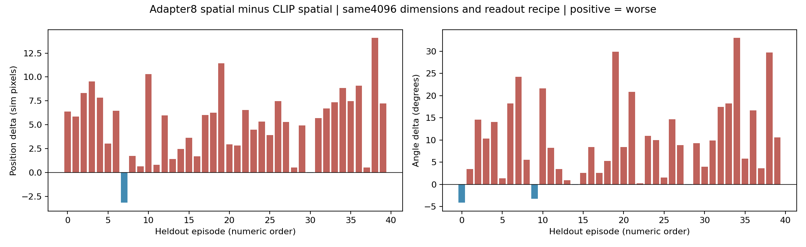
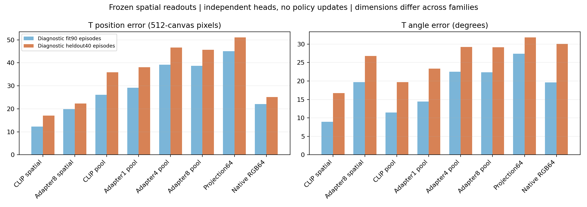

# 217660完整输出核对：空间读出在前端处理后变弱

已收到report、predictions、frame manifest、固定alignment samples和原protocol，共5个文件。压缩包成员和本地解压内容一致，protocol与发布包逐字节相同；本地重新执行原verify_output.validate通过，重新计算的训练/留出/打乱标签指标与终端一致。没有新拟合读出器、加载策略检查点或运行仿真。

## 主要新增证据

**相同空间读出下的变差广泛存在。** CLIP空间矩与Adapter第8层空间矩同为4096维，读出配方、拟合帧、正则和留出均相同：40条演示中，Adapter后的T块位置误差在38条上变大，朝向在36条上变大，34条两项同时变差。

| 配对比较：后者减前者 | 位置均值差（模拟像素） | 配对演示bootstrap95%区间 | 朝向均值差（度） | 区间 |
| --- | ---: | --- | ---: | --- |
| CLIP空间矩→Adapter8空间矩 | +5.20 | [4.10, 6.23] | +10.02 | [7.21, 12.80] |
| Adapter1全局→Adapter4全局 | +8.54 | [6.49, 10.60] | +5.83 | [3.62, 7.96] |
| Adapter4全局→Adapter8归一化前 | -0.09 | [-0.18, 0.01] | -0.03 | [-0.15, 0.09] |
| Adapter8归一化前→归一化后 | -0.92 | [-1.20, -0.63] | -0.07 | [-0.50, 0.40] |
| Adapter8全局→最终64维投影 | +5.37 | [4.60, 6.15] | +2.67 | [0.47, 4.82] |
| 原生RGB64→项目最终64维 | +25.93 | [21.65, 30.23] | +1.74 | [-2.14, 5.57] |

这是固定40条演示的描述性配对区间，不是多个策略训练种子的区间或经过多重比较校正的检验。跨1024→64维的比较有读出容量差异，不能单凭它认定投影错误。原生与项目64维的朝向差区间跨零，不能声称项目在该项稳定更差。输出LayerNorm略微改善位置，第4→8层几乎持平，因此不能笼统说每加一层就变差或把归一化认定为主要故障。

## 训练误差与对照回答了什么

| 诊断表征 | 读出器拟合位置/朝向 | 留出位置/朝向 |
| --- | --- | --- |
| CLIP空间矩 | 12.30像素 / 8.91° | 17.10像素 / 16.76° |
| Adapter8同样空间矩 | 19.87像素 / 19.66° | 22.30像素 / 26.78° |
| 项目最终64维 | 45.04像素 / 27.42° | 51.02像素 / 31.79° |
| 原生RGB64 | 22.03像素 / 19.62° | 25.09像素 / 30.05° |

训练帧上的**诊断读出器误差**也变差，说明这套空间信息读出下降并不只发生在未见演示上。这不是重新测得原策略的训练动作误差，不能解释成“已经通过的小样本拟合又失败”。它仍可能涉及非线性重编码及固定读出正则的适配性，而非不可逆的信息丢失。

CLIP空间矩在正确标签下留出为17.10像素/16.76°；相同特征、相同配方而打乱拟合标签后为74.23像素/39.55°；仅用训练均值为72.47像素/37.11°。这支持读出器确实利用了特征中的真实空间关联。agent状态单独预测T块也较弱，为57.70像素/36.92°，没有解释CLIP空间读出的优势。最终64维仍优于均值，不能说它完全没有空间信息。

原生策略闭环奖励更高，但其朝向线性读出不如CLIP空间矩，所以诊断器排名不能代替策略排名。当前没有策略性能提升的新增证据。

## 标签与输入核对

- 90拟合演示1080帧、40非策略训练演示480帧；同一episode不跨角色，1560个帧编号唯一；报告记录所选图像跨角色完全相同数量为0。
- 预测文件中的source state重新编码后与标签逐元素相同；frame manifest、图像对齐样本及预测行编号一致。CLIP/项目/原生前端的冻结与不变检查通过。
- 已查看预先固定的24帧叠图，包括第一条拟合和第一条留出演示各12帧。源状态旋转/平移出的T形轮廓与图中灰T位置朝向相符，控制点也相符；24个agent位置到最近蓝色像素距离均小于0.59个96图像像素。
- 这只是固定24帧的标签叠图和文件身份检查，不认证所有25650帧时序与物理契约绝无问题。图像颜色及1像素邻域统计是宽松QA，不是新的采用门槛。

叠图：[拟合演示](../reports/pusht_spatial_analysis_217660_20261021/alignment_fit.png)、[留出演示](../reports/pusht_spatial_analysis_217660_20261021/alignment_heldout.png)。位置指标单位是512模拟画布像素，不是cm；叠图显示时按96/512缩放，不能转述成机器人毫米精度。

## 下一步收敛到一个结构问题

**优先验证：在CLIP继续冻结的前提下，能否让Adapter前的patch空间信息通过显式通路进入动作条件，与文本语义融合并行保留。** 所有模块和训练细节须先形成一个控制/候选方案，再以闭环奖励判断是否有效；线性诊断读出改善不能作为替代。

已经核对已关闭的210334分支：它在第8层Adapter之后，对patch新增1026个内容/坐标评分参数做softmax加权，再同CLS融合为一个1024维全局向量；固定预算下未通过采用条件。该分支不重跑。新的空间保留问题若开展，应明确取自Adapter之前、保留何种空间结构，并与这个既有失败方案区分，不能只换一个池化名称。

当前尚未实施这个结构干预，没有新提交作业，最终场景仍封存。217660支持把排查优先级放到前端的空间保留与读出，但没有证明唯一根因，也没有证明可以根治Bridge或跨任务泛化。

分析：[完整机器可读报告](../reports/pusht_spatial_analysis_217660_20261021/report.json)、[验收记录](../reports/pusht_spatial_analysis_217660_20261021/verification.json)、[可重复分析脚本](../scripts/analyze_pusht_spatial_217660_20261021.py)。
