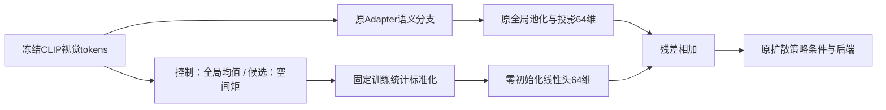

# Adapter前空间旁路：单一对照与预检已准备

承接[217660空间读出分析](PUSHT_SPATIAL_217660_ANALYSIS_20261021.md)。本次实现一条明确的结构干预：保留CLIP冻结，保留原Adapter语义分支，在Adapter之前从原始patch另取特征，通过零初始化残差头进入相同64维视觉条件。尚未加载真实端点或提交集群作业。

## 控制变量

| 项目 | 全局旁路控制 | 空间旁路候选 |
| --- | --- | --- |
| 起点 | 完整恢复215999的84168更新端点 | 相同 |
| 原语义分支 | 原8层Adapter、全局池化、原1024→64投影 | 相同 |
| 新旁路来源 | 原始冻结CLIP patch | 相同 |
| 旁路摘要 | patch全局均值，重复4份 | patch的均值、x、y、xy固定空间矩 |
| 标准化 | 原训练90演示11356帧，固定通道均值/标准差 | 同一算法、同一训练帧范围 |
| 新头 | 4096→64线性，无偏置、权重全零 | 相同 |
| 新参数量 | 262144 | 相同 |
| 动作条件 | 原64视觉维+2维agent状态 | 相同 |
| 训练范围 | 原Adapter/投影/扩散后端+新头 | 相同 |
| 优化状态 | 原Adam历史、学习率、EMA计数、RNG保留；仅新头冷Adam | 相同 |
| 正式计划 | 固定8192次接续更新，单一终点EMA | 相同 |

两组拥有相同的新参数量和原始CLIP访问范围，控制组也有新增旁路；比较问题是空间布局信息是否带来额外收益。有效特征秩并不相同，这是空间信息干预的一部分，不能声称两个特征统计结构相同。两组都未给CLIP提供梯度。

空间矩使用CLIP的16×16 patch网格，权重为固定1、x、y、xy。固定训练通道标准化保留帧间坐标幅度，不使用每帧LayerNorm，不学习诊断物体状态或角度。训练损失仍是作者原epsilon动作噪声目标，诊断40条留出及其状态标签不进入策略训练。



## 此次只提交预检

发布包包含预检入口，没有正式训练入口。两组各8次不同计数的预检更新，并各额外重算1次做完整磁盘重放；这些状态不作为正式续训起点。

预检会核对：真实原始raw/EMA/Adam/LR/EMA计数/RNG完整恢复；新旁路零初始化后的原始raw/EMA条件及DDPM100动作精确一致；原参数对象与Adam历史保留；新头与原前后端梯度有效；新状态的模式/协议绑定和完整磁盘恢复；新Adam与EMA的更新计数；固定文本和标准化缓冲不变。用2条训练窗口检查动作，不运行奖励评估或任务仿真。

旧数据/缓存读取器与作者训练核心直接复用，源文件逐字节不变。它们的例行身份检查仍执行，不是重新开展旧实验。此处新增真实资源测量针对旁路接入后的训练路径。

本地[67项CPU合成检查](../reports/pusht_spatial_bypass_preflight_checks_20261021.json)通过，包括原作者loss/EMA配合轻量前后端的新增接口验证、原参数与优化历史保留、冷新头更新、8+2部分微批、完整下一步恢复、拒绝跨模式/协议恢复，以及Python3.9和Bash语法。合成检查没有真实CLIP、真实端点、真实训练数据或仿真成绩。

## 预定的后续问题与停止条件

如果真实预检通过，再准备单独正式入口，绑定本次成功预检。两组从相同215999重新恢复，批次/噪声从84168继续，同样8192更新到92360；不使用预检更新后的权重，学习率时域512400及EMA计数不重启。

只在固定终点EMA上评价相同开发20场景及采样流，不做中途最佳检查点选择。原215999与原生212158的既有分数作为背景。该dev20已被使用，成绩只能作为开发证据，最终50继续封存。

开发采用条件预先固定：候选平均重叠奖励至少同时比配对全局旁路控制及原215999高0.05；候选减控制的配对场景bootstrap95%均值差下界大于0；候选满奖励比例不低于控制及原0.25。失败关闭该有界变体，不自动追加种子、预算、变体或最终集评分。采用条件通过也不等于最终集泛化确认或机器人抓取成功。

这是一项固定预算接续实验，不是新架构从头训练的上限；仍使用64维视觉条件与同一已经学习的后端。失败不能排除所有空间架构。正式预算只是计划，时间与显存必须等本次真实预检实测，不能从合成测试推算用时。

## 与旧210334的区别

210334只在Adapter之后对patch内容/坐标增加1026个标量评分参数，加权后仍折叠为单个全局向量，未通过既有采用条件且已结束。此次空间信号来自Adapter之前，并以独立残差路径保留，与同容量原始全局旁路比较；不重跑该旧池化分支，也不更改Bridge207558。

## 提交

[发布包](../cluster_packages/pusht_spatial_bypass_preflight_v1.zip)，SHA256：`cbd19f7b9af784b307f836abc766abafad224d4c9fad487984429a44a3708fdf`。

本机PowerShell：

```powershell
scp "D:\ntu_related\dissertation\Zero_shot\cluster_packages\pusht_spatial_bypass_preflight_v1.zip" zixiao005@10.97.216.128:/projects/Zeroshot/
```

集群终端：

```bash
cd /projects/Zeroshot
unzip -n pusht_spatial_bypass_preflight_v1.zip
bash -n pusht_spatial_bypass_preflight_v1/preflight.sh &&
bash pusht_spatial_bypass_preflight_v1/submit_once.sh
```

申请A6000一张、4CPU、40GiB、最长30分钟。30分钟是申请上限，不是实测预计用时。需要至少12GiB空余空间存两份完整重放检查点，不删除源文件。输出目录为`runs/pusht-bypass-preflight-实际编号`，大replay.pt保留服务器。

完成后用原环境运行包内`verify_preflight.py`。预检只支持技术接入/资源结论，不支持泛化改善判断，也不会自动提交正式作业。
