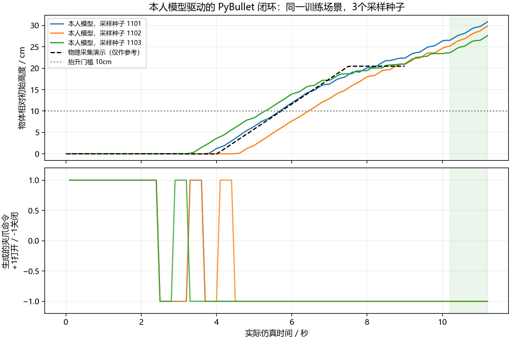
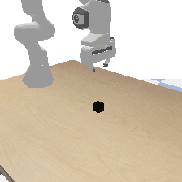

# 本人模型的固定场景物理抓取正对照

这项实验承接 Bridge 八窗口联合拟合：目标是进一步检查当前网络能否输出可执行动作，驱动真实双指接触抓取。使用同一项目的冻结 CLIP、八层交叉注意力 Adapter、多尺度条件 U-Net、原生100步 DDPM采样，以及原有 `train.policy_loss` 位姿与夹爪联合损失。没有换成回归头，也没有加载作者的抓取策略。

本实验用 PyBullet 自己采集的一条固定场景演示重新训练网络。任务是“夹起黑色方块并悬空保持”，相机、机器人、物体位置与训练完全相同。这是训练场景过拟合正对照，不能当作原 Bridge 权重迁移成功、独立泛化、零样本成功或标准 benchmark 成绩。演示没有释放阶段，不验证放置能力。

## 物理采集与接口

Panda 双指抓取，方块边长4cm、质量60g；控制周期24个物理步（240Hz仿真，即0.1s）。采集控制器只发机械臂与手指电机目标，不建立物体固定约束，不在执行途中重置或传送物体。物理采集确实抬升20.47cm，最后10个动作均有双指接触并持续悬空。这个成绩仅验证采集与物理条件，不是学习模型的成绩。

保存91个真实渲染画面、实际末端位姿、实际手指开度、对应夹爪电机命令及物体高度。数据约4.5MB。8个训练窗口起点固定为0、12、24、30、38、46、58、74，每个窗口16个未来动作。

未来到达位姿以当前观测末端位姿为同一锚点，沿用项目的 `relative_pose_action` / `decode_relative_pose`，位移尺度0.1m。实际运行的位移往返最大差异为2.27e-12m。夹爪命令采用负数关闭、正数打开；模型当前输入取两个手指的**实测**关节位置之和，按 `2*width/0.08-1` 编码。夹住4cm方块时该值接近0，不假装已经完全闭合至-1。它有独立的Panda数据契约，不混称Bridge原始测量。

## 训练与闭环核验

固定随机初始化42，Adam学习率1e-4、batch8、1000次更新、Adapter训练dropout0.1、梯度裁剪1；冻结CLIP并缓存其实际图像/文本token，不更新CLIP。网络的每次100步生成从纯高斯动作噪声开始，夹爪根据生成的位姿轨迹预测。离线用3个采样种子核验，属于同一次训练。

闭环评估单独从磁盘加载本次保存的权重。每次重新渲染当前图像、读取实际夹爪开度，调用本人模型生成16步轨迹并执行前4步，然后再次观测。模型不接收物体的真实坐标，不调用采集专家，不中途恢复演示状态。固定工作空间裁剪只是控制边界。

成功判据：最后10个执行动作中方块一直高于初始位置10cm，且最终有左右两指的有效接触；报告另记录最后10步双指接触次数。闭环结果以 `rollout_report.json` 的实际记录为准，训练误差不能替代这个判据。

## 实际结果

1000次更新的8训练窗口：路径位置均值0.141664cm（1.417mm）、旋转0.602383°，全部8窗口通过预定位姿门槛；3个采样种子的夹爪状态和平衡准确率均100%，唯一可评估闭合事件均正确。没有释放事件。

独立加载保存的本人模型后，真实闭环3/3回合通过抬升和双指保持判据。网络只看真实相机图像、固定文本与实测手指宽度；未提供物体坐标，未调用专家或人工绑定。

| 采样种子 | 最终抬升 | 最后1秒双指接触动作数 | 物理抓取判据 |
|---|---:|---:|---|
| 1101 | 30.85cm | 10/10 | 通过 |
| 1102 | 29.85cm | 10/10 | 通过 |
| 1103 | 27.62cm | 10/10 | 通过 |

这是同一次训练、同一初始场景下的3个生成种子，不是3次独立训练或3个新场景。保存权重SHA256：`c42e5566f914415ee266a7f151ce07e51564a169ef8fb66c2ecf1178c8a51932`；训练报告和闭环报告的哈希一致。动作日志中的物体高度与报告逐项核对一致。

真实不足也可见：网络第一次关闭在第25个执行动作，随后出现短暂重新打开；采集专家在第31步关闭，但两种控制轨迹不同，不能只据这个全局时间差判定抓取错误。演示在9秒结束，网络继续执行至11.2秒时，物体又上升约6.72～8.81cm。这证明抓取执行可以成功，仍未证明精确停止在指定高度；不能用这次3/3掩盖停位漂移或夹爪抖动。

[真实闭环报告](../reports/pybullet_fixed_grasp_policy_20261011/rollout_report.json) · [独立轨迹核验](../reports/pybullet_fixed_grasp_policy_20261011/verification.json)



以下是本人模型的真实PyBullet相机帧动画，约2.5倍速播放，不是专家动画，也不是生成示意图：



## 文件与复用

- 采集与物理执行：[pybullet_fixed_grasp.py](../code/pybullet_fixed_grasp.py)
- 原模型训练和独立重载闭环：[fit_pybullet_fixed_grasp.py](../code/fit_pybullet_fixed_grasp.py)
- 原始采集：[physics_report.json](../reports/pybullet_fixed_grasp_20261011/physics_report.json)
- 训练报告：[training_report.json](../reports/pybullet_fixed_grasp_model_20261011/training_report.json)

训练参数、模型配置和Panda接口保存于权重内；CLIP使用现有本地文件，没有新下载。大权重、NPZ数据被Git忽略；保留源码快照和SHA256记录。重新运行时换一个尚不存在的输出目录，避免覆盖已有证据。

```powershell
& 'D:\miniconda\envs\zeroshot-gpu\python.exe' code/pybullet_fixed_grasp.py --output reports/grasp_collect_new
& 'D:\miniconda\envs\zeroshot-gpu\python.exe' code/fit_pybullet_fixed_grasp.py train --demonstration reports/grasp_collect_new/demonstration.npz --output reports/grasp_train_new --updates 1000
& 'D:\miniconda\envs\zeroshot-gpu\python.exe' code/fit_pybullet_fixed_grasp.py rollout --checkpoint reports/grasp_train_new/final.pt --output reports/grasp_rollout_new
```
