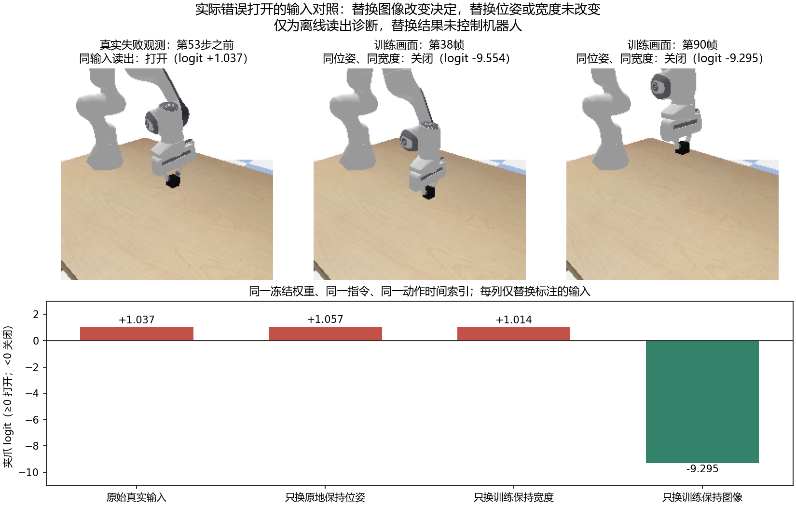

# 固定训练场景：错误松开的冻结输入对照

本次已经执行，不训练、不生成新扩散轨迹、不控制机器人。使用保持组失败种子1102第53个动作前的真实记录。其模型权重SHA256为`88816c726d5bd6ee1e48776c131ce469780151a2ac85853c9fe258cedd955a72`。

## 明确结果

本回合第一次已夹住物体后错误打开，定位到了图像条件分支的读出行为：固定相同生成位姿、实测夹爪宽度、语言指令和动作时间索引，只替换图像为训练保持画面即可使夹爪改为关闭。只替换位姿或实测宽度不能改变打开决定。此结论针对这一实际失败点，不等于全部不稳定行为有同一根因，也不等于某个库存在实现错误。

| 第53步读出条件 | 夹爪logit | 命令 |
|---|---:|---|
| 原记录图像、生成位姿、实测宽度 | +1.037 | 打开 |
| 只将位姿换成原地保持 | +1.057 | 打开 |
| 只将位移换成零，保持原旋转 | +1.057 | 打开 |
| 只将旋转换成单位旋转，保持原位移 | +1.037 | 打开 |
| 只将实测宽度换成训练保持帧90的宽度 | +1.014 | 打开 |
| 只将图像换成训练保持帧90，保持原位姿和宽度 | -9.295 | 关闭 |

生产阈值为logit≥0打开，否则关闭。logit及其sigmoid不是任务成功率，也没有校准为真实概率。训练帧38、46、58、74也均使这一固定失败位姿/宽度下的第一个读出变为关闭；训练帧0、12、24则输出打开。该对照表明图像输入可改变决定，不能据此说视觉模型准确识别了物体或抓取阶段。

错误动作发出之前上一动作仍有双指接触，物体高度0.706319m，相对初始高度已抬升约6.13cm；实测夹爪输入为+0.033724，训练保持帧90为-0.010342。接触和物体高度仅用于结果解释，没有输入网络。此时尚未达到要求的保持高度。

## 可信度与边界

- 重放保持组3个已执行回合的84次观测、336条夹爪命令，与原记录的阈值决策全部一致，差异0条。不是重跑新的物理回合。
- 原记录只保存每个16步chunk中执行的前4步。当前生产夹爪头在时间维逐点读出；改变未保存后12步的填充值，前4步logit最大差异为0。因此可以检查保存的执行前缀，不能宣称重放了未保存的完整轨迹。
- 所有模型参数（含CLIP）、检查点和原生产源文件在检查前后哈希一致。诊断代码独立于训练和控制器。
- 原记录中“上一动作双指接触且这一动作输出打开”的点仅1个，就是本次第53步。该局部故障的图像分支证据较明确，仍不覆盖后续反复开闭或高度漂移的所有原因。
- 替换图像后的关闭命令只用于离线诊断，没有发给机器人，因此没有新的闭环成功率。

## 对下一步的约束

不再围绕这次错误松开调整DDPM噪声表、采样步数、位姿缩放或单纯增加U-Net大小。当前需要检查的是：已抓住但尚处于较低位置的闭环真实画面，经过冻结CLIP、Adapter和夹爪图像条件读出后，为什么不能保持关闭。现有证据不能把责任单独归给CLIP、Adapter或夹爪投影层；训练画面可记住，也不证明闭环观测覆盖完整。

如继续修复，先建立这些真实持物观测的物理标签与训练覆盖对照，再进行一个范围明确的配对干预。避免把手写强制关闭当成模型学会保持，也避免直接扩充所有数据集。本报告未启动新的训练。

## 复查

- [完整结果与逐动作logit](../reports/pybullet_hold_pair_20261011/frozen_gripper_probe/report.json)
- [原始失败前实际画面](../reports/pybullet_hold_pair_20261011/frozen_gripper_probe/before_wrong_open.png)
- [检查脚本](../code/probe_pybullet_gripper_conditioning.py)
- [此前保持窗口配对结果](PYBULLET_HOLD_PAIR_RESULT_20261011.md)

运行：在安装原项目依赖、可读取原本地CLIP缓存与检查点的环境中执行`python code/probe_pybullet_gripper_conditioning.py`。此脚本不下载文件、不保存新权重。
