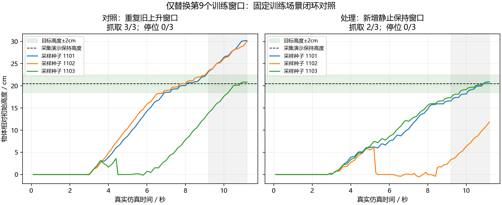

# 保持状态窗口配对实验：未通过稳定停位验收

**仅增加一个纯保持窗口，没有获得稳定的闭环改善。** 两组小样本拟合都通过，闭环停位都0/3；新增保持组有一次因反复打开、丢失接触和抬升延误而未通过抓取抬升保持组合判据。不能把离线误差下降或两次终点较接近目标解释成修复成功。本次结果不推翻此前本人模型固定训练场景3/3的执行证据，也没有给出完整泛化根因。

## 已执行的控制条件

沿用[事先协议](PYBULLET_STABILITY_NEXT_20261011.md)。重新物理采集原演示并只延长16个保持控制周期，107帧；原91帧图像、实际末端位姿、开度、命令和物体高度均与旧记录逐项完全一致。新增窗口起点90，16个未来位姿真实记录，最大位移3.29e-7m，始终双指接触。

对照组原8窗口＋重复起点74；保持组原8窗口＋起点90。两组原8窗口输入/目标相同，全部夹爪标签也相同。第9个窗口的位姿目标由继续上升约6.4mm变为静止保持，图像和实测开度使用对应真实观测。重复记录是显式采样权重，不是新的独立演示。

两组初始非CLIP状态SHA256完全相同：`534ee777e3bd38302dd6dd2fc48e41e9c0341832513ad5578504a6f9e8d4fcdf`；训练源码哈希相同。batch9、Adam1e-4、1000次更新、dropout0.1、加噪种子策略、损失、冻结CLIP、8层Adapter、多尺度U-Net、100步采样均相同。GPU注意力训练实现曾提示部分算子非确定性；相同初始化与随机种子不能承诺所有训练算子跨次逐位重放。本次只有一组配对初始化，不能当作多训练种子的统计结论。

闭环独立加载各自权重，固定相同场景、采样种子1101/1102/1103、28次重规划、每次执行4动作；无专家接管或人工物体绑定。评分用目标物体高度0.8496936989m，仅用于评估，不作为模型或控制器输入。

## 实际结果

| 指标 | 对照组 | 新增保持组 |
|---|---:|---:|
| 9窗口路径位置均值 | 1.52mm | 1.10mm |
| 路径旋转均值 | 0.77° | 0.81° |
| 预设小样本位姿门槛 | 通过，9/9窗口 | 通过，9/9窗口 |
| 夹爪状态/平衡准确率 | 100% / 100% | 100% / 100% |
| 可观察的训练闭合事件 | 3个采样种子均正确 | 3个采样种子均正确 |
| 抓取抬升保持组合验收 | 3/3 | 2/3 |
| 严格停位验收 | 0/3 | 0/3 |

没有释放阶段，两组均不验证释放。停位预设要求最后2秒高度误差始终≤2cm、高度极差≤1cm且20个动作均双指接触，没有事后放宽门槛。

| 种子 | 对照最大高度误差 / 极差 | 保持组最大高度误差 / 极差 |
|---|---:|---:|
| 1101 | 9.72cm / 6.63cm | 3.34cm / 3.75cm |
| 1102 | 9.55cm / 6.33cm | 16.92cm / 8.29cm |
| 1103 | 6.13cm / 6.51cm | 2.58cm / 2.64cm |

保持组1102在第53个动作发出打开命令，随后丢失接触、方块落下；之后又反复开闭。最终仍有双指接触且抬升11.84cm，但最后1秒未持续高于10cm，因此按原组合门槛判失败，不能仅凭最后一帧宣布成功。

## 进一步无需重训的定位

实际记录了每一步解码后的目标位置、实测末端位置与双指接触。[末段执行跟踪审计](../reports/pybullet_hold_pair_20261011/execution_tracking_audit.json)显示，6个回合最后2秒的平均末端位置跟踪误差0.165～0.380mm，最大不超过0.619mm；网络给出的目标相对前一时刻实测末端仍平均要求向上移动1.74～4.59mm/动作。至少在该段，厘米级高度变化主要对应网络继续生成上移动作，不能解释为控制器没有跟住静止目标。

这将本次现象进一步限定到闭环生成轨迹和夹爪时序：已有训练目标能拟合，物理控制器在被检查末段能跟踪，但新观测下的动作生成没有可靠停位，夹爪还可能错误松开。仍不能据此断言视觉编码器、Adapter、扩散头、轨迹条件夹爪头中哪一个是唯一训练根因。

**决策：不采用新增保持组替换先前正对照，不继续增加轮数或数据种类。** 下一步冻结权重，围绕实际失败的第53步前观测，检查轨迹条件夹爪头在生成位姿条件下为何发出打开；同步检查近目标图像下的残余上移预测。这些检查可以使用同一模型做反事实读出，无须先重训或加入手写抓取规则。

## 可复查证据

后续冻结检查已经执行：[错误松开的图像、位姿与实测宽度输入对照](PYBULLET_FROZEN_GRIPPER_PROBE_20261011.md)。336条夹爪命令重放一致；第53步替换图像可使决定改为关闭，替换位姿或实测宽度不能改变。这是该故障点的输入分支定位，并非新的闭环修复成绩。

- [配对准备与前缀一致性](../reports/pybullet_hold_pair_20261011/preparation.json)
- [独立配对核验与逐种子成绩](../reports/pybullet_hold_pair_20261011/comparison.json)
- [对照闭环原始报告](../reports/pybullet_hold_pair_20261011/baseline_rollout/rollout_report.json)
- [保持组闭环原始报告](../reports/pybullet_hold_pair_20261011/hold_rollout/rollout_report.json)
- [保持组失败种子真实动画，约2.5倍速](../reports/pybullet_hold_pair_20261011/hold_rollout/policy_seed_1102.gif)

两组权重和轨迹保存于对应目录，权重不包含CLIP；源代码快照与哈希同时保留。本次不下载模型或数据，也不上传大权重。
