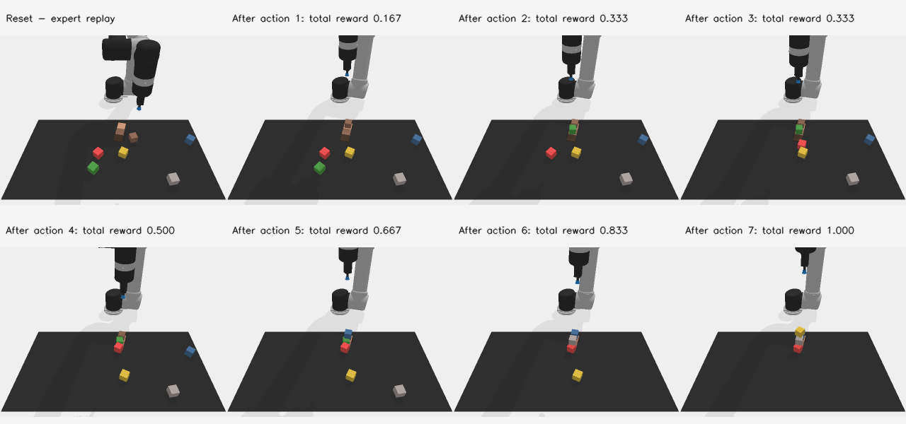

# 模型拟合与仿真执行：2026-10-11 核验

**同日最新补充：本人模型的固定训练场景双指抓取已实际通过3/3采样回合。** 使用PyBullet原生采集数据重新训练本项目的CLIP→八层Adapter→扩散位姿与夹爪网络，独立从保存权重重载，在无专家接管、无物体约束绑定的情况下抬升方块并持续双指接触。详见[固定场景本人模型物理抓取](PYBULLET_FIXED_GRASP_20261011.md)。这是固定场景过拟合正对照，尚有高度漂移与夹爪抖动；未证明Bridge权重迁移、精确停位、释放或泛化。下文保留较早CLIPort专家核验及其历史证据边界。

## 本次实际运行

复用现有 CLIPort 作者代码、隔离环境和现有专家演示，运行一次原生 PyBullet 回放。未加载学习模型，未下载包或权重，未创建新的数据集。新增报告和九张 PNG 总计约 0.3 MB。

固定任务 stack-block-pyramid-seq-seen-colors，训练模式，seed=0，仅一条演示。动作来自此前作者 oracle 生成并保存的 pose0/pose1 primitive；不是 Bridge 模型输出，也不是独立泛化实验。

结果：7 次操作全部执行，累计原生奖励 0.9999999999999999，最后 done=True。7 次原生抓取检查全部 True；每步物体位置与保存记录一致，奖励逐步一致，输入五个文件哈希均与原清单一致。未启用 reset 恢复或中途状态恢复；物体仅在作者环境初始化时创建。回放报告保存本次作者源码哈希。

CLIPort 原生吸盘通过实际接触检查后建立固定约束模拟吸附，再通过解除约束释放。这是作者定义的吸盘模型，不是 Panda 双指摩擦抓取的验证。未修改作者环境、primitive、吸盘、任务或奖励实现；回放脚本只增加可选相机画面保存，使用已返回的观测，不增加物理步。

报告：[完整执行记录](../reports/cliport_native_recheck_20261011.json)、[简要核验](../reports/cliport_native_recheck_20261011_summary.json)。



## 模块证据的边界

| 模块 | 当前证据 | 尚不能得出的结论 |
|---|---|---|
| 当前多尺度 U-Net、x0 位姿训练、完整100步采样组合 | 固定缓存条件下，8个真实训练窗口从头训练500次更新，位置均值0.152763cm、旋转0.303888°，8/8窗口达到预定门槛 | 未验证原始 dataloader、当前 CLIP/Adapter 联合训练或泛化 |
| CLIPort 原生专家动作执行链 | 本次一条专家记录7次操作成功，奖励1，逐步匹配记录 | 未验证模型输出到机器人动作的转换，也未验证双指抓取 |
| 模型夹爪头 | 此次小样本位姿实验没有训练它；本次仿真也没有调用它 | 不能称模型已学会抓取、释放或定位物体 |
| Bridge 模型到 CLIPort 的接口 | 已有合同核查记录 | 连续实测夹爪开度与吸盘状态不等价；未来到达位姿与原生动作协议不等价，未完成接入 |
| Panda scripted 示例 | 源码明确使用辅助固定约束及直接放置物体 | 只能作为评估器自检，不能作为模型或双指物理抓取成绩 |

原生专家回放此前已有成功记录；本轮是复核并补充可查看画面，不是修复了模型抓取或新增泛化成果。8窗口拟合的具体协议与限制见 [小样本正对照](BRIDGE_POSITIVE_CONTROL_LOCAL_20261011.md)。

## 后续主线

保留目前已经通过的位姿记忆配方和执行证据。同日后续已经实际完成同一八窗口、当前八层Adapter的固定与联合更新对照，两组均通过预定位姿记忆门槛，详见 [Adapter联合拟合对照](BRIDGE_ADAPTER_PAIR_LOCAL_20261011.md)。两组均关闭dropout、冻结夹爪；它补充条件链的学习证据，没有完成下述仿真接入要求。

同日进一步已完成原模型夹爪联合拟合及真实打开方向补查：最终8训练窗口位姿1.524mm/0.937°，夹爪状态全对，4关闭＋4打开时刻全对，保存并从原始图像重新加载本人模型预测也一致。详见[联合学习结果](BRIDGE_JOINT_GRIPPER_LOCAL_20261011.md)。这一结果更新夹爪的小样本学习证据，不更新本页专家仿真结果，也没有验证物理抓取。

模型进入仿真前另需验证：输出与控制器的单位/坐标/时间合同、当前观测输入兼容，以及模型实际生成动作驱动的抓取与释放。现有Panda policy分支输入上一条命令，当前Bridge模型输入连续实测值，两者尚未对齐；当前训练任务sweep into pile与Panda固定抓取指令也不同。不能用本次专家动作代替模型输出证明这些模块通过。

## 复用命令

现有报告不会被覆盖，再次核验时使用新的输出路径：

```powershell
.\training_cache\cliport_replay_env\Scripts\python.exe diagnostics/replay_cliport_native.py --author-root training_cache/cliport_author --dataset-dir training_cache/cliport_fresh_control --output-json reports/cliport_native_recheck_new.json --capture-frames-dir reports/cliport_native_recheck_new_frames
```

八张相机图为初始状态及每次原生 primitive 结束后的快照，未记录运动中的连续视频。
